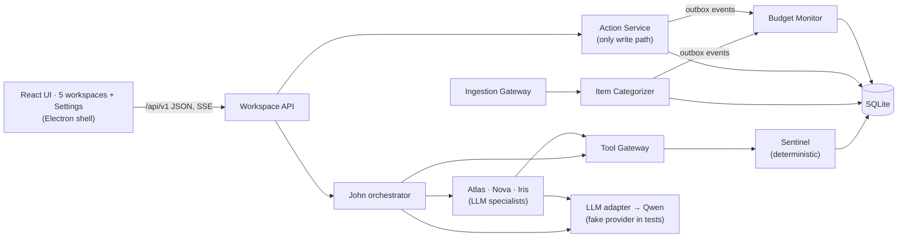

# FinMate AI

**An AI financial coach for retail-bank customers. The coach answers questions with figures from deterministic calculations, and nothing changes without the user's confirmation.**

> **Status: planning complete, implementation not started.** This repository holds the full specification, prototype design and implementation plans for the FinMate AI prototype. It contains **no application code yet**. Implementation is blocked until the team resolves [TD-01](docs/team-decisions.md#td-01--source-baseline-import-the-existing-code-or-rebuild), which decides how the application code these plans build on gets into the repository. Everything below marked *planned* describes intended behaviour, not something that exists.

---

## Overview

FinMate AI is a personal-finance coaching product, intended to be white-labelled and offered by banks to their retail customers (B2B2C, one deployment per bank). A customer's bank transactions are ingested and categorised, and deterministic models compute budgets, goals, forecasts and alerts from them. **John**, the chat coach, coordinates three LLM specialists (**Atlas**, **Nova** and **Iris**). Every figure John shows must come from a computed result, and every change to the user's plan needs the user's explicit confirmation.

This repository targets the **hackathon prototype**: one Node.js server, one SQLite database, a React UI in an Electron desktop shell, and a Qwen 32B-class model reached through an OpenAI-compatible API. Production would use Gemini Enterprise for financial services.

## Problem statement and objectives

Generic chatbots give financial advice whose numbers can't be traced, and they may act on a user's money or plans without clear consent. FinMate AI's prototype aims to prove that its frozen architecture works end to end at small scale ([`prototype-design/00-overview.md` §2](docs/prototype-design/00-overview.md)):

1. A bank batch enters the system, and each transaction is typed and categorised.
2. The data persists and drives deterministic budgets, goals, forecasts and alerts.
3. John coordinates real LLM specialists. Every number in an answer must be backed by a calculation result.
4. Every change requires the user's confirmation and passes deterministic re-validation.
5. State survives a restart.

## Intended capabilities (planned, not yet implemented)

| Area | Capability | Specification |
| --- | --- | --- |
| **John** (chat) | Routing by rules first, with an LLM router as fallback; parallel specialist calls; conflict resolution; grounded synthesis; confirmation cards, T1 chips and Undo; corrections made in chat; streaming answers | [`john-orchestrator-spec.md`](docs/specifications/john-orchestrator-spec.md) |
| **Atlas** | Savings goals: create, fund, release, pause, delete and restore; feasibility checks; an illustrative SIP calculator | [`atlas-savings-strategist-spec.md`](docs/specifications/atlas-savings-strategist-spec.md) |
| **Nova** | Budget caps with tiers (Healthy, Warning, Exceeded); a daily envelope; event-driven alerts; rebalancing; logging expenses | [`nova-budget-guardian-spec.md`](docs/specifications/nova-budget-guardian-spec.md) |
| **Iris** | A next-month planner and purchase what-ifs; spending advice | [`iris-spending-advisor-spec.md`](docs/specifications/iris-spending-advisor-spec.md) |
| **Sentinel** | 17 deterministic functions (spending, trends, forecasts, cash-flow risk, health score) and an LLM-free workspace | [`sentinel-financial-observer-spec.md`](docs/specifications/sentinel-financial-observer-spec.md) |
| **Item Categorizer** | Canonical bank-batch ingestion, movement typing, categorisation, a review queue, and corrections with Undo | [`item-categorizer-spec.md`](docs/specifications/item-categorizer-spec.md) |
| **Platform** | An Action Service with consent tokens, an event outbox, a tool gateway, snapshots and an LLM adapter | [`system-contracts.md`](docs/specifications/system-contracts.md) §13–§17 |

The UI has five workspaces (John, Atlas, Nova, Iris and Sentinel) plus Settings. They are specified screen by screen in [`07-ui-screens-and-interactions.md`](docs/prototype-design/07-ui-screens-and-interactions.md).

## System architecture

The prototype is a **modular monolith**. One Node/Express process runs in-process modules whose interfaces match the shared contracts. It also runs an in-process event dispatcher and uses one SQLite database. LLM calls happen only inside John and the three specialists ([ADR-01…ADR-13](docs/prototype-design/01-system-architecture.md)).



Details: [`01-system-architecture.md`](docs/prototype-design/01-system-architecture.md), [`02-shared-data-model-and-contracts.md`](docs/prototype-design/02-shared-data-model-and-contracts.md), [`03-end-to-end-data-flows.md`](docs/prototype-design/03-end-to-end-data-flows.md).

## Technology stack (planned)

These versions are taken from the planning documents. None of it is installed in this repository yet.

| Layer | Technology |
| --- | --- |
| Backend | Node.js ≥ 22.5 (CommonJS), Express 4, `node:sqlite`, JWT + bcrypt auth; Ajv and decimal.js added by WS-FND-P3 |
| Database | SQLite (one file) with versioned SQL migrations (WS-FND-P2) |
| Frontend | React 19, Vite 8, Recharts, lucide-react |
| Desktop | Electron 41 |
| LLM (runtime) | Qwen 32B-class through an OpenAI-compatible API (prototype); Gemini Enterprise (production) — D-008 |
| Tests | `node --test` on temporary SQLite databases; a fake LLM provider for deterministic tests; a separate live-model suite |
| CI | GitHub Actions, created by WS-FND-P1 (not configured yet) |

## Repository structure

**Current:**
```text
finmate-ai/
├── README.md                           ← this file
├── .gitignore
└── docs/
    ├── README.md                       ← documentation index (start here)
    ├── development-workflow.md         ← how the four developers use Git/GitHub
    ├── team-decisions.md               ← open decisions + readiness verdict
    ├── repository-migration-notes.md   ← audit trail of this repository's creation
    ├── specifications/                 ← 7 frozen component specs + system contracts
    ├── prototype-design/               ← Docs 00–07 (architecture … UI screens)
    └── implementation-plan/            ← 21 plans in 7 workstreams + roadmap, tracking
        ├── workstreams/WS-{FND,CAT,SEN,PLT,AGT,JON,UI}/
        └── tracking/
```

**Planned**, after the source baseline is resolved and the plans are implemented ([`00-overview.md` §4.1](docs/prototype-design/00-overview.md)): `backend/src/{shared,platform,engines,agents,routes,seed}`, `backend/test/`, `src/workspaces/{john,atlas,nova,iris,sentinel}`, `src/components`, `electron/`.

## Prerequisites

- Git, and a GitHub account with Write access to this repository ([`development-workflow.md` §2](docs/development-workflow.md#2-one-time-setup)).
- To implement the plans: Node.js ≥ 22.5 and npm. On Windows, use Git Bash or PowerShell; the plans give commands for both.
- A Qwen API endpoint is needed **only** for the live-model evaluation. Its details are open decision TD-13 (U-2); every other test uses the fake provider.

## Installation and setup

```bash
git clone https://github.com/Kathir-M-03/finmate-ai.git
cd finmate-ai
```
There is nothing to install yet. Once the application code exists (TD-01 and then WS-FND-P1), setup will follow [`first-day-action-plan.md`](docs/implementation-plan/first-day-action-plan.md) §1: `npm ci`, `npm --prefix backend ci`, then copy `backend/.env.example` to `backend/.env` and set a local `JWT_SECRET`. **Never commit `.env` files or API keys.**

## Running the project

Not possible yet, because there is no runnable code. The planned commands are `npm run reset-demo` (WS-FND-P4) and `npm run app` (Electron; WS-FND-P5), with the demo procedure in [`06-testing-and-acceptance.md` §5](docs/prototype-design/06-testing-and-acceptance.md).

## Testing

No tests exist yet. The planned commands, created by WS-FND-P1, are:
```bash
npm --prefix backend test       # unit, contract and integration tests on temporary SQLite DBs (*.test.js)
npm run build                   # Vite build
npx oxlint                      # lint, including the "no money arithmetic in the frontend" rule
npm --prefix backend run test:live   # live-model suite (*.live.js); manual, needs TD-13
```
The acceptance criteria are P-AC-01…P-AC-20 ([`06-testing-and-acceptance.md` §3](docs/prototype-design/06-testing-and-acceptance.md)) and the gates G1–G7 ([`acceptance-checklist.md`](docs/implementation-plan/acceptance-checklist.md)).

## Documentation

| Document | Purpose |
| --- | --- |
| [`docs/README.md`](docs/README.md) | **Documentation index.** What each document contains and where to begin |
| [`docs/development-workflow.md`](docs/development-workflow.md) | **Four-developer Git/GitHub workflow.** All developers follow it |
| [`docs/implementation-plan/`](docs/implementation-plan/README.md) | The 21 implementation plans, assignments, dependencies, roadmap, tracking |
| [`docs/specifications/`](docs/specifications/system-contracts.md) | Frozen component specifications and the shared system contracts |
| [`docs/prototype-design/`](docs/prototype-design/00-overview.md) | Prototype architecture, data model, flows, security, testing, UI screens |
| [`docs/team-decisions.md`](docs/team-decisions.md) | Open decisions and the implementation-readiness verdict |
| [`docs/repository-migration-notes.md`](docs/repository-migration-notes.md) | How this repository was assembled, every change made, unresolved dependencies |

## Implementation roadmap

Seven workstreams contain 21 plans, owned by four developers. The full roadmap, dependency graph and gates are in [`roadmap.md`](docs/implementation-plan/roadmap.md).

| Milestone | Content | Target |
| --- | --- | --- |
| M−1 Repository ready | Pre-implementation decisions recorded; source baseline resolved (TD-01) | Before D1 |
| M0 Contracts agreed | Test harness, CI, route split, contract PRs | End D1 |
| M1 Skeleton integrated | Migrations, event dispatcher, tool-result store, LLM adapter (fake), five workspaces render | End D3 |
| M2 Deterministic core proven | Categorizer and Sentinel conformance, consent-safe actions, event-driven alerts | End D4 |
| M3 AI layer integrated | Runner and specialists, John, proposals → confirm → propagation | End D7 |
| M4 End-to-end prototype | Sentinel workspace, chat UX, canonical ingestion, demo data, legacy removed | End D8 |
| M5 Verified and accepted | End-to-end, security and reliability suites; acceptance checklist signed | End D9 |

| Developer | Workstreams |
| --- | --- |
| Dev A — Integration Lead | WS-FND (foundations, CI, migrations, events, LLM adapter, demo data, legacy retirement, E2E) |
| Dev B — Data & Write-Path | WS-CAT (categorizer, ingestion), WS-PLT (Action Service, Profile, Budget Monitor) |
| Dev C — AI Engineer | WS-JON (John), WS-AGT (specialist runner, Atlas/Nova/Iris, live evaluation) |
| Dev D — Workspaces & Analytics | WS-SEN (Sentinel), WS-UI (React workspaces, chat UX, desktop) |

Which person fills each role is still open ([TD-03](docs/team-decisions.md#td-03--developer-mapping-and-repository-access)).

## Current status and known limitations

- **No application code.** The plans modify an existing codebase (the *source baseline*, described in [`baseline.md`](docs/implementation-plan/baseline.md)) that is not in this repository. **All 21 plans are Blocked** until TD-01 is resolved ([`repository-migration-notes.md` §5](docs/repository-migration-notes.md#5-source-code-dependency-sd)).
- The prototype design is "Proposed" and awaits team approval (TD-05). The UI screen design (Doc 7) was generated from the existing documents and is also awaiting approval.
- The Qwen endpoint is unknown (TD-13), so live-model criteria can't be verified yet.
- CI and branch protection aren't configured. CI is created by WS-FND-P1. Branch protection on a private repository needs GitHub Pro or Team (TD-04).
- Deferred features (ISO 20022 adapters, bank SSO, PostgreSQL, push notifications, several actions) are listed in [`00-overview.md` §3.2](docs/prototype-design/00-overview.md).

## Contributing and development workflow

All four developers follow [`docs/development-workflow.md`](docs/development-workflow.md). In short:

- Nobody pushes to `main`.
- Each plan gets its own branch, named `ws-<id>/p<n>-<slug>` and created from the latest `main`.
- Changes that alter shared contracts go in a separate PR, which goes first.
- Every PR is at most 600 lines, carries the completion handoff, passes the tests and is approved by the code owner, then is squash-merged.
- Status and evidence are recorded in [`tracking/STATUS.md`](docs/implementation-plan/tracking/STATUS.md).

When using a coding model, also follow [`execution-manual.md`](docs/implementation-plan/execution-manual.md).

## Licence

No licence has been chosen yet. The repository is private, and the decision is tracked as [TD-24](docs/team-decisions.md#4-non-blocking-decisions-can-be-made-during-implementation). Until a licence is added, all rights are reserved by the project owners.
