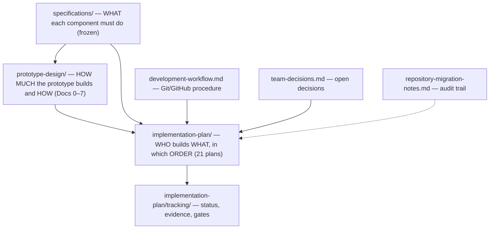

# FinMate AI — Documentation Index

Everything needed to implement the FinMate AI prototype lives in this folder. Start with **§1 Where to begin**.

## 1. Where to begin

| You are… | Read, in this order |
| --- | --- |
| **Anyone, first day** | 1. [`team-decisions.md`](team-decisions.md) — what is still open (implementation starts once the source-baseline import, D-PLAN-3, is on `main`); the decisions themselves are in `implementation-plan/baseline.md` §6 · 2. [`development-workflow.md`](development-workflow.md) — how the four of us use Git and GitHub · 3. [`implementation-plan/README.md`](implementation-plan/README.md) · 4. [`implementation-plan/baseline.md`](implementation-plan/baseline.md) · 5. [`implementation-plan/workstream-assignments.md`](implementation-plan/workstream-assignments.md) |
| **A developer starting a plan** | [`implementation-plan/execution-manual.md`](implementation-plan/execution-manual.md) §1–§4 → [`implementation-plan/prompt-templates.md`](implementation-plan/prompt-templates.md) (if using a coding model) → your plan file → the spec and design sections listed for your workstream in execution manual §1.4 → [`implementation-plan/tracking/STATUS.md`](implementation-plan/tracking/STATUS.md) |
| **An AI coding assistant** | The plan file it is given, plus the context layers in execution manual §1.3–§1.5. Never the whole folder |
| **Reviewing architecture** | [`prototype-design/00-overview.md`](prototype-design/00-overview.md) → [`01-system-architecture.md`](prototype-design/01-system-architecture.md) §8 (ADRs) → [`specifications/system-contracts.md`](specifications/system-contracts.md) |

**Required before implementation:** `team-decisions.md` §2 decisions recorded; `development-workflow.md`; the four planning files in row 1; for your workstream, the spec and design sections named in execution manual §1.4.

## 2. How the documents relate

Authority order when documents disagree: **specifications** (frozen) → **prototype design** → **implementation plans** → this repository's guides. Each plan cites the spec sections (`SC §n`, `<Component> §x`) and design sections (`Doc N §x`) it implements; the plan's §4 table lists the files it may touch, §9 its tests, §10 its acceptance criteria.

## 3. Contents

### 3.1 Specifications — `specifications/` (found; unchanged; frozen 2026-10-10)
| File | Contains |
| --- | --- |
| [`system-contracts.md`](specifications/system-contracts.md) | Everything shared: identifiers, money, entities, envelopes, tool protocol, grounding, constraint codes, action registry and consent tiers, events, errors, security, platform services, UI map (§18), decision log D-001…D-025 |
| [`john-orchestrator-spec.md`](specifications/john-orchestrator-spec.md) | John: routing, task packets, validation, conflict rules, proposals/cards/chips, chat corrections, synthesis and grounding, `ChatRequest@1`/`ChatResponse@1` |
| [`atlas-savings-strategist-spec.md`](specifications/atlas-savings-strategist-spec.md) | Atlas: goals, funding, feasibility, SIP calculator, Atlas workspace |
| [`nova-budget-guardian-spec.md`](specifications/nova-budget-guardian-spec.md) | Nova: caps, tiers, rebalance, alert explanations, Nova workspace |
| [`iris-spending-advisor-spec.md`](specifications/iris-spending-advisor-spec.md) | Iris: forward-looking spending advice, next-month planner, Iris workspace |
| [`sentinel-financial-observer-spec.md`](specifications/sentinel-financial-observer-spec.md) | Sentinel: 17 deterministic functions, rule library, Sentinel workspace |
| [`item-categorizer-spec.md`](specifications/item-categorizer-spec.md) | Item Categorizer: ingestion pipeline, movement typing, corrections, review queue, taxonomy v1 |

### 3.2 Prototype design — `prototype-design/` (found, plus one generated document)
| File | Contains | Origin |
| --- | --- | --- |
| [`00-overview.md`](prototype-design/00-overview.md) | Source-baseline analysis, what the prototype proves, scope and deferrals, risks, open decisions | Found (provenance note added) |
| [`01-system-architecture.md`](prototype-design/01-system-architecture.md) | Modular monolith, runtime, boundaries, five workspaces, ADR-01…ADR-13 | Found |
| [`02-shared-data-model-and-contracts.md`](prototype-design/02-shared-data-model-and-contracts.md) | SQLite schema, module interfaces, HTTP API (§6), example payloads | Found |
| [`03-end-to-end-data-flows.md`](prototype-design/03-end-to-end-data-flows.md) | Flows F1–F11 with sequence diagrams and failure paths | Found |
| [`04-component-specifications.md`](prototype-design/04-component-specifications.md) | Prototype slice of each component; action subset (§8.1) | Found |
| [`05-security-and-reliability.md`](prototype-design/05-security-and-reliability.md) | Safeguards S-1…S-16, reliability, data rules | Found |
| [`06-testing-and-acceptance.md`](prototype-design/06-testing-and-acceptance.md) | Test layers, acceptance P-AC-01…20, demo procedure, scope tiers | Found |
| [`07-ui-screens-and-interactions.md`](prototype-design/07-ui-screens-and-interactions.md) | Screen-by-screen UI: shell, navigation, shared components, fields, states, flows, accessibility, open UI questions | **Generated 2026-10-13** (awaiting approval, TD-05) |

### 3.3 Implementation plans — `implementation-plan/` (found; updated for the new repository)
| File | Contains |
| --- | --- |
| [`README.md`](implementation-plan/README.md) | Package navigation, numbering, how to run a plan, handoff template, global rules |
| [`baseline.md`](implementation-plan/baseline.md) | The **source baseline** (code the plans modify), gaps G-1…G-14, conflicts C-1…C-7, decisions |
| [`workstream-assignments.md`](implementation-plan/workstream-assignments.md) | Dev A–D allocation, file ownership, shared-file rules, branching |
| [`cross-workstream-dependencies.md`](implementation-plan/cross-workstream-dependencies.md) | 47-row dependency matrix with types and early-start rules |
| [`roadmap.md`](implementation-plan/roadmap.md) | Milestones, Mermaid dependency graph, D1–D9 schedule, tiers, gates G1–G7 |
| [`acceptance-checklist.md`](implementation-plan/acceptance-checklist.md) | Plan, gate, workstream and final acceptance |
| [`execution-manual.md`](implementation-plan/execution-manual.md) | Using coding models: context layers, per-plan loop, sessions, parallel execution, recovery |
| [`prompt-templates.md`](implementation-plan/prompt-templates.md) | Prompts A–G |
| [`first-day-action-plan.md`](implementation-plan/first-day-action-plan.md) | Pre-D1 conditions and D1 actions |
| [`audit-report.md`](implementation-plan/audit-report.md) | Historical audit of the package (2026-10-11) |
| [`tracking/`](implementation-plan/tracking/README.md) | `STATUS.md` board, per-workstream state files, evidence rules |
| `workstreams/WS-*/plan-00N-*.md` | The 21 plans (table below) |

| Workstream | Owner | Plans |
| --- | --- | --- |
| WS-FND Foundations, Tooling & Integration | Dev A | [P1](implementation-plan/workstreams/WS-FND/plan-001-baseline-guardrails-route-split.md) · [P2](implementation-plan/workstreams/WS-FND/plan-002-migrations-and-schema-gaps.md) · [P3](implementation-plan/workstreams/WS-FND/plan-003-events-toolstore-traces-llm-adapter.md) · [P4](implementation-plan/workstreams/WS-FND/plan-004-demo-dataset-and-seed.md) · [P5](implementation-plan/workstreams/WS-FND/plan-005-legacy-retirement-single-server.md) · [P6](implementation-plan/workstreams/WS-FND/plan-006-e2e-suites-and-acceptance.md) |
| WS-CAT Item Categorizer & Ingestion | Dev B | [P1](implementation-plan/workstreams/WS-CAT/plan-001-categorizer-conformance.md) · [P2](implementation-plan/workstreams/WS-CAT/plan-002-canonical-ingestion-gateway.md) · [P3](implementation-plan/workstreams/WS-CAT/plan-003-corrections-read-api-golden-eval.md) |
| WS-SEN Sentinel Engine & Workspace Views | Dev D | [P1](implementation-plan/workstreams/WS-SEN/plan-001-sentinel-conformance.md) · [P2](implementation-plan/workstreams/WS-SEN/plan-002-rule-parity-and-view-contracts.md) |
| WS-PLT Action Service, Profile & Budget Monitor | Dev B | [P1](implementation-plan/workstreams/WS-PLT/plan-001-consent-safe-action-service.md) · [P2](implementation-plan/workstreams/WS-PLT/plan-002-event-driven-monitor-and-profile.md) |
| WS-AGT Specialist Runner & LLM Specialists | Dev C | [P1](implementation-plan/workstreams/WS-AGT/plan-001-specialist-runner-and-nova.md) · [P2](implementation-plan/workstreams/WS-AGT/plan-002-atlas-and-iris-on-runner.md) · [P3](implementation-plan/workstreams/WS-AGT/plan-003-live-model-evaluation.md) |
| WS-JON John Orchestrator & Chat | Dev C | [P1](implementation-plan/workstreams/WS-JON/plan-001-router-synthesis-streaming.md) · [P2](implementation-plan/workstreams/WS-JON/plan-002-proposals-corrections-arbitration.md) |
| WS-UI Frontend Workspaces & Desktop Shell | Dev D | [P1](implementation-plan/workstreams/WS-UI/plan-001-five-workspace-shell.md) · [P2](implementation-plan/workstreams/WS-UI/plan-002-sentinel-workspace-and-settings.md) · [P3](implementation-plan/workstreams/WS-UI/plan-003-chat-ux-and-desktop.md) |

### 3.4 Repository guides (generated 2026-10-13)
| File | Contains |
| --- | --- |
| [`development-workflow.md`](development-workflow.md) | **The four-developer Git/GitHub workflow**: concepts, setup, picking tasks, branching, PRs, reviews, parallel work, dependencies, command reference, full example, daily checklists |
| [`team-decisions.md`](team-decisions.md) | Readiness register TD-01…TD-25 mapped to the team decisions of 2026-10-13 (D-PLAN-1…13), what is still open, recommendations, readiness verdict |
| [`repository-migration-notes.md`](repository-migration-notes.md) | Audit trail: what was received, what changed, the source-code dependency, conflicts, reference audit |

## 4. Recovered vs generated
- **Found and kept** (54 files received): all 7 specifications, prototype-design Docs 0–6, all 21 plans and the planning/tracking package. Nothing referenced by the plans was missing by filename.
- **Generated:** `prototype-design/07-ui-screens-and-interactions.md` (substantive gap: screen-level design), and the repository guides in §3.4.
- **Updated (2026-10-13):** the planning package and plans (repository references, source-baseline gating, one spec conflict) — listed in `repository-migration-notes.md` §4.
- **Updated by the team (2026-10-13 decisions, received 2026-10-15):** 36 planning documents (decision record in `implementation-plan/baseline.md` §6; PR model, tiers, consent, Qwen handling). Merged with the repository updates above — see `repository-migration-notes.md` §10.

## 5. Unresolved questions and dependencies
- **Source-baseline import (D-PLAN-3, decided 2026-10-13) not yet committed.** All 21 plans are Blocked until the code from `fc0981d` is imported into this repository.
- Still open before D1: branch protection (TD-04), CI minutes (TD-10), tracking (TD-11), Doc 7 approval (TD-05). Task-level: TD-15…TD-17, TD-19…TD-21; the stand-in LLM provider before D8. See [`team-decisions.md`](team-decisions.md).
