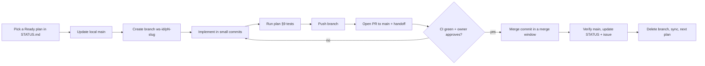

# Development Workflow — How Four Developers Build FinMate AI with Git and GitHub

| Field | Value |
| --- | --- |
| Repository | `https://github.com/Kathir-M-03/FINNMIN-JFK-John` (private) |
| Audience | Dev A, Dev B, Dev C, Dev D — including anyone new to collaborative Git |
| Authoritative rules this guide explains | `implementation-plan/workstream-assignments.md` §5–§7 (ownership, branching), `implementation-plan/execution-manual.md` §2 (per-plan loop), `implementation-plan/cross-workstream-dependencies.md` (what blocks what), `implementation-plan/tracking/README.md` (status and evidence) |
| If this guide and those files disagree | Those files win; fix this guide in a `docs/` PR |
| Team decisions this guide follows | Taken 2026-10-13, recorded in `implementation-plan/baseline.md` §6: **one plan = one branch = one PR** (D-PLAN-4), contract files as the first commit of a **Draft PR**, review commit by commit, **merge commit (not squash)**, rebase on `main` daily (U-4), stub after half a day late (D-PLAN-7) |
| Before anyone starts | The open items in [`team-decisions.md`](team-decisions.md) §2 — above all the **source-baseline import** (D-PLAN-3: the application code from `fc0981d` is not in the repository yet) |

Contents: [1 Concepts](#1-the-collaboration-model) · [2 One-time setup](#2-one-time-setup) · [3 Clone](#3-get-the-repository) · [4 Picking a task](#4-how-tasks-are-identified-and-assigned) · [5 Before starting](#5-before-starting-a-task) · [6 While working](#6-while-working) · [7 Finishing](#7-when-a-task-or-plan-is-finished) · [8 Parallel work](#8-how-four-developers-work-in-parallel) · [9 Dependent tasks](#9-handling-dependent-tasks) · [10 Command reference](#10-git-command-reference) · [11 Full example](#11-complete-example-one-plan-from-start-to-finish) · [12 Daily checklists](#12-daily-checklists)

---

## 1. The collaboration model

### 1.1 Words you will see
| Term | Meaning in this project |
| --- | --- |
| **Repository (repo)** | The project's files plus their full history, hosted on GitHub. Each developer also has a local copy (a *clone*) |
| **`main`** | The shared branch that always holds the latest **reviewed, working** state. Everyone starts new work from it. Demo builds and the nightly integration build come from it |
| **Branch** | A separate line of work. You create one per plan (e.g. `ws-cat/p2-canonical-ingestion`) so your unfinished changes never disturb anyone else |
| **Commit** | A saved snapshot of your changes with a message. Commits exist only on your computer until you push |
| **Push** | Upload your branch's commits to GitHub so others can see them and so they are backed up |
| **Pull / fetch** | Download other people's commits. `fetch` only downloads; `pull` downloads and merges into your current branch |
| **Pull request (PR)** | A request on GitHub to merge your branch into `main`. It shows the diff, runs CI, and is where review happens |
| **Review** | A teammate (normally the owner of the files, via CODEOWNERS) reads the PR and approves it or requests changes |
| **CI** | Continuous integration — GitHub Actions running tests automatically on every PR. **It does not exist yet**; WS-FND-P1 creates it (`.github/workflows/ci.yml`) |
| **Merge** | Bringing a PR's changes into `main`. This project uses a **merge commit** (not squash, D-PLAN-4): every commit of the PR is kept, so one bad commit can later be reverted on its own |
| **Conflict** | Git cannot combine two changes to the same lines automatically; a human decides the result |
| **Plan** | One of the 21 implementation plans, e.g. `WS-CAT-P2`. **One plan = one branch = one PR** (D-PLAN-4) — a plan is never split |
| **Contract commit** | The **first commit** of a plan's PR when the plan produces a shared interface (JSON Schema, function signature, HTTP shape). The PR is opened as a **Draft** so the consumers can approve that commit before the rest is written or reviewed |
| **Draft PR** | A PR marked "not ready to merge". Used here so consumers can review a plan's contract commit early |

### 1.2 Why nobody commits directly to `main`
`main` is what the other three developers start from every morning and what the demo is built from. A direct push skips review and CI; if it breaks something, all four developers are blocked at once. Every change therefore reaches `main` through a PR that has (1) passed the tests, (2) been reviewed by the owner of the files it touches, and (3) been merged with a merge commit. The repository is private; GitHub only *enforces* this on private repositories with a paid plan (TD-04). If it is not enforced, it is a team rule — treat a direct push to `main` as a mistake to report immediately.

### 1.3 How four people work at the same time without overwriting each other
1. **Ownership.** Every file belongs to exactly one workstream (`workstream-assignments.md` §4). You change only your own files; changes to someone else's file go through them (a PR they review, marked "coordinated" in the plan's §4 table).
2. **One branch per plan.** Your work lives on your branch until it is finished and reviewed.
3. **Hotspots are designed away.** The shared route file only gets one-line `router.use(...)` additions; migrations use per-workstream number ranges (`0xx` FND, `1xx` CAT, `2xx` SEN, `3xx` PLT, `4xx` AGT, `5xx` JON); the route inventory test is updated in the same PR that changes a route.
4. **Contracts first, inside the plan's PR.** If two developers share an interface, the producing plan puts it in its first commit, opens a Draft PR, and the consumers approve that commit before either side depends on it.
5. **Frequent integration.** Each plan's PR is reviewed **commit by commit** (commits in plan-step order; `git diff --color-moved=dimmed-zebra main...HEAD` greys out moved code); merges happen in two daily windows (midday and end of day); Dev A runs the integration build every evening. Problems show up the same day, when they are still small. Leaving work unmerged until the end of the hackathon would turn nine days of small conflicts into one unmanageable one.

### 1.4 The recommended workflow in one picture


---

## 2. One-time setup

**Repository owner (once):**
1. Invite Dev A–D as collaborators: GitHub → repository → *Settings* → *Collaborators* → *Add people* → role **Write**.
2. Protect `main` if the account's plan allows it (TD-04 — still to check): *Settings* → *Branches* (or *Rules → Rulesets*) → rule for `main`: require a pull request, 1 approval, review from Code Owners, required status check `ci` (after WS-FND-P1 adds CI), block force pushes and deletion.
3. *Settings* → *General* → *Pull Requests*: allow **merge commits** only (untick squash and rebase merging — D-PLAN-4); enable "Automatically delete head branches".
4. If TD-11 = B, create labels `WS-FND`, `WS-CAT`, `WS-SEN`, `WS-PLT`, `WS-AGT`, `WS-JON`, `WS-UI`, `blocked`, `ready`, `in-progress`, `in-review`, `contract`, `decision`, and one issue per plan (title `WS-CAT-P2 — Canonical Ingestion Gateway`, body = link to the plan file).

**Every developer (once):**
```bash
git --version                       # Git 2.30+ recommended
node --version                      # must be ≥ 22.5 (plans and CI use Node 22.x)
git config --global user.name  "Your Name"
git config --global user.email "you@example.com"   # the email on your GitHub account
git config --global pull.rebase false               # 'git pull' merges (predictable for beginners)
git config --global init.defaultBranch main
```
Authenticate to GitHub once, e.g. with GitHub CLI (`gh auth login`) or Git Credential Manager (bundled with Git for Windows). Windows users: everything below works in Git Bash or PowerShell; where they differ both are shown.

---

## 3. Get the repository
```bash
git clone https://github.com/Kathir-M-03/FINNMIN-JFK-John.git   # downloads the repository into ./FINNMIN-JFK-John
cd FINNMIN-JFK-John
git status                                               # should say: On branch main, nothing to commit
```
After the source baseline has been imported (D-PLAN-3) follow `implementation-plan/first-day-action-plan.md` §1 step 3: `npm ci`, `npm --prefix backend ci`, copy `backend/.env.example` to `backend/.env`, set a local `JWT_SECRET`. **Never commit `backend/.env`** — it is ignored by `.gitignore`.

---

## 4. How tasks are identified and assigned

The unit of work is a **plan** (21 of them, in `implementation-plan/workstreams/<WS>/`). Assignment is already decided at workstream level (`workstream-assignments.md` §2); each developer works through their own queue in order:

| Developer | Queue (execution order) |
| --- | --- |
| Dev A | WS-FND-P1 → P2 → P3 → P4 → P5 → P6 |
| Dev B | WS-CAT-P1 → WS-PLT-P1 → WS-PLT-P2 → WS-CAT-P2 → WS-CAT-P3 |
| Dev C | WS-JON-P1 → WS-AGT-P1 → WS-JON-P2 → WS-AGT-P2 → WS-AGT-P3 |
| Dev D | WS-UI-P1 → WS-SEN-P1 → WS-SEN-P2 → WS-UI-P2 → WS-UI-P3 |

**To find your next task:**
1. Open `implementation-plan/tracking/STATUS.md`. Find the first plan in **your** queue whose status is not *Complete*.
2. Open the plan file. Read §1 (objective), §2 (dependencies), §4 (files), §9 (tests), §10 (acceptance criteria).
3. **Check prerequisites.** In §2, every dependency of type *implementation* must be *Complete* in STATUS.md. Dependencies of type *interface* only need the contract (frozen spec section, merged schema file, or a contract commit approved in the producer's Draft PR). Decisions (C-1, U-2, TD-…) must be answered or have an applicable default. If anything is missing the plan stays **Blocked** — see §9 of this guide for what you may still do.
4. **Check the files.** The §4 table is the list of files you may change. Look for rows marked "coordinated" or "(X approves)" — those need the other owner.
5. **Check nobody else is on it.** STATUS.md row status and the plan's GitHub issue assignee (if TD-11 = B). Also run `git fetch origin` and `git branch -r` to see whether a branch for this plan already exists.
6. **Claim it.** Set the STATUS.md row to *In progress* (in your first PR, or a tiny `tracking:` PR), assign yourself on the issue, add label `in-progress`.
7. **Never split a plan** (D-PLAN-4). A large plan stays one PR with commits in plan-step order (e.g. WS-FND-P1: docs if needed, test helpers, legacy test port + scripts, CI + `.gitignore`, route split + inventory test, CODEOWNERS; WS-AGT-P2: schema commit, Atlas commits, Iris commits). If it exceeds its size by > 50 %, tell Dev A to re-plan the schedule. Never pull scope forward from a later plan.

**Parallel work is allowed only when the dependency matrix says so.** Four developers can each work on their own queue because the plans were designed with separate file ownership and an acyclic dependency graph (`implementation-plan/roadmap.md` §3). It does **not** mean any four plans can run together: for example WS-JON-P2 genuinely needs WS-PLT-P1 and WS-CAT-P3 merged first.

> **Current state (2026-10-15):** every plan is Blocked until the source-baseline import (D-PLAN-3) is on `main`. The first plan to become Ready will be WS-FND-P1.

---

## 5. Before starting a task
1. **Sync `main`:**
   ```bash
   git switch main            # go to your local main
   git pull origin main       # bring it up to date with GitHub
   ```
2. **Confirm assignment and prerequisites** (section 4, steps 1–5). If a prerequisite is missing, stop and say so at stand-up.
3. **Confirm it isn't done already**: STATUS.md says it isn't *Complete*; `git log --oneline --grep "WS-CAT-P2"` on `main` shows no merged PR for it.
4. **Create your branch from the fresh `main`** using the naming convention:

   | Kind of work | Branch name | Example |
   | --- | --- | --- |
   | Plan implementation | `ws-<id>/p<n>-<slug>` (from the plan banner) | `ws-cat/p2-canonical-ingestion` |
   | Fix after merge | `fix/<plan-id>-<slug>` | `fix/ws-cat-p2-batch-idempotency` |
   | Documentation / decisions | `docs/<slug>` · `decisions/td-<nn>-<slug>` | `decisions/td-01-source-baseline` |
   | Status-only update | `tracking/<plan-id>-<status>` | `tracking/ws-fnd-p1-complete` |

   ```bash
   git switch -c ws-cat/p2-canonical-ingestion   # create the branch and switch to it
   git push -u origin ws-cat/p2-canonical-ingestion   # publish it (empty is fine) so others see you started
   ```
   If your plan **produces a contract** (WS-JON-P1 Chat schemas on D1, WS-PLT-P1 registry/ActionCtx on D2, WS-FND-P3 envelope schemas on D2–D3, WS-CAT-P2 and WS-SEN-P2 schemas later), make the contract files your first commit, push, and open the PR immediately as a **Draft**: `gh pr create --draft --base main --title "WS-JON-P1: …"`. Ask the consumers (`workstream-assignments.md` §6) to approve that commit before you continue.
5. **Read the plan section completely** and the spec sections it cites (`execution-manual.md` §1.4 lists them per workstream). If you use a coding model, follow `execution-manual.md` §2 and `prompt-templates.md` (Template A then B).
6. **Write down the acceptance criteria** (plan §10) before writing code — they define "done".

---

## 6. While working

### 6.1 Habits
- Change only the files in your plan's §4 table. Check often with `git status` and `git diff --stat main...HEAD`.
- **Commit in logical steps** (one plan step, one test file plus its fix). Message format: `WS-CAT-P2: add CSV mapping profile parser`. Present tense, say *what* and, if not obvious, *why* in a second paragraph.
- **Run the tests your plan lists in §9 before every push.** After WS-FND-P1 lands the standard ones are `npm --prefix backend test`, `npm run build`, `npx oxlint`. Until then, run the commands the plan itself gives.
- **Push at least at the end of every working session** (backup + visibility).
- **Update from `main` at least once a day** (6.4).
- **Never commit** `.env` files, API keys, tokens, passwords, database files (`*.db`), `node_modules/`, build output (`dist/`), or personal editor settings. `.gitignore` covers the common cases; still look at `git status` before every commit. If a secret is committed, tell Dev A immediately — the key must be rotated even if the commit is removed.

### 6.2 Communicate
- **Daily stand-up**: what merged, what you are on, what blocks you, any interface change you need.
- **Blockers**: say them as soon as you know, with the plan ID and the missing artifact ("WS-PLT-P2 needs the dispatcher from WS-FND-P3; I'm writing handler unit tests meanwhile").
- **Interface changes**: never change a shared contract silently (see 6.3).

### 6.3 When your task needs to change an interface someone else uses
Examples in this project: `ChatResponse@1` (Dev C produces, Dev D consumes), `/workspaces/*` HTTP schemas (Dev D produces, Dev B edits the Nova route), `ActionCtx`/`registerExecutor` (Dev B), `CanonicalBatch@1` (Dev B produces, Dev A's seed consumes), `llm.complete` and the fake-fixture format (Dev A produces, Dev C consumes).
1. Stop implementing the part that depends on the change.
2. Make the change the **first commit** of your plan's PR (or, if the PR already exists, a clearly titled contract commit pushed before any code that depends on it) and mark the PR **Draft**. Describe in the PR: what changes, why, the spec reference, which consumers are affected.
3. Request review from **every consumer** listed in `workstream-assignments.md` §6. They approve that commit before the rest is reviewed.
4. Consumers build against the **approved** contract commit (or the frozen spec section) — never against an interface that someone is still editing.
5. If the change touches a frozen spec, architecture, money, consent, security or the data model, it goes to the team lead first (`execution-manual.md` §6, mandatory escalation).

### 6.4 Keeping your branch up to date with `main`
Team rule (U-4, `workstream-assignments.md` §7): **rebase your plan branch on `main` at least daily** and before asking for review. Because PRs are merged with a merge commit, rebasing keeps your plan's commits clean and in plan-step order on `main`.

```bash
git switch ws-cat/p2-canonical-ingestion
git fetch origin                    # download the latest main
git rebase origin/main              # replay your commits on top of it (may stop for conflicts — see 10.6)
npm --prefix backend test           # re-run tests: someone else's change may affect yours
git push --force-with-lease         # update YOUR plan branch on GitHub (required after a rebase)
```
**Why the force push is safe here, and when it is not:** a plan branch belongs to exactly one developer, so rewriting it harms nobody. `--force-with-lease` refuses if someone else pushed to the branch since you last fetched. **Never** force-push `main` or a branch another developer has committed to. If a teammate has pushed commits to your branch (rare — e.g. a coordinated edit), use `git merge origin/main` + plain `git push` instead of rebasing.

If a rebase gets confusing: `git rebase --abort` returns you to exactly where you were.

---

## 7. When a task or plan is finished

A plan is **complete only when** its acceptance criteria are met **and** its changes are reviewed, merged into `main`, verified on `main`, and recorded in STATUS.md (`tracking/README.md` §3). Pushing a branch, or a coding model saying "done", is not completion.

1. **Finish the implementation** of every step in plan §6 that belongs to this PR.
2. **Run the plan's tests and checks** (§9), plus `npm --prefix backend test`, `npm run build`, `npx oxlint` and any `git grep` gates the plan lists. Record pass counts.
3. **Compare against plan §10** line by line; note the evidence (test name, command output, screenshot) for each criterion.
4. **Review your own diff for unintended changes:**
   ```bash
   git fetch origin
   git diff --stat origin/main...HEAD     # only files from your §4 table?
   git diff origin/main...HEAD            # read every hunk
   ```
   Remove debugging code and unrelated formatting changes (`git restore -p <file>` lets you discard individual hunks).
5. **Commit** the final changes: `git add <files>` then `git commit -m "WS-CAT-P2: …"`.
6. **Push:** `git push`.
7. **Open the plan's single PR to `main`** (or, if you opened it as a Draft for a contract commit, click **Ready for review**). On GitHub: *Compare & pull request*, or `gh pr create --base main --title "WS-CAT-P2: Canonical Ingestion Gateway"`. One PR for the whole plan (D-PLAN-4).
8. **Describe it** by pasting the **completion handoff** (template below; same as `implementation-plan/README.md`): what changed, why, how it was tested, acceptance status, contract changes, known limitations, next eligible plans.
9. **Link the issue** (if TD-11 = B): put `Closes #12` in the description.
10. **Request review** from the file owner(s). CODEOWNERS (added by WS-FND-P1) does this automatically. Plans touching money, consent/tokens, security, a shared contract or the data model also need the independent review recorded (`tracking/README.md` §3 item 4).
11. **Address feedback**: make the changes on the same branch, commit, push — the PR updates itself. Reply to each comment.
12. **Confirm CI passes** (once WS-FND-P1 has added it; before that, paste local test output in the PR).
13. **Merge only when** the required approval is present and CI is green, in a merge window (midday or end of day). Use **Create a merge commit** (not squash — D-PLAN-4); keep the title `WS-CAT-P2: …`. Rebase on `main` just before merging so the history is clean.
14. **If GitHub reports conflicts**, rebase on `main` (6.4), resolve (10.6), re-test, push with `--force-with-lease`. Never resolve a conflict in someone else's file without asking them.
15. **Verify on `main`:** `git switch main && git pull`, run the plan's tests again; check CI on `main` is green. If `main` breaks because of your merge, revert it the same day (10.7) and fix on a new branch.
16. **Update tracking:** STATUS.md row → *Complete* with PR link and evidence; append the handoff to `tracking/state/<WS>.md`; flip any plans this one unblocks to *Ready* (plan §13 "Next eligible"); close/label the issue; tell the team.
17. **Delete the merged branch:** GitHub's "Delete branch" button (or automatic), then locally `git branch -d ws-cat/p2-canonical-ingestion`.
18. **Sync before the next task:** `git switch main && git pull`.

**Completion handoff template (paste into the PR description):**
```
Plan: WS-<ID>-P<n> — <title>
Files changed: <list>
Functionality implemented: <bullets>
Tests executed: <commands> → <pass/fail counts>
Acceptance criteria: <ID: satisfied / outstanding + reason>
Contract changes: <none | schema/interface + PR to docs>
Known limitations: <bullets>
Decisions required: <ID, owner>
Remaining risks: <bullets>
Next eligible plans: <IDs now unblocked>
Integration instructions: <migrations to run, env vars, seed steps>
```

---

## 8. How four developers work in parallel

### 8.1 A normal day (D1 of the schedule in `implementation-plan/roadmap.md` §4)
| Developer | Works on | Why it can run in parallel |
| --- | --- | --- |
| Dev A | WS-FND-P1 — one PR, harness commit pushed early, merged in the evening window (route split time-boxed to 16:00, else merged D2 morning) | First plan; needs only the source-baseline import |
| Dev B | WS-CAT-P1 test design against Dev A's branch (pm) | Needs only the harness (matrix #1); rebases on `main` once WS-FND-P1 merges |
| Dev C | WS-JON-P1 — contract commit (`ChatRequest@1`/`ChatResponse@1`/`RouterOutput@1`) first, Draft PR for Dev D's approval; then work against a local fake adapter | Interface dependencies only on D1 |
| Dev D | WS-UI-P1, built against current workspace responses and Doc 2 §6; reviews Dev C's contract commit | Route paths are fixed in `baseline.md` Appendix A (matrix #4) |

Each developer is on a **different branch** touching **different files**. Dev B can read Dev A's pushed harness commit (`git fetch origin` then look at `origin/ws-fnd/p1-baseline-guardrails`) to write tests in the same style. In the evening merge window WS-FND-P1 merges with a merge commit; Dev B rebases on `main`; Dev D approves Dev C's contract commit in the Draft PR; Dev A runs the integration build on `main`.

### 8.2 Situations and what to do
| Situation | What happens | Rule / source |
| --- | --- | --- |
| **One developer finishes early** (e.g. Dev B's WS-CAT-P1 merges by D2 morning) | Dev B starts the next plan in **their own** queue if it is Ready (WS-PLT-P1). If nothing in their queue is Ready, they do **reviews first**, then bug fixes. They do **not** start another developer's plan | `workstream-assignments.md` §2.3 rule 3 |
| **One developer is delayed** (e.g. Dev A's WS-FND-P3 slips) | Only plans with an *implementation* dependency on it wait: WS-PLT-P2 dispatcher wiring, WS-AGT-P1 adapter, WS-JON-P1 adapter. Each continues against the documented interface: WS-PLT-P2 calls handlers directly in tests (#10), WS-AGT-P1/WS-JON-P1 use a local fake with the same `llm.complete` signature (#11, #12). Everybody else is unaffected. Once the delay exceeds **half a day** (D-PLAN-7), Dev A publishes a contract-faithful stub behind the real export | `cross-workstream-dependencies.md` §2, §4 rule 2 |
| **Dev D slips on WS-UI-P1 past D2** | Contingency 1: the whole WS-SEN sequence moves to Dev A before WS-SEN-P1 starts (numbering unchanged) | `workstream-assignments.md` §2.3 |
| **A task depends on unfinished work** (Dev C wants to start WS-JON-P2, but WS-CAT-P3 is not merged) | WS-JON-P2 stays Blocked (implementation dependency #29). Dev C works on the next Ready plan in their queue or builds the parts that only need interfaces (UI-block rendering against fixtures) | Matrix #20, #29 |
| **Two developers need the same file** | Check ownership. `routes/v1/index.js`: each adds one `router.use` line in their own PR — trivial conflicts. `platform/action-service.js`: WS-PLT-P1 and WS-CAT-P3 both edit it — deliberately both Dev B, sequenced (PLT-P1 first). `routes/v1/workspaces-nova.js`: owned by WS-SEN (Dev D), edited by WS-PLT-P1/P2 (Dev B) with Dev D's approval. `src/services/authService.js`: WS-FND-P5 (Dev A) edits it, Dev D approves. If two people discover an unplanned overlap, the owner makes the change or the second person waits for the first PR to merge | `workstream-assignments.md` §4–§5 |
| **A developer changes an API others use** | Contract commit first in a Draft PR, all consumers approve (6.3). A change merged without that is reverted | §6.3; `workstream-assignments.md` §7 rule 6 |
| **A PR reveals an integration problem** (CI or review shows Dev C's chat blocks don't match Dev D's renderer) | Don't patch around it. The consumer runs an integration session (Template F in `prompt-templates.md`) with both contracts; the merged contract file or spec decides; the side that deviates fixes it | `execution-manual.md` §4, §6 |
| **A branch is outdated** (GitHub says "This branch is out-of-date" or has conflicts) | Update from `main` (6.4), re-run tests, push | §6.4 |
| **A merged change breaks another component** | Whoever notices tells the author and Dev A at once. The breaking merge — or just the offending commit, since PRs keep their commits — is **reverted on `main` the same day** (10.7); the author reproduces on a new `fix/…` branch, fixes with tests, and re-merges. The two owners agree any contract fix first | `workstream-assignments.md` §7 rule 6 |
| **The end-of-D5 tier checkpoint** (D-PLAN-9) | Dev A checks gate G3. If it closed ≤ 1 day late, Tier 3 stays. If later, the team lead cuts Tier 3: WS-AGT-P2, WS-JON-P2, WS-UI-P2 and WS-FND-P6 follow their "Tier cut" notes; record it in STATUS.md | `roadmap.md` §5 |

### 8.3 Communicating a schedule risk
Say it at stand-up (or in the team channel) in one line: *plan ID — what is late — which plans it blocks (from the matrix) — new estimate — fallback (stub / fixtures)*. Dev A records it in `tracking/STATUS.md` §4 and applies the contingency rules or the tier cut (`roadmap.md` §5).

---

## 9. Handling dependent tasks

The dependency matrix (`implementation-plan/cross-workstream-dependencies.md`) classifies every relationship. Use the type, not the plan numbers, to decide what you may do.

| Type | Meaning | What you may do before the producer finishes | Real examples |
| --- | --- | --- | --- |
| **Independent** | No dependency between the plans | Work fully in parallel | WS-CAT-P2 and WS-CAT-P3 both need only WS-CAT-P1 (not each other); WS-SEN-P1 and WS-PLT-P1 |
| **Implementation** | You need the producer's code merged | Only the steps the matrix marks *Early start: Yes* (tests, pure logic) — never integrate against unmerged code | WS-FND-P2 → WS-CAT-P2 (ingestion tables; parser/validator may start, #5); WS-PLT-P1 → WS-JON-P2 (#20); WS-CAT-P3 → WS-UI-P2 (#30) |
| **Interface** | You need an agreed contract, not the code | Build and test against the contract (spec section, merged schema, or approved contract commit) using fixtures | WS-SEN-P1 → WS-PLT-P1 (rule-library output in Sentinel §E, #14); WS-JON-P1 → WS-UI-P3 (John §C.2 SSE blocks, #32); WS-PLT-P2 → WS-CAT-P2 (`profile.upsertAccounts` signature, #24) |
| **Integration** | Both sides must be merged to run the joint test | Prepare the test; run it when both land | Everything → WS-FND-P6 (#38) |
| **Decision** | Someone must decide | Proceed on the documented default if one exists; otherwise wait | U-2 → WS-AGT-P3 (#40, details arrive D3; stand-in provider per D-PLAN-12); C-1 → WS-AGT-P1/WS-JON-P1 (#41, decided); **D-PLAN-3 import → all plans (#47)** |

**Fallback rules** (matrix §4): if an implementation producer is more than **half a day** late (D-PLAN-7), the producer publishes a stub with the real signature; a missing table may be added in your own migration range with `CREATE TABLE IF NOT EXISTS` (`110_ingestion.sql`, `300_intent_tokens.sql`); decisions default as listed. **Never invent an interface** to get unblocked.

**If a plan's dependency information looks incomplete** (e.g. you discover you need a function no plan produces): stop, raise it at stand-up, add it to `team-decisions.md` or the decision log in STATUS.md, and get the owning developer to add it to their plan (or a contract PR) before you depend on it.

---

## 10. Git command reference

Commands marked ⚠️ can discard work. Read the warning before using them.

### 10.1 Look around (always safe)
| Command | Use it to |
| --- | --- |
| `git status` | See your branch, changed files, staged files. Run it constantly |
| `git branch` / `git branch -r` | List local / remote branches |
| `git log --oneline --graph -20` | See recent history |
| `git log --oneline origin/main..HEAD` | See commits on your branch that are not on `main` |
| `git diff` / `git diff --staged` | See unstaged / staged changes |
| `git diff --stat origin/main...HEAD` | Files your branch changes compared with `main` |
| `git show <commit>` | Inspect one commit |

### 10.2 Get changes from GitHub (safe)
| Command | Use it to |
| --- | --- |
| `git fetch origin` | Download all new commits and branches without changing your files |
| `git pull origin main` (while on `main`) | Update your local `main` |
| `git switch <branch>` | Move to another branch (commit or stash first) |
| `git switch -c <new-branch>` | Create a branch from where you are and switch to it |

### 10.3 Save and publish (safe)
| Command | Use it to |
| --- | --- |
| `git add <file>` / `git add -p` | Stage a file / stage selected hunks interactively |
| `git commit -m "WS-XXX-Pn: message"` | Commit staged changes |
| `git push -u origin <branch>` | First push of a branch |
| `git push` | Later pushes |
| `git stash` / `git stash pop` | Temporarily shelve uncommitted changes (e.g. to switch branches) and bring them back |

### 10.4 Update your branch from `main` (team rule: daily rebase — see 6.4)
```bash
git fetch origin
git rebase origin/main            # then: git push --force-with-lease (your own plan branch only)
# alternative if someone else has commits on your branch:
git merge origin/main             # then: git push
```

### 10.5 Delete a merged local branch (safe)
```bash
git switch main
git pull origin main
git branch -d ws-cat/p2-canonical-ingestion    # refuses if the branch is not merged — that protects you
git fetch --prune                                # forget remote branches deleted on GitHub
```

### 10.6 Resolve a merge conflict
1. `git rebase origin/main` (or `git merge origin/main`) stops with "CONFLICT (content): Merge conflict in <file>".
2. `git status` lists the conflicted files.
3. Open each file. Git marks the clash:
   ```
   <<<<<<< HEAD
   your version
   =======
   the version from main
   >>>>>>> origin/main
   ```
4. Edit to the correct combined result and delete the three marker lines. If the file belongs to another workstream, ask its owner what the result should be.
5. `git add <file>` for each resolved file, then `git rebase --continue` (during a rebase) or `git commit` (during a merge).
6. Run the tests, then `git push`.
7. To give up and return to the state before: `git rebase --abort` or `git merge --abort` (safe — only undoes the unfinished operation).

### 10.7 Recover safely from common mistakes
| Mistake | Safe fix |
| --- | --- |
| Edited a file you shouldn't have (not committed) | `git restore <file>` ⚠️ discards your uncommitted edits to that file |
| Staged the wrong file | `git restore --staged <file>` (keeps your edits) |
| Last commit message is wrong (not pushed yet) | `git commit --amend -m "new message"` |
| Committed to `main` locally by accident (not pushed) | `git switch -c my-rescue-branch` (your commit is now on a branch), then `git switch main` and `git reset --hard origin/main` ⚠️ — safe here only because the commit is preserved on the rescue branch |
| Pushed a bad commit to **your own** branch | `git revert <commit>` then `git push` (adds an undo commit; no history rewrite) |
| A merged PR broke `main` | On GitHub, open the merged PR → **Revert** → merge the generated revert PR. Or locally: `git switch -c revert/<plan-id> origin/main`, `git revert -m 1 <merge-commit>` to undo the whole plan, or `git revert <commit>` to undo a single commit of it (possible because PRs are merged with merge commits), push, PR |
| Lost track of a commit | `git reflog` shows everything you recently had checked out; `git switch -c rescue <sha>` brings it back |
| Accidentally committed a secret | Tell Dev A immediately; rotate the secret. Removing it from history is a separate, coordinated operation — do not attempt it alone on a shared branch |

### 10.8 Destructive commands — know them, avoid them on shared branches
| Command | Danger | When it is acceptable |
| --- | --- | --- |
| ⚠️ `git reset --hard <ref>` | Discards uncommitted work and moves your branch | Only on **your own local** branch, for commits you have **not pushed** (e.g. `execution-manual.md` §4 "revert the session's changes") |
| ⚠️ `git push --force` | Overwrites the branch on GitHub, deleting others' commits | **Never.** After rebasing your own plan branch, use `git push --force-with-lease`, which refuses if someone else pushed |
| ⚠️ `git push --force-with-lease` | Still rewrites remote history | After the daily rebase of **your own plan branch** (6.4); refuses if someone else pushed. **Never on `main`** or a branch others commit to |
| ⚠️ `git clean -fd` | Deletes untracked files permanently | Rarely; run `git clean -nd` first to preview |
| ⚠️ `git branch -D <branch>` | Deletes a branch even if unmerged | Only after confirming its work is merged or not needed |
| ⚠️ `git checkout -- .` / `git restore .` | Discards all uncommitted edits | Only when you really want to throw everything away |

---

## 11. Complete example: one plan from start to finish

*Developer B implements `WS-CAT-P2 — Canonical Ingestion Gateway` (Dev B's queue, scheduled D5). Commands are shown for Git Bash; PowerShell is identical except where noted.*

**Morning — pick and check (D5, 09:00)**
1. STATUS.md: WS-CAT-P1 *Complete*, WS-FND-P2 *Complete* (the plan's two implementation dependencies). WS-PLT-P2's `profile.upsertAccounts/recordBalances` is an *interface* dependency (#24) — signatures are fixed in WS-PLT-P2 §5, so that's enough. WS-FND-P4 has already built the seed files against SC §17.7; this plan adds the `CanonicalBatch@1`/`MappingProfile@1` schemas and validates those files.
2. GitHub issue "WS-CAT-P2 — Canonical Ingestion Gateway": assign self, label `in-progress`.
3. ```bash
   git switch main
   git pull origin main
   git switch -c ws-cat/p2-canonical-ingestion
   git push -u origin ws-cat/p2-canonical-ingestion
   ```
   First commit = the contract files (plan §6 step 1): `CanonicalBatch@1.json`, `MappingProfile@1.json` + examples. Push and open the PR as a Draft for Dev A (seed owner) to approve:
   ```bash
   git add backend/src/shared/contracts/schemas/CanonicalBatch@1.json backend/src/shared/contracts/schemas/MappingProfile@1.json
   git commit -m "WS-CAT-P2: CanonicalBatch@1 and MappingProfile@1 schemas (contract)"
   git push
   gh pr create --draft --base main --title "WS-CAT-P2: Canonical Ingestion Gateway" --body "Contract commit for review; implementation follows."
   ```
4. Read plan §3–§10 and Categorizer §C.1, SC §17.7. Write the §10 criteria into a scratch checklist. Update STATUS.md row to *In progress* and `tracking/state/WS-CAT.md` "Current plan".

**Working (D5, 09:30–16:00)**
5. If using a coding model: Template A (WS-CAT primer) + Template B with the full plan. Review its inspection report before any code.
6. Commit per step:
   ```bash
   git add backend/src/platform/ingestion/validate.js backend/test/ingestion/validate.test.js
   git commit -m "WS-CAT-P2: validate CanonicalBatch@1 rows and record row errors"
   npm --prefix backend test
   git push
   ```
7. Midday: Dev A's fix to the temp-DB helper merged. Rebase:
   ```bash
   git fetch origin
   git rebase origin/main
   npm --prefix backend test
   git push --force-with-lease
   ```
8. A new route `POST /api/v1/demo/ingest` is added → update `backend/test/routes-inventory.test.js` **in this PR** (global rule) and add the one-line `router.use` only if a new router file was created.

**Marking the PR ready (D5, 16:00)**
9. ```bash
   npm --prefix backend test && npm run build && npx oxlint
   git diff --stat origin/main...HEAD      # only WS-CAT files + routes-inventory + (coordinated) profile calls
   gh pr edit --body-file handoff.md       # replace the Draft description with the completion handoff
   gh pr ready                             # Draft → Ready for review
   ```
   The body is the handoff template filled in, plus `Closes #7`. CODEOWNERS requests Dev A (routes inventory) and Dev B is the owner of the rest; the plan also needs the independent review (money/data model) — Dev B runs Template C in a fresh session and pastes the verdict.
10. Remove `handoff.md` if you created it in the repo folder (don't commit it): `rm handoff.md` (PowerShell: `Remove-Item handoff.md`).

**Review (D5, 17:00)**
11. Dev A comments: "duplicate `idempotency_key` should return the original batch, not 409". Dev B fixes:
    ```bash
    git add backend/src/platform/ingestion/index.js backend/test/ingestion/idempotency.test.js
    git commit -m "WS-CAT-P2: return original batch on duplicate idempotency key (review)"
    git push
    ```
    Replies "Fixed in <sha>" on the comment. CI green; Dev A approves.

**Merge (D5, 18:00 merge window)**
12. `git fetch origin && git rebase origin/main && git push --force-with-lease` (clean history), then GitHub → **Create a merge commit** (title `WS-CAT-P2: Canonical Ingestion Gateway`) → **Delete branch**.
13. ```bash
    git switch main
    git pull origin main
    npm --prefix backend test           # verify on main
    git branch -d ws-cat/p2-canonical-ingestion
    git fetch --prune
    ```
14. Tracking PR (or included earlier): STATUS.md row → *Complete* with PR link, test counts, review verdict; mark WS-UI-P2 dependency #27 satisfied and WS-FND-P4/WS-FND-P5 inputs available; append the handoff to `tracking/state/WS-CAT.md`. Close the issue. Post in the team channel: "WS-CAT-P2 merged — `/demo/ingest` live; WS-UI-P2 can wire the loader."

**Next (D6, 09:00)**
15. Dev B's next plan is WS-CAT-P3 → back to step 1.

---

## 12. Daily checklists

### Before starting work
- [ ] `git switch main && git pull origin main`
- [ ] STATUS.md: my plan is *Ready* (or I'm on an allowed early-start step); prerequisites and decisions checked
- [ ] Nobody else holds this plan; issue assigned to me
- [ ] Branch created from fresh `main` with the right name (or existing plan branch rebased: `git fetch origin && git rebase origin/main`)
- [ ] Plan §4 (allowed files), §9 (tests) and §10 (acceptance) re-read
- [ ] Blockers and interface changes raised at stand-up

### Before opening a pull request
- [ ] All plan §9 commands pass locally (`npm --prefix backend test`, `npm run build`, `npx oxlint`, grep gates) — counts recorded
- [ ] Every §10 criterion has evidence or an approved exception
- [ ] `git diff --stat origin/main...HEAD` shows only my §4 files (coordinated edits approved)
- [ ] Branch rebased on `main` and re-tested
- [ ] No secrets, `.env`, `*.db`, `dist/`, debug code; no deleted or weakened tests
- [ ] Route inventory updated if routes changed; contract changes already merged separately
- [ ] One PR for the whole plan, title `WS-<ID>-P<n>: …`; commits in plan-step order (contract commit first, approved); handoff template filled; issue linked; reviewers requested

### After a pull request is merged
- [ ] `git switch main && git pull origin main`; tests green on `main`; CI on `main` green
- [ ] STATUS.md → *Complete* with PR link and evidence; `tracking/state/<WS>.md` handoff appended
- [ ] Newly unblocked plans flipped to *Ready*; their owners told
- [ ] Issue closed; branch deleted on GitHub and locally (`git branch -d`, `git fetch --prune`)
- [ ] Anything broken on `main`? Revert the same day and tell the team
