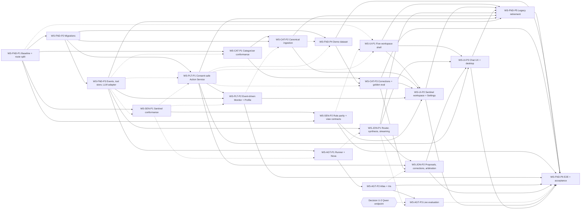

# Shared Project Roadmap

Schedule uses relative working days **D1–D9** for **four developers** (Dev A–Dev D, `workstream-assignments.md` §2). **Decided 2026-10-13:** 9 or more working days are available (U-1); the target is Tier 3 with Tier 2 as the fallback, checked at the end of D5 (§5, D-PLAN-9). Every plan is delivered as one branch and one PR (D-PLAN-4).

## 1. Workstream inventory
| Workstream | Developer | Objective | Local plans | Key dependencies | Integration checkpoint |
| --- | --- | --- | --- | --- | --- |
| WS-FND | Dev A | Test/CI, route split, schema, events, tool-result store, LLM adapter, demo data, legacy retirement, E2E | P1–P6 | None to start; P5/P6 need all | G1 (P1), G2 (P2/P3), G5 (P4/P5), G6–G7 (P6) |
| WS-CAT | Dev B | Categorizer conformance, canonical ingestion, corrections via Action Service | P1–P3 | WS-FND-P1/P2/P3, WS-PLT-P1/P2 (interfaces), WS-FND-P4 | G3 (P1), G4 (P3), G5 (P2) |
| WS-SEN | Dev D | 17 functions golden-tested, one rule library, view contracts | P1–P2 | WS-FND-P1/P3 | G3 (P1), G5 (P2) |
| WS-PLT | Dev B | Consent-safe Action Service, event-driven Monitor, Profile | P1–P2 | WS-FND-P2/P3, WS-SEN-P1 (interface) | G3 (P1/P2) |
| WS-AGT | Dev C | Runner + LLM Atlas/Nova/Iris with deterministic fallback | P1–P3 | WS-FND-P3, WS-SEN-P1; U-2 for P3 | G4 (P1), G5 (P2), G6 (P3) |
| WS-JON | Dev C | LLM router/synthesis, grounding gate, streaming, consent, proposals, corrections | P1–P2 | WS-FND-P3, WS-AGT-P1 (interface), WS-PLT-P1, WS-CAT-P3 | G4 (P1/P2) |
| WS-UI | Dev D | Five workspaces, no mocks, chat UX, desktop | P1–P3 | WS-FND-P1, WS-SEN-P2, WS-PLT-P1/P2, WS-CAT-P2/P3, WS-JON-P1/P2 | G2 (P1), G5 (P2/P3) |

## 2. Milestones
| Milestone | Content | Target |
| --- | --- | --- |
| M−1 — Repository ready *(added 2026-10-13)* | Source baseline `fc0981d` imported into the new repository (D-PLAN-3); developer names mapped (done 2026-10-15) | Before D1 |
| M0 — Contracts agreed | Specs + design + this package in the repository; harness, CI, route split (WS-FND-P1); WS-JON-P1 Draft PR with its Chat-schema contract commit under review | End D1 |
| M1 — Skeleton integrated | Migrations, dispatcher, tool-result store, LLM adapter (fake), CI green; five-workspace shell renders its views from `/api/v1` | End D3 |
| M2 — Deterministic core proven | Categorizer + Sentinel conformance, consent-safe actions, event-driven alerts | End D4 |
| M3 — AI layer integrated | Runner + Nova + John on fake LLM; proposals → confirm → propagation; corrections in chat | End D7 |
| M4 — End-to-end prototype | Sentinel workspace, chat UX, canonical ingestion, demo data, legacy removed | End D8 |
| M5 — Verified and accepted | E2E fake + live (Qwen from D3, or stand-in provider), security/reliability, acceptance checklist | End D9 |

## 3. Dependency graph (unique IDs; solid = implementation, dashed = interface/decision)

**Critical path (dependencies only):** `WS-FND-P1 → WS-FND-P2 → WS-FND-P3 → WS-JON-P1 → WS-JON-P2 → WS-UI-P3 → WS-FND-P5 → WS-FND-P6`. `WS-JON-P2` also waits on `WS-CAT-P3` and `WS-PLT-P1`. A second implementation chain of equal length runs `WS-FND-P1 → WS-FND-P2 → WS-FND-P4 → WS-CAT-P3 → WS-JON-P2 → …`; matrix #13 shortens it (WS-CAT-P3 can start on its own 30-row fixture). Interface edges (dashed) never block: they only fix contracts.

**Critical chain with four developers (resources included):** Dev D's queue `WS-UI-P1 → WS-SEN-P1 → WS-SEN-P2 → WS-UI-P2 → WS-UI-P3`, followed by `WS-FND-P5 → WS-FND-P6`. Dev D has the least slack (≈ 0.5 day); protect it with the contingency rule in `workstream-assignments.md` §2.3.

## 4. Execution schedule (four developers)
"am"/"pm" = first/second half of the day. **Bold** = plan completes (merged to `main`). "Contract commit" = the first commit of a plan's single PR, opened as a Draft so consumers can approve the contract early (D-PLAN-4: plans are never split).

| Day | Dev A (WS-FND) | Dev B (WS-CAT, WS-PLT) | Dev C (WS-JON, WS-AGT) | Dev D (WS-SEN, WS-UI) | Gate |
| --- | --- | --- | --- | --- | --- |
| D1 | **WS-FND-P1** (one PR; harness commit first so others can work against the branch; merged in the evening window) | Test design for WS-CAT-P1 against Dev A's branch (pm) | WS-JON-P1 start: Chat-schema contract commit, Draft PR for Dev D's review; routing rules | WS-UI-P1 start (against current workspace responses and Doc 2 §6) | **G1** |
| D2 | **WS-FND-P2** (am); WS-FND-P3 start | **WS-CAT-P1** (am); WS-PLT-P1 start: contract commit (registry, aliases, ActionCtx, `/proposals`), Draft PR for Dev C/D review | WS-JON-P1 against local fake adapter | **WS-UI-P1** | — |
| D3 | **WS-FND-P3** (end of day) | WS-PLT-P1 | WS-JON-P1 (switch to real adapter as soon as WS-FND-P3 merges) | WS-SEN-P1 | **G2** |
| D4 | **WS-FND-P4** | **WS-PLT-P1** merged in the morning (rebased on FND-P3); **WS-PLT-P2** (full day) | **WS-JON-P1** (am); WS-AGT-P1 start | **WS-SEN-P1** (am); WS-SEN-P2 | **G3** |
| D5 | Integration lead: daily builds, reviews (Template C), WS-FND-P6 scaffolding | **WS-CAT-P2** | **WS-AGT-P1** | **WS-SEN-P2** (am); WS-UI-P2 start | **Tier checkpoint** (§5) |
| D6 | Integration lead; WS-FND-P5 pre-checks (inventory of legacy imports) | **WS-CAT-P3** | WS-JON-P2 (corrections wired when CAT-P3 merges) | WS-UI-P2 | — |
| D7 | WS-FND-P5 start (backend + Electron parts) | Fixes, FND-P5 co-authoring (sync removal) | **WS-JON-P2** (am); WS-AGT-P2 | **WS-UI-P2** (am); WS-UI-P3 | **G4** |
| D8 | **WS-FND-P5** (after WS-UI-P3 merges); WS-FND-P6 start | Fixes | **WS-AGT-P2** (am); WS-AGT-P3 (Qwen from D3, or stand-in provider) | **WS-UI-P3** (am); fixes | **G5** |
| D9 | **WS-FND-P6** | Fixes | **WS-AGT-P3** | Desktop walkthrough evidence, fixes | **G6**, **G7** |

**Rules for this schedule**
- One plan = one branch = one PR, merged whole with a merge commit (D-PLAN-4). Contract files go in the first commit of that PR.
- Same local plan number on the same day means nothing; developers follow their own execution order (`workstream-assignments.md` §2.1).
- A plan can start before its "implementation" dependency merges only where `cross-workstream-dependencies.md` says *Early start: Yes*, and only against the contract — never against an invented interface.
- If any plan slips more than half a day, the owner says so at the stand-up; Dev A updates `tracking/STATUS.md` and applies the contingency rules (`workstream-assignments.md` §2.3) or the tier cut (§5).

## 5. Scope tiers (aligned with prototype design Doc 6 §6) and the tier decision
**Decision (D-PLAN-9, 2026-10-13):** aim for **Tier 3**; fall back to **Tier 2**. Tier 1 is not a planned fallback — if Tier 2 is at risk, escalate to the team lead.

| Tier | Demo steps (Doc 6 §5) | Scope | Delivered by |
| --- | --- | --- | --- |
| 1 | 1–5, 7, 10 | Foundations, ingestion + categorizer, Sentinel, Action Service, Monitor, Nova specialist + John single-specialist path, Nova/Sentinel/Atlas workspaces, corrections, persistence | WS-FND-P1–P6, WS-CAT-P1–P3, WS-SEN-P1–P2, WS-PLT-P1–P2, WS-AGT-P1, WS-JON-P1, WS-JON-P2 (cards, T1, corrections), WS-UI-P1–P3 |
| 2 | 6, 8 | Iris specialist, parallel dispatch, arbitration, health score, John workspace strip | WS-AGT-P2 (Iris `WHAT_IF_PURCHASE`; Atlas `GOAL_PROGRESS`, `EVALUATE_FUND_ADDITION`, `CREATE_GOAL`), WS-JON-P1 (parallel, health score), WS-JON-P2 (arbitration), WS-SEN-P2 + WS-UI-P3 (John strip) |
| 3 | 9 + remaining | Iris planner workspace, bills/cash-flow scan, SIP, plan review, dependency edge, remaining task types | WS-AGT-P2 (Atlas `GOAL_PLAN_REVIEW`, `SIP_PROJECTION`, `HANDLE_PEER_FINDING`; Iris `MONTHLY_PLAN`, `BILL_OUTLOOK`, `OVERSPEND_DIAGNOSIS`, `PLAN_REVIEW`), WS-JON-P2 (dependency edge), WS-UI-P2 (forecast/risk radar beyond the bills list, demo loader control), Iris planner and SIP calculator verification, WS-FND-P6 step 9 |

**Tier checkpoint — end of D5 (Dev A runs it, team lead decides):**
- If gate G3 closed **on time or ≤ 1 day late** → keep Tier 3.
- If G3 closed **more than 1 day late** → cut the Tier 3 items above immediately. The affected plans (WS-AGT-P2, WS-JON-P2, WS-UI-P2, WS-FND-P6) carry a "Tier cut" note saying exactly what to skip; skipped task types keep today's deterministic behaviour. Record the outcome in `tracking/STATUS.md` (gate log and decision log).

## 6. Integration gates
| Gate | Entry criteria | Verified by | Owner |
| --- | --- | --- | --- |
| G1 Contract agreement (end D1) | `docs/specifications` + `docs/prototype-design` + this package in the repository; WS-FND-P1 merged (harness + CI, route split, CODEOWNERS); WS-JON-P1 Draft PR open with its Chat-schema contract commit; decisions recorded (`baseline.md` §6); developer names mapped | Checklist in `acceptance-checklist.md` §2 | WS-FND |
| G2 Skeleton integration (end D3) | `npm --prefix backend test` green in CI on temp DBs; migrations reproduce today's schema; dispatcher delivers a test event; `llm.complete` works with `fake` under test; Electron boots and the five nav items + Settings render their workspace views from `/api/v1` (Backend B may still run until WS-FND-P5) | CI run + manual Electron smoke | WS-FND |
| G3 Core deterministic loop (end D4) | Ingest (existing `/ingest/batch`) → categorization → `categorization.updated` → Monitor alert (no LLM) → Nova view; proposal → confirm → executed; T2 cannot execute without confirm token | Integration tests in CAT, SEN, PLT plans | WS-PLT (coordinates) |
| G4 Cross-component behaviour (end D7) | Chat with fake LLM: single specialist, parallel specialists, arbitration, rule-detected T1 with Undo, typed "yes" refused; correction propagates to next answer | `backend/test/integration/chat-*.test.js` | WS-JON |
| G5 End-to-end prototype (end D8) | Demo journey steps 1–10 (Doc 6 §5) pass with the fake provider via E2E test; legacy code removed; UI shows no mocks | `backend/test/e2e/demo-journey.test.js` | WS-FND |
| G6 Regression/security/reliability (D9) | Security suite (Doc 5 S-1…S-16), failure injection, restart persistence, live suite with Qwen or the labelled stand-in provider (D-PLAN-12) | `WS-FND-P6` reports | WS-FND |
| G7 Final acceptance (D9) | P-AC-01…P-AC-20 | `acceptance-checklist.md` signed by team lead | Team lead |
