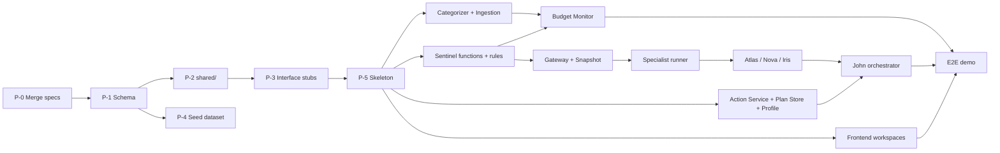

# FinMate AI Prototype — Architecture Package Overview

| Attribute | Value |
| --- | --- |
| Folder | `docs/prototype-design/` |
| Status | **Proposed — awaiting team-lead approval** (Stage D). No implementation, task sets or code until approved. |
| Date | 2026-10-11 |
| Inputs inspected | The application code of the **previous project repository** at commit `485ed0f` (historical provenance only — that repository is out of scope for this project; see `docs/repository-migration-notes.md`), the six frozen specifications and `system-contracts.md` |
| Authoritative behaviour | `docs/specifications/*.md` (frozen 2026-10-10). This package defines **how much** of that behaviour the prototype builds and **how**; it never redefines component behaviour. Where the prototype simplifies, the simplification is named and justified. |

## Documents in this package
| # | File | Answers |
| --- | --- | --- |
| 0 | `00-overview.md` (this file) | What exists today, what the prototype proves, scope, repository/team structure, final review |
| 1 | `01-system-architecture.md` | Components, runtime, boundaries, communication, decisions (ADRs), production mapping |
| 2 | `02-shared-data-model-and-contracts.md` | Tables, entities, conventions, module interfaces, HTTP API, example payloads |
| 3 | `03-end-to-end-data-flows.md` | Eleven flows with sequence diagrams and failure paths |
| 4 | `04-component-specifications.md` | Prototype slice of John, Iris, Nova, Sentinel, Atlas, Item Categorizer (+ platform services) |
| 5 | `05-security-and-reliability.md` | Minimum safeguards, what is deferred to production hardening |
| 6 | `06-testing-and-acceptance.md` | Test layers, acceptance criteria, demonstration script |
| 7 | `07-ui-screens-and-interactions.md` (**added 2026-10-13**, awaiting approval) | Screen-by-screen UI design: shell, navigation, shared components, fields, states, flows, accessibility |

Spec references use `SC §n` for `system-contracts.md` and `<Component> §x` for a component spec.

> **Repository notes (added 2026-10-13, repository migration — no architecture change).**
> 1. This package now lives in the project repository `https://github.com/Kathir-M-03/FINNMIN-JFK-John`. "The repository" / "existing code" in §1 and §4 below describe the **source baseline** — the application code these documents were written against, which per team decision D-PLAN-3 is imported into the new repository from commit `fc0981d` (import pending at the time of writing).
> 2. R-11 / prerequisite P-0 ("merge the frozen specs") is **satisfied**: `docs/specifications/` and `docs/prototype-design/` are on `main` of the new repository from its first commit.
> 3. §4 describes a six-person team and a branch-per-workstream model (U-4 default below). For execution these are **superseded** by `docs/implementation-plan/workstream-assignments.md` (four developers, short-lived plan branches) and `docs/development-workflow.md`. U-3 (browser vs Electron) is recorded as resolved to Electron in `docs/implementation-plan/baseline.md` C-2, pending confirmation Q-UI-01.
> 4. Document 7, `07-ui-screens-and-interactions.md`, was **added** on 2026-10-13 to give screen-level UI design for WS-UI; it is generated from Docs 0–6 and the specifications and awaits team approval (TD-05). The team approved Docs 0–6 on 2026-10-13 (A-ARCH).

---

## 1. Stage A — What the repository contains today

### 1.1 Technology stack (as found)
| Layer | Found | Notes |
| --- | --- | --- |
| Frontend | React 19, Vite 8, Recharts, lucide-react (`src/`) | `src/App.jsx` shell, `src/components/*`, workspace views under `src/agents/*/` and `src/tools/*/` |
| Desktop shell | Electron 41 (`electron/main.js`), `launch.bat` | Boots **both** backends in-process and loads `dist/` |
| Backend A | `backend/` — Express 4, CommonJS, `node:sqlite` (`backend/src/db.js`), JWT + bcrypt auth, port **4000** | Routes: auth, users/profile, goals, transactions, budget, insights (Sentinel/Iris/health/bills), coach (Gemini), subscriptions |
| Backend B | `src/index.js` — Express, CommonJS, port **4001**, `better-sqlite3` (optional dependency) with a hand-written in-memory fallback (`src/db/db.js`) | Routes: budget, transactions, actions, nova telemetry. Identity from `x-user-id` header defaulting to `user_demo_nova` (no authentication) |
| LLM | Gemini via `backend/src/routes/coach.js` only | No LLM in `src/agents/*` (Nova, Iris, Atlas, John modules are deterministic code with templated text) |
| Tests | Plain Node scripts per module + `tests/novaEngine.test.js`; gate `web-testing/verify-web-readiness.js` | **All pass locally — against the in-memory fallback store**, because `better-sqlite3` is not installed; the SQL in Backend B is not exercised by the tests |
| Build artefacts | `dist/` committed | Should not be versioned |

### 1.2 Entry points
- `launch.bat` → gate → `electron .` → `electron/main.js` starts Backend A (:4000) and Backend B (:4001), loads `dist/index.html`.
- `npm run dev:backend` → Backend A; `npm start` → Backend B; `vite` → frontend :5173.
- Frontend API clients: `src/services/api.js` → `http://localhost:4000/api`; `src/agents/nova/novaService.js` → Backend B (:4001).

### 1.3 Persistence
Two independent SQLite files with **different schemas for the same concepts**:
| Concept | Backend A (`finmate.db`) | Backend B (`nova.db` / in-memory) |
| --- | --- | --- |
| User | `users` (integer id, bcrypt password, income, fixed housing, risk) | `users` (text id, default income 75000, currency '₹') |
| Transactions | `transactions` (REAL rupees, free-text category) | `transactions` (REAL rupees, `category_id` like `cat_food_dining`, status `SETTLED/NEEDS_REVIEW/UNCATEGORIZED`) |
| Caps | `budget_categories` (free-text category) | `budget_categories` (category + optional `category_id`) |
| Goals, bills, subscriptions | Present | Absent |
| Alerts, snapshots, tokens, review queue, peer hints, John memory | — | **In-process `Map`s / arrays** (lost on restart) |

A cap changed in the Nova workspace (Backend B) is invisible to John's coach (Backend A), and vice-versa.

### 1.4 What is implemented vs incomplete (relative to the frozen specs)
| Component | Implemented today | Missing or non-conforming |
| --- | --- | --- |
| Item Categorizer (`src/tools/tally`) | Keyword categorizer, taxonomy registry (`cat_*` IDs), 3 statuses, review queue, data-quality calc, Spending Analyser UI | Movement typing (transfers, card payments, refunds), merchant evidence, confidence bands per evidence tier, versioned results, events, canonical ingestion, idempotency, corrections via Action Service; taxonomy IDs differ from SC §6.3 |
| Sentinel (`src/tools/sentinel`) | 6 functions: ledger summary, utilization, velocity, anomalies, rebalance, cap validation; snapshot manager (in-memory); tool gateway (Nova allowlist only) | 11 functions (goals, surplus, simulation, bills, cash-flow, available balance, health, SIP, timeseries); integer paise; registry; envelope `SentinelResult@1`; persistent snapshots |
| Nova (`src/agents/nova`) | Deterministic engine, placeholder binder, untrusted-text sanitizer, lifecycle runner, rich UI | LLM specialist role; response shape per SC §9.4; proposals stored via Action Service |
| Atlas (`src/agents/atlas`) | Stub responding to `GOAL_FUNDING_PRESSURE` | **Hardcoded values** (`delay_days: 5`, fabricated `tool_result_id`); no Sentinel calls; goals CRUD lives in Backend A without validators |
| Iris (`src/agents/iris`) | Stub echoing recurring-anomaly hints and alerts | All planning behaviour; manifest calls Iris a "Subscription & Recurring Specialist", contradicting the frozen spec ("Spending Advisor") |
| John (`src/agents/john` + `backend/src/routes/coach.js`) | Rule routing table, task-packet builder, peer-hint queue; chat UI calls Gemini with a SQL context dump | Grounding, validation, conflict rules, proposals through Action Service, persistent memory; chat path bypasses the orchestrator |
| Action Service (`src/tools/action-service`) | Token issue/verify (in-memory), T1/T2/T3 tiers, audit log table | Persistent proposals, idempotency, re-validation with the rule library, base-version checks, undo |
| Budget Monitor (`src/tools/threshold-job`) | Tier detection, dedupe, alert hygiene (in-memory) | Persistence, event triggers from a real outbox, period rollover |
| Frontend | Nine nav items: Home, Subscriptions, John, Spending Analyser, Iris, Nova, Atlas, Financial Health, Settings | Sentinel is not a workspace; several views read `src/data/mockFinancialData.js` (Header, Sidebar, AgentStatusBadge, Atlas, Iris, Sentinel, John, Health) |

### 1.5 Contradictions and gaps found
| ID | Finding | Resolution in this package |
| --- | --- | --- |
| R-1 | Two backends, two databases, two user models | ADR-01/02: one backend (`backend/`, `node:sqlite`), one database |
| R-2 | Backend B trusts `x-user-id` (no auth) | Retired with Backend B; all routes behind existing JWT |
| R-3 | Tests pass on an in-memory SQL imitation | ADR-13: tests run on real SQLite files |
| R-4 | Money stored as REAL rupees | ADR-08: integer paise; one-time migration |
| R-5 | Taxonomy IDs `cat_*` vs SC `PARENT.LEAF` | SC IDs win (they are referenced by caps, preferences, fixed lines); the `cat_*` keyword lists are reused as seed rules |
| R-6 | Atlas/Iris return hardcoded figures | Replaced by spec-conforming specialists grounded in Sentinel results |
| R-7 | Iris described as "Subscription & Recurring Specialist" in `branch-manifest.json` | Frozen spec wins: Iris = Spending Advisor; subscriptions become declared recurring bills in the Sentinel workspace |
| R-8 | Nine nav items; no Sentinel workspace; Health page shown | Five workspaces + Settings (SC §18); Analyser, Subscriptions and Predictor merge into Sentinel; Health becomes an on-demand John answer |
| R-9 | Chat path (Gemini + SQL dump) bypasses the orchestrator and grounding | All chat goes through John's orchestrator |
| R-10 | README says 4 developers / 6 branches; this task says 6 developers | Plan for 6 developers; branch-per-module model kept |
| R-11 | Frozen specs live on an unmerged branch (`docs/requirements-freeze-specs`) | Merge it before implementation (prerequisite P-0 in §4) — **satisfied 2026-10-13** (see repository notes at the top of this file) |
| R-12 | Committed `dist/` | Remove from VCS; build in CI/launch script |

### 1.6 Existing code to reuse (not rewrite)
| Existing asset | Reuse as |
| --- | --- |
| `backend/src/db.js` (`node:sqlite` adapter with transactions) | Database adapter for the single backend |
| `backend/src/middleware/auth.js`, `routes/auth.js`, onboarding in `routes/users.js` | Authentication and onboarding (fields remapped to Profile@1) |
| `src/tools/sentinel/*` calculators (utilization, velocity, anomalies, rebalance, cap validation) | Ported into `backend/src/engines/sentinel/functions/` after conversion to paise, snapshot inputs and the `SentinelResult@1` envelope |
| `src/tools/tally/TallyCategorizer.js` keyword lists, `TaxonomyRegistry.js` | Seed global keyword rules mapped to SC taxonomy IDs |
| `src/tools/threshold-job/*` tier and hygiene logic | Budget Monitor, made DB-backed and event-triggered |
| `src/tools/action-service/*` tier/token logic | Action Service, made DB-backed with idempotency and re-validation |
| `src/agents/nova/PlaceholderBinder.js`, `UntrustedTextSanitizer.js` | Shared grounding binder and sanitizer |
| `src/contracts/*` | Replaced by JSON Schemas generated from SC §9 (shapes differ), but the validator-factory pattern is kept |
| React views (John dashboard, Nova view + CSS, Atlas modals, Iris simulator slider, Sentinel predictor, Spending Analyser, Statement import modal, Subscriptions view, Settings, Auth, Onboarding) | Kept; data sources switched from mocks/Backend B to the single API |
| Electron shell, `launch.bat`, web-testing gate | Kept, simplified to start one server and run `node --test` |

---

## 2. What the prototype proves

**Claim:** the frozen architecture works end to end at small scale — a bank batch enters, is typed and categorized, persists, drives deterministic budgets, goals, forecasts and alerts, and John coordinates real LLM specialists whose every number is grounded in Sentinel results and whose every change requires the user's confirmation and passes deterministic re-validation.

**Primary demo journey (must work live):**
1. Load the demo bank batch (90 days, ~250 transactions, 2 accounts incl. a credit card) → categories, transfers and card payments typed; review list shows the few uncertain items.
2. Sentinel workspace shows spend by category, trends, upcoming bills and balance with data-quality badge.
3. Nova shows Dining (`FOOD.DINING`) at Warning; the alert appeared without any LLM call. Opening it → John invokes Nova → explanation + rebalance card → Confirm → caps change for this month → alert resolves.
4. Correct a grocery purchase that the rules placed in Dining (Dining → Groceries) inline → both leaf categories' tiers recompute; John's next answer uses the new numbers.
5. In John: "Can I afford a ₹60,000 phone next week and still keep my Goa trip goal on track?" → Iris (what-if) and Atlas (goal progress) in parallel → grounded answer; proposals as cards.
6. Atlas: create an Emergency Fund goal via the form; add funds → rejected when exceeding available balance (rule shown); accepted when within.
7. Ask "How healthy are my finances?" → health score from Sentinel, explained by John.
8. Restart the app → everything above persists.

---

## 3. Scope

### 3.1 Build now (essential)
| Area | Prototype scope |
| --- | --- |
| Runtime | One Node process (Express API + in-process job/event dispatcher), one SQLite file, React frontend (browser or Electron shell) |
| Ingestion | `CanonicalBatch@1` JSON and CSV (one mapping profile) through the Ingestion Gateway; demo loader script and a labelled "Load demo bank batch" control |
| Item Categorizer | Pipeline steps 1–6, 9, 10 (classifier and LLM stages off, as specified); versioned results with events; corrections, confirmations, merchant-scope recategorization with dry run, undo; review queue; status |
| Sentinel | All 17 functions (they are deterministic and needed by the five workspaces), rule library shared with the Action Service, registry v1 |
| Atlas, Nova, Iris | Real LLM specialists via the shared runner, prototype task subsets (Doc 4) |
| John | Rules + LLM router, packets, parallel dispatch, one dependency edge, validation, conflict rules incl. Sentinel arbitration, synthesis with grounding, proposals/cards/chips, chat corrections, direct answers (health overview, health score), threads + rolling summary |
| Platform | Action Service (proposals, tokens, idempotency, re-validation, ledger, undo for T1), Plan Store, Profile Service, Budget Monitor (event-driven tiers, on-demand daily scan, rollover), Snapshot Service (optimistic), Tool Gateway (allowlist, ResultRef, budgets, result store), outbox + dispatcher, LLM adapter (Qwen via OpenAI-compatible API; fake provider for tests) |
| Frontend | Five workspaces + Settings + Auth/Onboarding; confirmation cards, chips, Undo, notices; no mock data |
| Tests | Unit, contract, integration on real SQLite, routing/synthesis evals with fake and live LLM suites, E2E demo script |

### 3.2 Deferred (visible controls are disabled with "Not in prototype")
| Deferred | Why it is safe to defer | Re-entry point |
| --- | --- | --- |
| ISO 20022 camt.053/054 adapters | Canonical format already isolates adapters | Add adapter under `platform/ingestion/adapters/` |
| Bank OIDC SSO | Session claims identical to the JWT path | Add OIDC callback route issuing the same JWT |
| PostgreSQL + RLS | Repository modules own all SQL | Driver swap + RLS policies |
| Temporal history tables (true point-in-time snapshots) | ADR-05 optimistic snapshots keep the same `snapshot_id` contract | Implement behind Snapshot helpers |
| Actions: `RESTORE_GOAL`, `CREATE_ALERT` (watch), `SET_TRANSACTION_TYPE`, `CONFIRM_LINK`/`BREAK_LINK`, `RESOLVE_DUPLICATE`, `MARK_OWN_ACCOUNT_COUNTERPARTY`, `CREATE_CATEGORY_RULE`/`DELETE_CATEGORY_RULE`, `DELETE_MANUAL_TRANSACTION`, `UPDATE_DECLARED_BILL`, `APPLY_TAXONOMY_MIGRATION` | Registry entries exist; executors are additive | Add executor + UI control |
| Specialist task types: Atlas `UPDATE_GOAL`, `SET_GOAL_STATUS`, `EVALUATE_FUND_RELEASE`, `DELETE_GOAL` via chat (forms cover them); Nova `ANOMALY_EVENT` (opened anomaly alerts route to `EXPLAIN_ANOMALY`) | Workspace forms provide the same actions deterministically; `EXPLAIN_ANOMALY` covers anomaly explanations | Add task config entries |
| John: reconcile round, memory facts (decision memory), alert-narrative cache | Not needed for the demo journeys; packets already carry preferences | Add modules; contracts unchanged |
| Push/email notifications, operator dashboards, rate-limit tuning, consent records beyond a flag | In-app feed suffices | Production hardening |
| Multi-tenant config, white-label theming | One tenant `demo` | Deployment config |

### 3.3 Simplifications that need reconsideration before production
| Simplification | Production change required |
| --- | --- |
| Optimistic snapshots (ADR-05) | Temporal history for plan, profile, balance and classification stores so pinned snapshots survive concurrent changes |
| Single process with in-process dispatcher (ADR-03/04) | Separate worker process for jobs/outbox; still no broker needed |
| SQLite single file | PostgreSQL with RLS, backups, migrations tooling |
| LLM via public API key (Qwen) | Gemini Enterprise per bank contract, data-processing terms, consent records (SC §16.6, O-1) |
| Demo bank-batch loader in the UI | Remove; ingestion only from the bank channel with mTLS/HMAC |

---

## 4. Shared repository and six-person team (architecture and dependencies only — no assignments)

### 4.1 Target repository layout
```
backend/src/
  index.js                     # single Express server (+ job dispatcher start)
  db.js                        # existing node:sqlite adapter
  db/migrations/NNN_*.sql      # schema (Doc 2) — shared foundation
  shared/                      # ids, money, time, errors, grounding, finance (movement, coverage), contracts/schemas + validate
  platform/
    events/  snapshot/  gateway/  llm/  action-service/  profile/  budget-monitor/  ingestion/
  engines/
    categorizer/   sentinel/ (functions/, rules/, registry/)
  agents/
    shared/runner.js   atlas/   nova/   iris/   john/
  routes/v1/                   # HTTP surface (Workspace API)
  seed/                        # demo dataset (canonical JSON), mapping profile, seed script
src/                           # React frontend only
  api/client.js                # single API client (replaces api.js + novaService.js)
  workspaces/{john,atlas,nova,iris,sentinel}/
  components/                  # shell, cards, chips, notices, auth, onboarding, settings
electron/                      # optional desktop shell (starts backend/src/index.js)
tests/                         # e2e + demo script; unit/contract tests live beside modules (*.test.js)
docs/specifications/  docs/prototype-design/
```
Server code currently under `src/agents/*` and `src/tools/*` moves to `backend/src/agents|engines|platform`; React views move to `src/workspaces/*`.

### 4.2 Shared foundations that must be agreed and merged before parallel work (prerequisites)
| ID | Foundation | Contents | Why first |
| --- | --- | --- | --- |
| P-0 | Merge `docs/specifications` + `docs/prototype-design` | Authoritative contracts in `main` | Everyone builds against the same text |
| P-1 | Schema migrations | All tables in Doc 2 §3 | Every module reads/writes them |
| P-2 | `shared/` | `ids`, `money`, `time` (IST periods), `errors`, JSON Schemas for SC §9/§10/§13 entities, `validate()` | Every interface uses them |
| P-3 | Module interface stubs | Exported functions with JSDoc signatures from Doc 2 §5, each throwing `NOT_IMPLEMENTED` | Parallel work compiles and integrates from day one |
| P-4 | Seed dataset + loader | Canonical batch JSON, profile, caps, goals, declared bills; deterministic `seed.js` | Shared fixtures for every test and the demo |
| P-5 | Runnable skeleton | `backend/src/index.js` serving `/api/v1/health`, auth, the event dispatcher, fake LLM provider; frontend shell with five empty workspaces calling `/api/v1` | Integration surface exists before features |
| P-6 | Test harness | `node --test` runner, temp-DB helper, fake LLM, contract-test helper | Every module ships with tests in the same style |

### 4.3 Dependency order (critical path)

Independently buildable once P-0…P-6 are merged: Categorizer, Sentinel, Action Service/Plan Store/Profile, Frontend. Specialists depend on the Gateway and Sentinel functions (they can start against fake Sentinel results). John depends on specialists' response contract (can start with stub specialists returning schema-valid fixtures).

### 4.4 Conflict minimisation rules
1. **Single owner per directory.** Each module directory has one owning workstream (assigned in the planning stage). Changes to another module go through a PR reviewed by its owner.
2. **Shared files are append-mostly.** `db/migrations` (new numbered files only), `shared/contracts/schemas` (new files or additive fields per SC §19), `routes/v1/index.js` (one line per router).
3. **Contracts change only by PR to `docs/specifications` or `docs/prototype-design` first**, then schema, then code.
4. **Branch per workstream**, rebased daily on `main`; merge gate = all `node --test` suites + contract tests green on real SQLite.
5. **Frontend–backend coordination** through `routes/v1` request/response JSON Schemas; the frontend uses a typed client generated from them by hand in `src/api/client.js` (one function per endpoint), and a mock-free dev mode against the seeded backend.

### 4.5 Integration approach
- Daily integration build on `main` runs: unit + contract tests, integration tests (temp SQLite), fake-LLM E2E of the demo journey, then (on demand) the live-LLM smoke suite.
- Integration owner role (assigned later) maintains `routes/v1/index.js`, `index.js` wiring, the seed and the E2E script.

---

## 5. Final architecture review (Stage C result)

### 5.1 Coverage check
| Check | Result |
| --- | --- |
| All six component specs considered | Yes — Doc 4 has one section per component with in/out scope traced to spec sections |
| Five workspaces represented | Yes — John, Iris, Nova, Sentinel, Atlas (Doc 1 §6, Doc 4) |
| Item Categorizer placed in the pipeline | Yes — between Ingestion Gateway and every consumer (Doc 3 F1–F2) |
| Consistent shared data model | One schema, one money convention, one taxonomy (Doc 2) |
| Explicit responsibilities and contracts | Doc 2 §5 interfaces, Doc 4 per component |
| Journeys traceable input → persistence → display | Doc 3 F1–F10, Doc 6 E2E |
| Implementable within hackathon constraints | Yes, with the deferrals in §3.2; risk R1/R2 below |
| Production feasibility demonstrated | Contracts identical to SC; simplifications listed in §3.3 |
| Six developers without inventing interfaces | Prerequisites P-0…P-6 and Doc 2 §5 stubs |

### 5.2 Most important risks
| ID | Risk | Likelihood / impact | Mitigation |
| --- | --- | --- | --- |
| K-1 | Qwen 32B-class model produces invalid JSON or weak tool choices | Medium / High (chat quality) | ADR-07: deterministic tool plans per task type; JSON-schema-constrained output; one repair; deterministic fallback text; workspaces never depend on the LLM |
| K-2 | Hackathon time is shorter than the scope | Unknown / High | Scope tiers in Doc 6 §6 (Tier 1 must-demo journey first); deferrals already cut |
| K-3 | Consolidating two backends disrupts the existing team branches | Medium / Medium | Port module by module; keep Backend B runnable until each module lands; delete it last |
| K-4 | LLM API unavailable or rate-limited at demo time | Medium / High | Health check before demo; fallback provider configured; degraded mode keeps all workspaces functional; recorded live-LLM run as backup evidence |
| K-5 | Paise conversion and taxonomy remap introduce data errors | Low / High | One migration script with reconciliation report (row counts and totals) |
| K-6 | Optimistic snapshots cause `DATA_STALE` churn during demos with rapid edits | Low / Low | One automatic retry with a fresh snapshot in John and the Workspace API |

### 5.3 Unresolved decisions (need your input)
| ID | Decision | Default used in this package |
| --- | --- | --- |
| U-1 | Hackathon duration and demo date | Scope tiers in Doc 6 §6 assume ~5–7 working days; Tier 1 alone fits ~2–3 days |
| U-2 | Exact Qwen endpoint/provider (base URL, model ID, whether tool-calling or JSON mode is supported) | OpenAI-compatible endpoint with JSON-schema output; ADR-07 does not require native tool calling |
| U-3 | Keep Electron as the demo shell or present in the browser | Both work; browser is the default demo surface (production target is web, A-3) |
| U-4 | Whether to keep the existing per-module Git branches or move to short-lived feature branches | Keep the six workstream branches, rebased daily |

### 5.4 Assumptions
Demo data is synthetic or the team's own consented data; one tenant (`demo`); two seeded users (demo + isolation-test user); Asia/Kolkata; INR; the frozen specs are merged before implementation starts.
