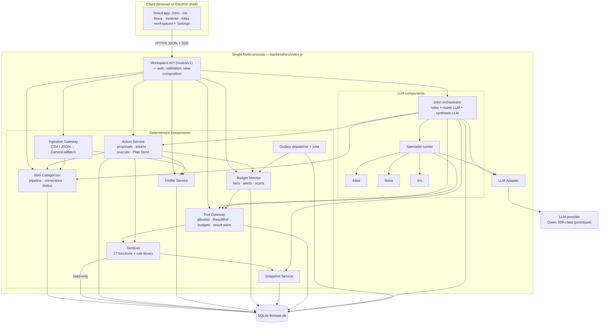

# Document 1 — Prototype System Architecture

**Decision in one line:** a modular monolith — one Node/Express process, one SQLite database, in-process modules whose interfaces are exactly the contracts in `system-contracts.md`, with real LLM calls only inside John and the three specialists.

---

## 1. System diagram

### 1.1 Connections explained
| From → To | Purpose | Contract |
| --- | --- | --- |
| UI → Workspace API | Every screen and every chat message | Doc 2 §6 HTTP API; chat streams `ChatResponse@1` blocks over SSE |
| API → John | Chat messages, alert "Explain", workspace "Ask" buttons | `handleMessage(ChatRequest, session, emit)` |
| API → Gateway → Sentinel | Deterministic workspace views and form pre-validation (no LLM) | `callTool(ToolCall, ctx)` → `SentinelResult@1` |
| API → Action Service | Confirm/decline cards, T1 taps, form submissions, undo | `createProposal`, `confirmAndExecute`, `executeT1`, `undo` |
| API → Categorizer | Transaction list, evidence, review queue, status | Read API (Doc 2 §5.3) |
| API → Ingestion | Demo bank-batch load (labelled), admin seed | `ingest(canonicalOrCsv, mappingProfileId)` |
| John → Runner → Atlas/Nova/Iris | Specialist tasks | `TaskPacket@1` → `SpecialistResponse@1` (SC §9) |
| John / Runner → Gateway | Sentinel calls within allowlists and budgets | SC §10 |
| John → Action Service | Store proposals; execute rule-detected chat T1 instructions | SC §13 |
| John → Categorizer | Status for `data_quality`, transaction search for chat corrections, review items for hints | Categorizer read API + `addReviewItem` |
| John / Runner → LLM Adapter → provider | Router, specialist reasoning, synthesis, summarizer | `complete({modelClass, …})` (SC §17.8) |
| Action Service → Sentinel rule library | Re-validation at proposal creation and execution (in-process import, not via gateway) | `rules.*` (Sentinel §E) |
| Action Service → Categorizer / Profile / Monitor | Executors for categorization changes, profile/preferences/bills, alert dismissals | Executor functions with `ActionCtx` |
| Ingestion → Categorizer / Profile | Transactions vs accounts and balances | `ingestBatch`, `upsertAccounts`, `recordBalances` |
| Outbox dispatcher → Budget Monitor (and John cache) | `categorization.updated`, `plan.changed`, `balances.updated`, `period.rolled` | `Event@1` (SC §14) |
| Monitor → Gateway → Sentinel | Utilization per affected category; daily anomaly and cash-flow scans | Monitor allowlist |
| All → SQLite | Each store has a single writer module (Doc 2 §3); Sentinel uses a read-only connection | — |

---

## 2. Runtime and deployment (prototype)

| Item | Decision |
| --- | --- |
| Processes | **One** Node ≥ 22.5 process: Express API, outbox dispatcher (polls `event_outbox` every 250 ms and also triggered right after each commit), job scheduler (`setInterval` for `period_rollover` check each minute, `reprocess_retryable` every 30 min; `daily_scan` on demand + once at startup) |
| Ports | API :4000 (`/api/v1/*`); Vite dev :5173 (proxy `/api` → :4000) or the built `dist/` served by Express at `/` |
| Database | `backend/finmate.db` (`node:sqlite`, WAL, foreign keys on). Sentinel opens a **second connection with `PRAGMA query_only = ON`** to enforce read-only access |
| Electron | Optional shell: starts `backend/src/index.js` in-process and loads `http://localhost:4000/`. Backend B (:4001) removed |
| Configuration | `backend/.env`: `JWT_SECRET`, `LLM_PROVIDER=openai_compat`, `LLM_BASE_URL`, `LLM_API_KEY`, `LLM_MODEL_ROUTER`, `LLM_MODEL_SPECIALIST`, `LLM_MODEL_SYNTHESIS`, `LLM_MODEL_SUMMARIZER`, `DB_PATH`, `TENANT_CODE=demo`, `TZ=Asia/Kolkata`, `SENTINEL_MODEL_VERSION=1.0.0`, `DEMO_CONTROLS=true` |
| Start commands | `npm run seed` (migrations + demo dataset), `npm run dev` (API + dispatcher), `npm run web` (Vite), `npm run app` (Electron), `npm test` (`node --test`) |

---

## 3. Responsibilities and boundaries (who does what)

| Concern | Where it happens | Never happens in |
| --- | --- | --- |
| Authentication, session → `user_id` | Workspace API middleware (existing JWT) | Agents, Sentinel |
| Input validation (HTTP) | Workspace API, JSON Schemas per route | — |
| Interpreting the user, choosing specialists, synthesis | John | Specialists, Sentinel |
| Domain reasoning and proposals | Atlas, Nova, Iris (LLM) | John's LLM, Sentinel |
| Every number, validator verdict, forecast | Sentinel (deterministic) | Any LLM, frontend |
| Transaction type, category, merchant | Item Categorizer (rules) or user via confirmed action | Any LLM |
| Authorization of a state change, re-validation, execution | Action Service + rule library | Any LLM, John's code paths without a user token |
| Tier detection, alerts | Budget Monitor | Nova |
| Number rendering and grounding check | Shared `shared/grounding` (used by John and Workspace API) | Specialists' raw text |
| Persistence of chat | John | Specialists |

**Frontend boundary:** the frontend performs no financial arithmetic. It renders values returned by the API (already formatted by the grounding formatter, plus raw `_minor` fields for charts). Charts plot `_minor` values divided by 100 for display only.

---

## 4. Communication model and concurrency

| Interaction | Mode | Notes |
| --- | --- | --- |
| UI ↔ API | HTTP JSON; chat via SSE | Chat streams after synthesis completes (grounding needs the full text) |
| Module ↔ module | In-process async function calls | Interfaces in Doc 2 §5; never import another module's internals |
| Specialist tasks | Parallel `Promise.allSettled` with one `AbortController` per task | ≤ 3 in parallel |
| Sentinel calls inside a task | Sequential per the task's plan (ADR-07); independent read-only calls may run in parallel within the plan step | Gateway budget ≤ 12 per request |
| Events | Transactional outbox → dispatcher → handlers (at-least-once, deduplicated by `event_id` and version) | Handlers are idempotent |
| Jobs | In-process scheduler | Each job takes a DB lock row in `jobs` to avoid overlapping runs |
| DB writes | One DB transaction per action/chunk; SQLite serializes writers | Executors never span two transactions |

**Independent vs dependent work**
| Can run independently | Depends on another result |
| --- | --- |
| Specialists in one request (Atlas ∥ Nova ∥ Iris) | Atlas `HANDLE_PEER_FINDING` after Nova `GOAL_FUNDING_PRESSURE` or Iris `SAVINGS_CAPACITY` (the single dependency edge) |
| Workspace view tool calls (e.g. utilization for each category) | John's arbitration simulation after both conflicting proposals exist |
| Budget Monitor recomputation per category | Synthesis after all tasks finish or the budget deadline fires |
| Categorization of different chunks (sequential commits, independent rows) | Pairing (transfers, card payments, refunds) after re-delivery checks; categories after movement typing |

---

## 5. Errors and partial failures

| Failure | Propagation | User-visible result |
| --- | --- | --- |
| Sentinel function error | `SentinelResult.status ≠ OK` → specialist returns `PARTIAL`/`ERROR`; workspace view shows "figure unavailable" for that panel only | Other panels and specialists continue |
| Specialist timeout / invalid output | Runner: one repair; John: one retry with smaller packet, then answer from others | `PARTIAL` notice naming what is missing |
| LLM provider down | LLM adapter circuit breaker opens → John returns `DEGRADED` with deterministic fallback text; workspaces unaffected | Chat banner; all forms and views work |
| Action validation failure | Action Service returns `REJECTED_VALIDATION` with rule codes | Card shows the rule in plain words |
| Stale snapshot | Sentinel `DATA_STALE` → caller creates a new snapshot and retries once | Transparent; second failure → notice |
| Event handler failure | Event stays undelivered; dispatcher retries with backoff (1 s, 5 s, 30 s); after 3 failures → `jobs_dead_letter` row + log | Alerts may lag; `/api/v1/health` reports dead letters |
| DB write failure | Transaction rollback → `PERSISTENCE_FAILED` / `FAILED_ROLLED_BACK` | "Not applied" message; nothing partially written |

Errors use `ErrorBody@1` (SC §15) everywhere.

---

## 6. The five workspaces

| Workspace | Purpose in prototype | Deterministic surfaces | LLM surfaces |
| --- | --- | --- | --- |
| John | Chat + account-health strip (surplus, upcoming bills, cash-flow flag) | Health strip via Sentinel | Router, specialists, synthesis |
| Iris | Next-month planner sliders, purchase what-if, upcoming bills | `run_spending_simulation`, `forecast_bill_outlays` | "Ask Iris" panel → John → Iris |
| Nova | Caps with tiers (settled/provisional), daily envelope, alerts, cap edit, "Cover this overspend", Log expense | Utilization, velocity, rebalance, validator, Monitor alerts | Alert "Explain", "Ask Nova" panel |
| Sentinel | Spending analyzer, trends, forecast & risk radar, declared recurring bills (old Subscriptions page), balances & data quality, transactions with inline correction, Needs-review list, "Load demo bank batch" (demo-only) | Ledger summary, timeseries, bills, cash-flow, Categorizer, Profile | Chat panel → John (Sentinel is never a persona) |
| Atlas | Goal cards, create/edit/fund/release/pause/delete modals, SIP calculator | Goal progress, feasibility, validators, available balance, SIP | "Ask Atlas" panel |

Settings (profile, fixed expenses, preferences incl. protected categories and LLM consent) is a page, not a workspace. The Financial Health score has no page (John on demand).

---

## 7. Mapping to the production architecture

| Production element (SC) | Prototype realisation | Change needed later |
| --- | --- | --- |
| Per-bank deployment, `tenant_id` | One tenant `demo`; `tenant_id` column kept in every table | Config only |
| Bank OIDC SSO | Existing email + JWT; same session claims | Add OIDC callback |
| Ingestion Gateway (camt.053/054, CSV, JSON, mTLS/HMAC) | CSV (one mapping profile) + canonical JSON; internal call | Add camt adapters and the signed external endpoint |
| PostgreSQL + RLS | SQLite; repository-layer scoping | Driver swap, RLS |
| Temporal history for snapshots | Optimistic snapshots (ADR-05) | History tables behind Snapshot helpers |
| Outbox + worker process | Outbox + in-process dispatcher | Move dispatcher to a worker process |
| Gemini Enterprise | Qwen 32B-class via OpenAI-compatible API | Provider switch in LLM Adapter |
| Full action registry (SC §13.2) | Subset (Doc 4 §8) | Additive executors |
| Observability (traces, metrics) | `traces` table with request spans + console logs | Export to the bank's observability stack |

---

## 8. Architectural decisions (ADRs)

### ADR-01 One backend, one database
- **Decision:** consolidate on `backend/` (Express, port 4000); retire `src/index.js` (port 4001) after porting its modules into `backend/src/{engines,platform,agents}`.
- **Why:** two databases hold conflicting copies of the same entities (R-1); the Nova workspace and John disagree; Backend B lacks authentication (R-2).
- **Alternatives:** (a) keep both and sync via API — duplicates authority, violates SC §2.3; (b) keep Backend B as the base — it has no auth and depends on a native module with a fake fallback.
- **Trade-off:** porting effort for the Nova ecosystem code (mostly mechanical: paise, IDs, envelopes).
- **Production:** matches SC (one deployment per bank, one DB).

### ADR-02 `node:sqlite` as the only database driver
- **Decision:** use the existing `backend/src/db.js` (`node:sqlite`); remove `better-sqlite3` and the in-memory emulator.
- **Why:** no native compilation on Windows laptops; real SQL in tests (R-3).
- **Alternatives:** `better-sqlite3` (faster, native build risk); Postgres now (setup overhead for six laptops).
- **Production:** repository modules make the Postgres switch a driver change (SC §3).

### ADR-03 Modular monolith with contract-shaped interfaces
- **Decision:** each component is a directory with an `index.js` exporting only the functions in Doc 2 §5; cross-module imports go through those entry points (lint rule `no-restricted-imports` for `*/internal/*`).
- **Why:** six developers in parallel, minimal infrastructure, yet the same seams as production services.
- **Alternatives:** microservices (operational overhead, no prototype value); one big routes file (current state, blocks parallel work).

### ADR-04 Transactional outbox with an in-process dispatcher
- **Decision:** writers insert `event_outbox` rows in the same DB transaction as their change; a dispatcher delivers to registered handlers (Budget Monitor, John cache) at least once.
- **Why:** SC §14 semantics (no lost or phantom events) without a broker.
- **Alternatives:** direct calls after commit (lost on crash between commit and call); EventEmitter only (not durable).

### ADR-05 Optimistic snapshots
- **Decision:** `snapshots` rows store the five counters (SC §7.1). Sentinel reads **current** state and, before returning, compares the counters of the snapshot with the current counters; any difference → `DATA_STALE`. No temporal history tables in the prototype.
- **Why:** temporal history for five stores is the single largest piece of production-only plumbing; the optimistic variant preserves the contract (`snapshot_id` on every call, identical output for an unchanged snapshot, never mixing versions within one result).
- **Alternatives:** full temporal history (spec-exact, costly); no snapshots (breaks caching, grounding, staleness checks).
- **Consequence:** a request that straddles a change retries once with a new snapshot; SEN-AC-12/15 ("old snapshot unchanged") becomes "old snapshot refused". Listed in Overview §3.3 as a production change.

### ADR-06 LLM provider and test substitute
- **Decision:** `LLM_ADAPTER` with providers `openai_compat` (Qwen 32B-class, per D-008) and `fake` (deterministic, fixture-driven; **tests only**, refused at startup unless `NODE_ENV=test`).
- **Why:** real LLM behaviour in the product; deterministic CI.
- **Alternatives:** call the provider SDK directly from agents (provider lock-in); fake provider usable in the app (would let a demo pass without a real model — forbidden by the brief).

### ADR-07 Specialist runner with deterministic tool plans
- **Decision:** for each task type, the specialist's required Sentinel call sequence (from its spec §B.2) is executed by the runner as a **plan**; the LLM then receives the results catalogue and may request **one** round of additional allowlisted calls (≤ 3) before producing the final `SpecialistResponse@1` as schema-constrained JSON. Proposals in the final JSON are validated by the runner calling the matching validator (counted in budget); failures are dropped with a constraint.
- **Why:** the specs already prescribe the call order per task type (ATL/NOV/IRS-AC "call sequences match B.2"); a 32B model is more reliable composing than orchestrating tool loops; fewer completions per task (≤ 3) keep latency and cost bounded.
- **Alternatives:** free tool-calling loop (spec-permitted but fragile on mid-size models); no LLM in specialists (contradicts specs, R-6).
- **Production:** the same runner works with native tool calling enabled for stronger models (config flag `runner.mode = plan|tool_loop`).

### ADR-08 Integer paise end to end
- **Decision:** all amounts in `INTEGER` paise (`*_minor`), ratios in basis points; `decimal.js` for non-integer intermediates; one migration converts existing REAL rupees.
- **Why:** SC §4.2; current REAL storage risks rounding drift (R-4).

### ADR-09 Authentication and users
- **Decision:** keep existing email + bcrypt + JWT; seed `demo@finmate.local` and `isolation@finmate.local`; every repository query takes `userId` from the session.
- **Why:** already implemented; isolation testable.
- **Production:** bank OIDC issues the same session claims (D-022).

### ADR-10 Ingestion path
- **Decision:** Ingestion Gateway module accepts `CanonicalBatch@1` JSON and CSV via one `MappingProfile@1` (`demo-bank-v1`); the existing Statement Import modal becomes a **demo-only "Load bank batch"** control (behind `DEMO_CONTROLS=true`, labelled as a bank-feed simulator). camt adapters deferred.
- **Why:** proves the canonical pipeline with the team's own data; no end-user upload in the product (D-023).

### ADR-11 Frontend structure
- **Decision:** keep React/Vite; five workspace folders; one API client; remove mock-data imports; Electron stays an optional shell.
- **Why:** reuse existing views (Overview §1.6); honest UI (no mocks).

### ADR-12 Action subset with honest deferral
- **Decision:** implement the actions in Doc 4 §8; unlisted controls render disabled with tooltip "Not in prototype".
- **Why:** every visible control must work or be marked unavailable.

### ADR-13 Testing on real SQLite with Node's built-in runner
- **Decision:** `node --test`; each test gets a temp DB file with migrations applied; fake LLM in automated suites; a separate `npm run test:live` suite hits the real provider.
- **Why:** removes the in-memory SQL emulator problem (R-3) without adding a framework.
