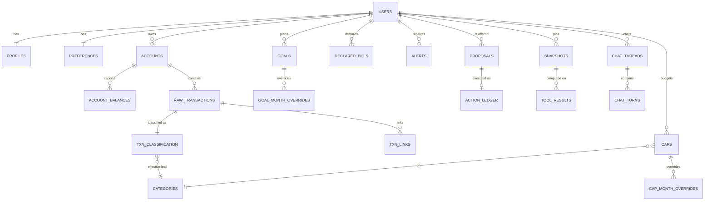

# Document 2 — Shared Data Model and Contracts (prototype)

**Rule:** every shared concept has exactly one definition — the entity schemas in `system-contracts.md` (SC). This document fixes the **prototype's physical schema** (SQLite), the module interfaces, and the HTTP API. Where the prototype stores less than SC, the omission is listed; no field changes meaning.

---

## 1. Shared conventions (from SC §4, restated for implementers)

| Concern | Convention |
| --- | --- |
| Identifiers | `<prefix>_<ULID>` text (SC §4.1). Generated only by the owning module (`shared/ids.js`). Existing integer IDs are migrated |
| Money | `INTEGER` paise in columns/fields ending `_minor`; always with `currency = 'INR'`. Unsigned; direction separate. Signed values use `_signed_minor`. Never floats |
| Ratios | Integer basis points `_bp` |
| Dates | `date` = `YYYY-MM-DD` in Asia/Kolkata; timestamps `_at` = RFC 3339 UTC; `period` = `YYYY-MM` |
| Transaction sign | `direction: DEBIT|CREDIT` + positive `amount_minor`. The movement `type` (SC §6.1) decides whether it is spend, income or neither |
| Missing data | `null` (never 0, never empty string) for unknown values; absence of history → `INSUFFICIENT_HISTORY`; uncategorized → status `UNCATEGORIZED`, never a fake category |
| Uncertainty | `confidence: HIGH|MEDIUM|LOW` on history-derived results; conservative values + `variance_band` on forecasts; `provisional` flags on data |
| Enums | `UPPER_SNAKE_CASE` |
| Errors | `ErrorBody@1 {code, message, retryable, details[]}`; HTTP body `{error, trace_id}` (SC §15) |
| Operation status | Specialist `OK|PARTIAL|NEEDS_INPUT|REJECTED|ERROR`; Sentinel `OK|<error code>`; Action `EXECUTED|…` (SC §13.5); chat `COMPLETE|PARTIAL|DEGRADED|REFUSED` |
| Versions | Per user: `categorization_version`, `plan_version`, `balance_version`; global: `taxonomy_version`, `model_version` |
| Tenancy | Every user-scoped table has `tenant_id TEXT NOT NULL DEFAULT 'demo'` and `user_id TEXT NOT NULL` (omitted below for brevity) |

---

## 2. Entity overview and ownership



| Store | Single writer (module) | Readers |
| --- | --- | --- |
| `users` | Workspace API auth routes | all (id only) |
| `profiles`, `fixed_expense_lines`, `preferences`, `declared_bills`, `accounts`, `account_balances` | `platform/profile` (user changes only via Action Service executors; accounts/balances via Ingestion) | Sentinel (read-only connection), John (preferences), API |
| `categories`, `merchants`, `merchant_aliases`, `global_rules` | Seed / release scripts only | Categorizer, API |
| `raw_transactions`, `txn_classification`, `txn_links`, `classification_events`, `review_items`, `user_categorization_state`, `user_category_rules`, `ingestion_batches`, `ingestion_errors` | `engines/categorizer` | Sentinel (read-only), John (status, search), API |
| `goals`, `goal_month_overrides`, `caps`, `cap_month_overrides`, `proposals`, `action_ledger`, `intent_tokens`, `confirmation_tokens` | `platform/action-service` (Plan Store inside it) | Sentinel (read-only), API, John |
| `alerts` | `platform/budget-monitor` | API, John |
| `version_counters`, `snapshots` | counters: each writer increments its own counter inside its transaction via `shared/versions.js`; `snapshots`: `platform/snapshot` | all |
| `tool_results` | `platform/gateway` | John validator, API (audit) |
| `event_outbox`, `event_deliveries`, `jobs`, `jobs_dead_letter` | writers append outbox rows; `platform/events` manages delivery and jobs | — |
| `chat_threads`, `chat_turns`, `rolling_summaries` | `agents/john` | API (history) |
| `traces` | each component appends its spans via `shared/trace.js` | operators |

---

## 3. Physical schema (SQLite DDL, prototype)

Notation: `NN` = NOT NULL. Every table below also has `tenant_id TEXT NN DEFAULT 'demo'`, and user-scoped tables have `user_id TEXT NN` with an index leading on `user_id`. `created_at`/`updated_at` TEXT UTC where useful.

### 3.1 Identity, profile, accounts
```sql
CREATE TABLE users (id TEXT PRIMARY KEY, email TEXT UNIQUE NN, password_hash TEXT NN, display_name TEXT NN, created_at TEXT NN);
CREATE TABLE version_counters (user_id TEXT PRIMARY KEY, categorization_version INTEGER NN DEFAULT 0,
  plan_version INTEGER NN DEFAULT 0, balance_version INTEGER NN DEFAULT 0);
CREATE TABLE profiles (user_id TEXT PRIMARY KEY, declared_income_minor INTEGER CHECK (declared_income_minor IS NULL OR declared_income_minor >= 0),
  version INTEGER NN DEFAULT 1);
CREATE TABLE fixed_expense_lines (line_id TEXT PRIMARY KEY, user_id TEXT NN, label TEXT NN CHECK (length(label) <= 40),
  category_id TEXT NN REFERENCES categories(category_id), amount_minor INTEGER NN CHECK (amount_minor > 0),
  UNIQUE (user_id, category_id));
CREATE TABLE preferences (user_id TEXT PRIMARY KEY, risk_comfort TEXT NN DEFAULT 'BALANCED' CHECK (risk_comfort IN ('CONSERVATIVE','BALANCED','AGGRESSIVE')),
  protected_category_ids TEXT NN DEFAULT '[]',  -- JSON array of category IDs
  language TEXT NN DEFAULT 'en-IN', llm_processing_consent INTEGER NN DEFAULT 0, version INTEGER NN DEFAULT 1);
CREATE TABLE accounts (account_id TEXT PRIMARY KEY, user_id TEXT NN, bank_account_ref_hash TEXT, account_type TEXT NN
  CHECK (account_type IN ('SAVINGS','CURRENT','CREDIT_CARD','MANUAL_CASH')), display_name TEXT NN, masked_number TEXT,
  currency TEXT NN DEFAULT 'INR' CHECK (currency = 'INR'), source TEXT NN CHECK (source IN ('BANK_FEED','MANUAL')),
  status TEXT NN DEFAULT 'ACTIVE', version INTEGER NN DEFAULT 1, UNIQUE (user_id, bank_account_ref_hash));
CREATE TABLE account_balances (balance_id TEXT PRIMARY KEY, user_id TEXT NN, account_id TEXT NN REFERENCES accounts,
  balance_minor INTEGER NN CHECK (balance_minor >= 0), balance_sign TEXT NN CHECK (balance_sign IN ('CREDIT','DEBIT')),
  as_of TEXT NN, source TEXT NN CHECK (source IN ('BANK_CLOSING_BALANCE','BANK_AVAILABLE_BALANCE','DERIVED_FROM_LAST_TRANSACTION','MANUAL')));
CREATE TABLE declared_bills (bill_id TEXT PRIMARY KEY, user_id TEXT NN, label TEXT NN, category_id TEXT, amount_minor INTEGER NN CHECK (amount_minor > 0),
  due_date TEXT NN, recurrence TEXT NN CHECK (recurrence IN ('NONE','MONTHLY','QUARTERLY','YEARLY')),
  status TEXT NN DEFAULT 'ACTIVE' CHECK (status IN ('ACTIVE','PAID','CANCELLED')), version INTEGER NN DEFAULT 1);
```
Omitted vs SC: history tables for these stores (ADR-05).

### 3.2 Taxonomy, merchants, rules
```sql
CREATE TABLE categories (category_id TEXT PRIMARY KEY, parent_id TEXT, label TEXT NN, kind TEXT NN CHECK (kind IN ('EXPENSE','INCOME')),
  status TEXT NN DEFAULT 'ACTIVE', taxonomy_version INTEGER NN, replaced_by TEXT);        -- seeded from Categorizer spec §C.6
CREATE TABLE merchants (merchant_id TEXT PRIMARY KEY, name TEXT UNIQUE NN, default_category_id TEXT REFERENCES categories);
CREATE TABLE merchant_aliases (alias_id TEXT PRIMARY KEY, scope TEXT NN CHECK (scope IN ('GLOBAL','USER')), user_id TEXT,
  pattern TEXT NN, match_type TEXT NN CHECK (match_type IN ('EXACT','VPA','TOKEN')), merchant_id TEXT NN REFERENCES merchants,
  UNIQUE (scope, user_id, pattern, match_type));
CREATE TABLE global_rules (rule_id TEXT PRIMARY KEY, tier TEXT NN CHECK (tier IN ('E2','E3')), conditions TEXT NN, -- JSON
  category_id TEXT NN, enabled INTEGER NN DEFAULT 1, version INTEGER NN);
CREATE TABLE user_category_rules (rule_id TEXT PRIMARY KEY, user_id TEXT NN, conditions TEXT NN, category_id TEXT NN,
  priority INTEGER NN, enabled INTEGER NN DEFAULT 1, created_from_action_id TEXT, version INTEGER NN DEFAULT 1);
```

### 3.3 Ingestion and transactions (Item Categorizer)
```sql
CREATE TABLE ingestion_batches (batch_id TEXT PRIMARY KEY, idempotency_key TEXT NN, source_format TEXT NN, mapping_profile_id TEXT,
  status TEXT NN CHECK (status IN ('PROCESSING','COMPLETED','COMPLETED_WITH_ERRORS','FAILED')), counts TEXT NN DEFAULT '{}',
  progress TEXT NN DEFAULT '{}', created_at TEXT NN, UNIQUE (tenant_id, idempotency_key));
CREATE TABLE ingestion_errors (batch_id TEXT NN, row_index INTEGER NN, code TEXT NN, field TEXT, PRIMARY KEY (batch_id, row_index));
CREATE TABLE raw_transactions (txn_id TEXT PRIMARY KEY, user_id TEXT NN, account_id TEXT NN REFERENCES accounts, batch_id TEXT NN,
  bank_txn_ref TEXT NN, row_hash TEXT NN, booking_date TEXT NN, value_date TEXT, date TEXT NN,
  description_raw TEXT NN, amount_minor INTEGER NN CHECK (amount_minor > 0), currency TEXT NN DEFAULT 'INR',
  direction TEXT NN CHECK (direction IN ('DEBIT','CREDIT')), posting_status TEXT NN CHECK (posting_status IN ('PENDING','POSTED')),
  source TEXT NN CHECK (source IN ('BANK_FEED','MANUAL')), channel TEXT, bank_tx_code TEXT, mcc TEXT,
  counterparty TEXT, balance_after_minor INTEGER, balance_after_sign TEXT, original_txn_ref TEXT,
  UNIQUE (user_id, account_id, bank_txn_ref), UNIQUE (user_id, account_id, row_hash));
  -- immutable: no UPDATE/DELETE statements exist in the repository module (enforced by test + trigger RAISE(ABORT))
CREATE TABLE txn_classification (txn_id TEXT PRIMARY KEY REFERENCES raw_transactions, user_id TEXT NN,
  description_clean TEXT NN, rail TEXT NN, counterparty_text TEXT, vpa TEXT,
  merchant_id TEXT, merchant_name TEXT, merchant_match TEXT NN, type TEXT NN, counterpart_missing INTEGER NN DEFAULT 0,
  pred_category_id TEXT, pred_method TEXT NN, evidence_tier TEXT, confidence_band TEXT NN, pred_evidence TEXT NN DEFAULT '[]',
  rule_id TEXT, confirmed_category_id TEXT, confirmed_at TEXT, confirmed_scope TEXT,
  effective_category_id TEXT, effective_status TEXT NN CHECK (effective_status IN ('CONFIRMED','AUTO','NEEDS_REVIEW','UNCATEGORIZED','NOT_APPLICABLE')),
  superseded_by TEXT, taxonomy_version INTEGER NN, pipeline_version TEXT NN, categorization_version INTEGER NN, row_version INTEGER NN DEFAULT 1,
  CHECK (effective_status <> 'CONFIRMED' OR confirmed_category_id IS NOT NULL));
CREATE TABLE txn_links (user_id TEXT NN, from_txn_id TEXT NN, to_txn_id TEXT NN,
  kind TEXT NN CHECK (kind IN ('TRANSFER_PAIR','CARD_PAYMENT_PAIR','REFUND_OF','DUPLICATE_OF','SUPERSEDES')), PRIMARY KEY (from_txn_id, to_txn_id, kind));
CREATE TABLE classification_events (event_id TEXT PRIMARY KEY, user_id TEXT NN, txn_id TEXT NN, event_type TEXT NN, before TEXT, after TEXT,
  actor TEXT NN, pipeline_version TEXT NN, categorization_version INTEGER NN, correlation_id TEXT, created_at TEXT NN);
CREATE TABLE review_items (item_id TEXT PRIMARY KEY, user_id TEXT NN, txn_id TEXT NN, reason TEXT NN,
  status TEXT NN DEFAULT 'OPEN' CHECK (status IN ('OPEN','RESOLVED','DISMISSED')), created_at TEXT NN);
CREATE UNIQUE INDEX ux_review_open ON review_items(user_id, txn_id, reason) WHERE status = 'OPEN';
CREATE TABLE user_categorization_state (user_id TEXT PRIMARY KEY, data_quality TEXT NN, -- DataQuality@1 JSON
  updated_at TEXT NN);
```
Omitted vs Categorizer spec: `txn_classification_history` (ADR-05; `classification_events` still records before/after for audit and undo), `own_account_counterparties` (action deferred).

### 3.4 Plan state (Action Service / Plan Store)
```sql
CREATE TABLE goals (goal_id TEXT PRIMARY KEY, user_id TEXT NN, name TEXT NN CHECK (length(name) BETWEEN 1 AND 40),
  target_minor INTEGER NN CHECK (target_minor > 0), saved_minor INTEGER NN DEFAULT 0 CHECK (saved_minor >= 0 AND saved_minor <= target_minor),
  monthly_add_minor INTEGER NN DEFAULT 0 CHECK (monthly_add_minor >= 0), deadline TEXT,
  priority_tier TEXT NN CHECK (priority_tier IN ('HIGH','MEDIUM','LOW')),
  status TEXT NN CHECK (status IN ('ACTIVE','PAUSED','COMPLETED','ARCHIVED')), archived_at TEXT, restore_until TEXT,
  currency TEXT NN DEFAULT 'INR', version INTEGER NN DEFAULT 1);
CREATE UNIQUE INDEX ux_goal_name ON goals(user_id, lower(name)) WHERE status <> 'ARCHIVED';
CREATE TABLE goal_month_overrides (override_id TEXT PRIMARY KEY, user_id TEXT NN, goal_id TEXT NN REFERENCES goals, period TEXT NN,
  monthly_add_minor INTEGER NN CHECK (monthly_add_minor >= 0), version INTEGER NN DEFAULT 1, UNIQUE (goal_id, period));
CREATE TABLE caps (cap_id TEXT PRIMARY KEY, user_id TEXT NN, category_id TEXT NN REFERENCES categories,
  amount_minor INTEGER NN CHECK (amount_minor >= 0), status TEXT NN DEFAULT 'ACTIVE', version INTEGER NN DEFAULT 1);
CREATE UNIQUE INDEX ux_cap_active ON caps(user_id, category_id) WHERE status = 'ACTIVE';
CREATE TABLE cap_month_overrides (override_id TEXT PRIMARY KEY, user_id TEXT NN, cap_id TEXT NN REFERENCES caps, period TEXT NN,
  amount_minor INTEGER NN CHECK (amount_minor >= 0), origin TEXT NN CHECK (origin IN ('REBALANCE','USER_EDIT','PLAN')),
  version INTEGER NN DEFAULT 1, UNIQUE (cap_id, period));
CREATE TABLE proposals (proposal_id TEXT PRIMARY KEY, user_id TEXT NN, action TEXT NN, params TEXT NN, params_hash TEXT NN,
  tier TEXT NN, origin TEXT NN, proposer TEXT NN, base_versions TEXT NN, snapshot_id TEXT NN, warnings TEXT NN DEFAULT '[]',
  requires_ack INTEGER NN DEFAULT 0, dry_run TEXT, state TEXT NN, target_key TEXT NN, expires_at TEXT NN, created_at TEXT NN,
  request_id TEXT, trace_id TEXT);
CREATE TABLE action_ledger (action_id TEXT PRIMARY KEY, user_id TEXT NN, proposal_id TEXT, action TEXT NN, params TEXT NN,
  idempotency_key TEXT NN, status TEXT NN, rule_codes TEXT NN DEFAULT '[]', result TEXT, new_versions TEXT,
  inverse TEXT,            -- JSON {action, params} used by undo
  undo_until TEXT, undone_by TEXT, executed_at TEXT NN, UNIQUE (user_id, idempotency_key));
CREATE TABLE intent_tokens (token_hash TEXT PRIMARY KEY, user_id TEXT NN, action TEXT NN, params_hash TEXT NN, origin TEXT NN,
  expires_at TEXT NN, used_at TEXT);
CREATE TABLE confirmation_tokens (token_hash TEXT PRIMARY KEY, user_id TEXT NN, proposal_id TEXT NN, params_hash TEXT NN,
  expires_at TEXT NN, used_at TEXT);
```

### 3.5 Alerts, snapshots, tool results, events, chat, traces
```sql
CREATE TABLE alerts (alert_id TEXT PRIMARY KEY, user_id TEXT NN, kind TEXT NN CHECK (kind IN ('CAP_TIER','ANOMALY','CASHFLOW_RISK','WATCH')),
  state TEXT NN CHECK (state IN ('OPEN','DISMISSED','RESOLVED')), severity TEXT NN, subject TEXT NN, tier TEXT, provisional INTEGER NN,
  snapshot_id TEXT NN, evidence_tool_result_id TEXT, cause TEXT NN, dedupe_key TEXT NN, created_at TEXT NN, resolved_at TEXT);
CREATE UNIQUE INDEX ux_alert_open ON alerts(user_id, dedupe_key) WHERE state IN ('OPEN','DISMISSED');
CREATE TABLE snapshots (snapshot_id TEXT PRIMARY KEY, user_id TEXT NN, created_at TEXT NN, as_of_date TEXT NN,
  categorization_version INTEGER NN, plan_version INTEGER NN, balance_version INTEGER NN,
  taxonomy_version INTEGER NN, model_version TEXT NN, reason TEXT NN);
CREATE TABLE tool_results (tool_result_id TEXT PRIMARY KEY, user_id TEXT NN, request_id TEXT NN, task_id TEXT, caller TEXT NN,
  function TEXT NN, params TEXT NN, params_hash TEXT NN, snapshot_id TEXT NN, envelope TEXT NN, created_at TEXT NN);
CREATE TABLE event_outbox (event_id TEXT PRIMARY KEY, user_id TEXT NN, type TEXT NN, payload TEXT NN, created_at TEXT NN);
CREATE TABLE event_deliveries (event_id TEXT NN, handler TEXT NN, status TEXT NN, attempts INTEGER NN DEFAULT 0, last_error TEXT,
  next_attempt_at TEXT, PRIMARY KEY (event_id, handler));
CREATE TABLE jobs (job_name TEXT PRIMARY KEY, locked_until TEXT, last_run_at TEXT, last_status TEXT);
CREATE TABLE jobs_dead_letter (id TEXT PRIMARY KEY, source TEXT NN, ref TEXT NN, error TEXT NN, created_at TEXT NN);
CREATE TABLE chat_threads (thread_id TEXT PRIMARY KEY, user_id TEXT NN, workspace TEXT NN, created_at TEXT NN, last_turn_at TEXT NN,
  pending_question TEXT);
CREATE TABLE chat_turns (turn_id TEXT PRIMARY KEY, thread_id TEXT NN REFERENCES chat_threads, user_id TEXT NN, role TEXT NN CHECK (role IN ('USER','JOHN')),
  text TEXT NN, blocks TEXT, request_id TEXT, snapshot_id TEXT, client_message_id TEXT, status TEXT, created_at TEXT NN,
  UNIQUE (thread_id, client_message_id));
CREATE TABLE rolling_summaries (thread_id TEXT PRIMARY KEY, summary TEXT NN CHECK (length(summary) <= 800), through_turn_id TEXT NN, updated_at TEXT NN);
CREATE TABLE traces (trace_id TEXT NN, span_id TEXT NN, user_id TEXT, component TEXT NN, name TEXT NN, attrs TEXT NN, started_at TEXT NN,
  duration_ms INTEGER, PRIMARY KEY (trace_id, span_id));
```
Omitted vs SC: `memory_facts`, `alert_narratives` cache (deferred, Overview §3.2).

### 3.6 Persistence rules
- All writes of one action/chunk happen in **one** `db.transaction(...)` that also increments the relevant counter and inserts the outbox event.
- Raw transactions are immutable (trigger `BEFORE UPDATE/DELETE ON raw_transactions → RAISE(ABORT)`).
- JSON columns hold JSON validated by the owning module against its schema before insert.
- Counters only increase.

---

## 4. Entity specifications

Field semantics are the SC definitions; this table states purpose, required fields, validation, ownership and permitted modifications for the prototype.

| Entity | Purpose | Required fields | Key validation | Permitted modifications |
| --- | --- | --- | --- | --- |
| User | Login identity | id, email, password_hash, display_name | email unique; bcrypt | Created at signup only |
| Profile (`profiles` + `fixed_expense_lines`) | Declared income and fixed expenses (SC §5.4, §6.4) | user_id | income ≥ 0 or null; fixed lines: category expense-type, unique, no parent/leaf overlap, not currently capped | `UPDATE_PROFILE` (T2) |
| Preferences | Risk comfort, protected categories, consent (SC §5.5) | all | enums; IDs exist | `UPDATE_PREFERENCE` (T1) |
| Account / AccountBalance | Accounts and balances (SC §5.1–5.2) | per DDL | account belongs to user; balance precedence rule | Ingestion only (MANUAL_CASH created on first manual entry) |
| DeclaredBill | User-declared recurring bills (replaces Subscriptions) | per DDL | amount > 0; due date valid; recurrence enum | `ADD_DECLARED_BILL`, `DELETE_DECLARED_BILL` (T1) |
| Category | Taxonomy v1 (Categorizer §C.6) | id, label, kind, version | IDs never reused | Seed only |
| RawTransaction | Bank or manual row (SC §5.3 source fields) | per DDL | Categorizer §B.2.1 rejection codes | Insert only |
| Classification | Type, merchant, category, status (Categorizer §C.3) | per DDL | effective status rules; leaf category only | Pipeline; `RECATEGORIZE_TRANSACTION`, `CONFIRM_CATEGORY`, `UNDO_CLASSIFICATION_CHANGE` via Action Service |
| Link | Pairs and supersessions | per DDL | both rows same user | Pipeline only (link actions deferred) |
| ReviewItem | Items needing user attention | per DDL | one open per (txn, reason) | Pipeline; `DISMISS_REVIEW_ITEM`; John `addReviewItem(SPECIALIST_HINT)` |
| Goal (+ month override) | Virtual earmark (SC §5.6) | per DDL | Sentinel goal rules (same library) | Goal actions (T2/T3) via Action Service |
| Cap (+ month override) | Standing and per-month budgets (SC §5.7) | per DDL | Sentinel cap rules; exclusive hierarchy | `ADJUST_BUDGET_CAP`, `REMOVE_CAP`, `APPLY_REBALANCE`; `PERIOD_ROLLOVER` (system) |
| Alert | Monitor output (SC §5.9) | per DDL | dedupe key per kind | Monitor; `DISMISS_ALERT` (T1) |
| Proposal / Ledger / Tokens | Consent and execution (SC §13) | per DDL | state machine SC §13.3 | Action Service only |
| Snapshot | Version tuple (SC §7.2) | per DDL | — | Insert only |
| ToolResult | Stored `SentinelResult@1` for grounding and audit | per DDL | envelope schema | Insert only (Gateway) |
| Chat thread/turn/summary | Conversation (John §C.4) | per DDL | text ≤ limits; summary sanitized | John only; user may delete a thread |

---

## 5. Module interfaces (in-process; the only cross-module entry points)

Signatures are JSDoc-typed CommonJS exports. `session = {userId, tenantId, consent}`; `ctx` objects are built by the caller module named.

### 5.1 `shared/`
```js
ids.newId(prefix) -> string
money.parseRupeesToMinor(str) -> int            // exact string parsing; throws INVALID_INPUT
money.formatInr(minor, {paise:false}) -> string // Indian grouping
time.today() -> 'YYYY-MM-DD' (IST); time.periodOf(date) -> 'YYYY-MM'; time.daysInMonth(period) -> int
versions.bump(tx, userId, counter) -> int       // inside caller's transaction
contracts.validate(schemaName, value) -> value  // throws SCHEMA_VIOLATION with Ajv errors
grounding.bind(text, sources) -> {text, violations[]}; grounding.check(text) -> violations[]
finance.movement.isSpend(row) / isIncome(row); finance.coverage.compute(rows) -> bp|null
events.append(tx, userId, type, payload)        // outbox insert inside caller's transaction
trace.span(ctx, component, name, fn)
```

### 5.2 Ingestion (`platform/ingestion`)
```js
ingest({ format: 'CANONICAL_JSON'|'CSV', body, mappingProfileId?, idempotencyKey }, ctx) -> { batchId, status: 'ACCEPTED' }
getBatch(batchId, ctx) -> IngestionBatch
```
Converts input to `CanonicalBatch@1` (SC §17.7), upserts accounts/balances via Profile, then calls `categorizer.ingestBatch`.

### 5.3 Item Categorizer (`engines/categorizer`)
```js
ingestBatch(canonicalBatch, ctx) -> {batchId, status}
ingestManual(ManualEntry, actionCtx) -> {txnId, categorizationVersion, result}
applyChange({action, params}, actionCtx) -> {changedTxnIds, categorizationVersion, rowVersions, inverse}
dryRun({action, params}, actionCtx) -> {affected:{updated, skippedConfirmed, skippedChanged}}
getStatus(session) -> DataQuality@1 & {taxonomyVersion, lastEventAt}
listTransactions(filters, page, session) -> {items: TransactionView[], nextCursor}
getTransaction(txnId, session) -> TransactionView & {evidence[], events[]}
listReviewItems(session) -> ReviewItem[]
addReviewItem({txnId, reason:'SPECIALIST_HINT'}, session) -> ReviewItem
readTransactionsForSnapshot(userId, period range, conn) -> Transaction@1[]   // used by Sentinel only, read-only connection
```

### 5.4 Sentinel (`engines/sentinel`)
```js
run(functionName, params, { snapshot, caller, requestId, traceId, signal }) -> SentinelResult@1
rules.validateGoalChange(state, op) / validateCapChange(state, change) / validateRebalance(state, transfers)
     / checkAvailableBalance(state, amountMinor) / validateProfile(state, profile) -> {verdict, rule_codes, warnings}
rules.loadState(userId, conn) -> state                // current state for the Action Service
```

### 5.5 Platform
```js
snapshot.create(reason, session) -> Snapshot@1; snapshot.get(id, session); snapshot.assertCurrent(snap, conn) // throws DATA_STALE
gateway.callTool({tool, params}, {caller, requestId, taskId, traceId, snapshotId, deadlineMs, signal, arbitration?}, session) -> SentinelResult@1
gateway.verifyResultOwnership(toolResultIds, requestId, session) -> boolean
gateway.getResult(toolResultId, session) -> SentinelResult@1
actionService.createProposal({action, params, tier?, origin, proposer, snapshotId, requestId, traceId}, session) -> Proposal@1 | {rejected: rule_codes}
actionService.confirmAndExecute(proposalId, {paramsHash, ack}, session) -> ActionResult@1
actionService.issueIntentToken({action, params, origin}, session) -> token        // Workspace API taps, John rule layer
actionService.executeT1({action, params, intentToken, idempotencyKey}, session) -> ActionResult@1
actionService.undo(actionId, session) -> ActionResult@1
actionService.declineProposal(proposalId, session); actionService.getProposal(proposalId, session)
planStore.readGoals/readCaps(userId, period, conn)     // used by Sentinel through rules.loadState / snapshot inputs
profile.getPreferences(session); profile.getProfile(session); profile.listAccounts(userId); profile.balances(userId, conn)
budgetMonitor.onEvent(Event@1); budgetMonitor.runDailyScan(userId); budgetMonitor.listAlerts(filters, session); budgetMonitor.dismiss(alertId, actionCtx)
llm.complete({modelClass, system, messages, jsonSchema, maxTokens, temperature, timeoutMs, signal, traceId}) -> {json?, text?, usage, model, provider}
```

### 5.6 Agents
```js
agents.atlas.invoke(TaskPacket@1, {signal}) -> SpecialistResponse@1   // same for nova, iris
agents.shared.runner.run(config, packet, {signal}) -> SpecialistResponse@1
agents.john.handleMessage(ChatRequest@1, session, emit) -> ChatResponse@1
agents.john.onVersionEvent(Event@1)
```

---

## 6. HTTP API (Workspace API, `/api/v1`, JSON, JWT bearer)

| Method & path | Request | Response | Notes |
| --- | --- | --- | --- |
| `POST /auth/signup`, `POST /auth/login`, `GET /auth/me` | existing | existing | Existing routes moved under v1 |
| `POST /onboarding` | `{display_name, declared_income_minor?, fixed_lines[], risk_comfort, protected_category_ids[], llm_processing_consent, first_goal?}` | `{profile, preferences}` | Executes `UPDATE_PROFILE`/`UPDATE_PREFERENCE`/`CREATE_GOAL` with `origin: UI_FORM` in one go |
| `GET /workspaces/john` | — | `{snapshot, surplus, bills, cashflow}` | Health strip |
| `GET /workspaces/atlas` | — | `{snapshot, goals:[{goal, progress: SentinelResult}], surplus}` | |
| `POST /workspaces/atlas/validate` | `{operation, …goal fields}` | `{validation, feasibility?, balance?}` | Pre-validation only |
| `POST /workspaces/atlas/sip` | SIP params | `SentinelResult` | Illustrative label |
| `GET /workspaces/nova` | — | `{snapshot, caps:[{cap, utilization, velocity}], alerts}` | |
| `POST /workspaces/nova/validate-cap` | `{category_id, new_cap_minor, scope, override_protected?}` | `SentinelResult` | |
| `POST /workspaces/nova/rebalance` | `{deficit_category_id}` | `{result, proposal}` | Creates `APPLY_REBALANCE` proposal (proposer USER) |
| `GET /workspaces/iris` | — | `{snapshot, bills, baseline_simulation}` | |
| `POST /workspaces/iris/simulate` | simulation params | `SentinelResult` | Deterministic planner |
| `GET /workspaces/sentinel/overview` · `/spending` · `/timeseries` · `/forecast` | query params | view JSON + `snapshot` + `data_quality` | |
| `GET /transactions`, `GET /transactions/:id`, `GET /review-queue`, `GET /categorization/status` | filters | Categorizer views | |
| `POST /proposals` | `{action, params}` | `Proposal@1` + rendered card | Form submissions for T2/T3 |
| `POST /proposals/:id/confirm` | `{params_hash, ack?}` | `ActionResult@1` | Issues confirmation token and executes |
| `POST /proposals/:id/decline` | — | `{state}` | |
| `POST /actions` | `{action, params, idempotency_key}` | `ActionResult@1` | T1 taps; server issues the intent token internally for the authenticated tap |
| `POST /actions/:id/undo` | — | `ActionResult@1` | |
| `GET /alerts` | `?kind=&state=` | `Alert@1[]` | |
| `GET /notifications` | — | recent `alert.changed` entries | In-app bell |
| `POST /chat/messages` | `ChatRequest@1` | SSE stream of `ChatResponse@1` blocks | |
| `GET /chat/threads`, `GET /chat/threads/:id` | — | thread + turns | |
| `GET /profile`, `GET /preferences` | — | current values | Changes go through `/proposals` or `/actions` |
| `POST /demo/ingest` | `{format, body, mapping_profile_id?}` | `{batch_id, status}` | Only when `DEMO_CONTROLS=true`; labelled bank-feed simulator |
| `POST /demo/daily-scan` | — | `{alerts_created}` | Only when `DEMO_CONTROLS=true` |
| `GET /health` | — | `{status, db, llm, dead_letters}` | |

---

## 7. Example records and payloads

### 7.1 Canonical batch (demo dataset excerpt)
```json
{"batch_id": "imp_01JABCDXYZ0000000000000001", "tenant_code": "demo", "source_format": "JSON", "generated_at": "2026-10-01T03:00:00Z",
 "customers": [{"customer_ref": "DEMO-CUST-1", "accounts": [
   {"bank_account_ref": "SB-001", "masked_number": "XXXXXX4521", "account_type": "SAVINGS", "currency": "INR",
    "balances": [{"kind": "CLOSING_BOOKED", "amount_minor": 18450000, "sign": "CREDIT", "as_of": "2026-09-30T18:29:59Z"}],
    "transactions": [
     {"bank_txn_ref": "UTR-88213", "booking_date": "2026-09-03", "amount_minor": 64800, "direction": "DEBIT", "posting_status": "POSTED",
      "description_raw": "UPI/P2M/SWIGGY/9876543210@ybl/Order 77", "channel": "UPI", "counterparty": {"vpa": "swiggy@ybl"}},
     {"bank_txn_ref": "NEFT-1101", "booking_date": "2026-09-01", "amount_minor": 9500000, "direction": "CREDIT", "posting_status": "POSTED",
      "description_raw": "NEFT CR ACME TECH PVT LTD SALARY SEP", "channel": "NEFT"},
     {"bank_txn_ref": "BBPS-552", "booking_date": "2026-09-12", "amount_minor": 2310000, "direction": "DEBIT", "posting_status": "POSTED",
      "description_raw": "BBPS CC PAYMENT HDFC CARD XX9921", "channel": "OTHER"}]},
   {"bank_account_ref": "CC-9921", "masked_number": "XXXXXXXXXXXX9921", "account_type": "CREDIT_CARD", "currency": "INR",
    "transactions": [
     {"bank_txn_ref": "CC-PAY-552", "booking_date": "2026-09-12", "amount_minor": 2310000, "direction": "CREDIT", "posting_status": "POSTED",
      "description_raw": "PAYMENT RECEIVED THANK YOU", "channel": "OTHER"}]}]}]}
```
Expected classification: Swiggy → `EXPENSE`, `FOOD.DELIVERY`, `AUTO` (E2 VPA alias); salary → `INCOME`, `INCOME.SALARY`; the two card-payment rows → `CARD_PAYMENT` + `CARD_PAYMENT_PAIR` (not spend).

### 7.2 Classification row (stored)
```json
{"txn_id": "txn_01JA…", "type": "EXPENSE", "merchant_id": "mer_swiggy", "merchant_name": "Swiggy", "merchant_match": "VPA",
 "pred_category_id": "FOOD.DELIVERY", "pred_method": "MERCHANT_ALIAS", "evidence_tier": "E2", "confidence_band": "HIGH",
 "pred_evidence": ["VPA swiggy@ybl matched merchant mer_swiggy"], "effective_category_id": "FOOD.DELIVERY", "effective_status": "AUTO",
 "taxonomy_version": 1, "pipeline_version": "1.0.0", "categorization_version": 3, "row_version": 1}
```

### 7.3 Sentinel result
```json
{"tool_result_id": "trs_01JB…", "function": "sentinel_run_category_utilization", "status": "OK",
 "data": {"category_id": "FOOD.DINING", "period": "2026-10", "cap_minor": 1200000, "covered_category_ids": ["FOOD.DINING"],
          "spent_signed_minor": 1104000, "spent_total_minor": 1104000, "spent_settled_minor": 1056000, "spent_provisional_minor": 48000,
          "utilization_bp": 9200, "remaining_signed_minor": 96000, "tier": "WARNING", "tier_is_provisional": false},
 "confidence": "HIGH", "variance_band": null, "data_as_of": "2026-10-10", "snapshot_id": "snap_01JB…", "categorization_version": 7,
 "data_quality": {"categorization_version": 7, "coverage_by_amount_bp": 9340, "uncategorized_amount_minor": 210000, "provisional_amount_minor": 48000,
   "unclassified_movement_amount_minor": 0, "card_payment_unmatched_minor": 0, "needs_review_count": 3, "uncategorized_count": 2,
   "pending_pipeline_count": 0, "import_in_progress": false, "complete": true},
 "constraint_codes": [], "computed_at": "2026-10-10T08:14:03Z", "model_version": "1.0.0", "params_hash": "a41f…"}
```
(The demo seeds leaf caps on `FOOD.DINING`, `FOOD.GROCERIES` and `FOOD.DELIVERY`, so a Dining ↔ Groceries correction moves spend between two caps.)

### 7.4 Task packet and specialist response (abridged)
```json
{"schema": "TaskPacket@1", "request_id": "req_…", "trace_id": "trc_…", "task_id": "tsk_…", "specialist": "NOVA", "task_type": "BREACH_EVENT",
 "snapshot_id": "snap_…", "trigger": {"kind": "ALERT_OPEN", "alert_id": "alr_…"}, "user_message": null,
 "ui_context": {"workspace": "NOVA", "selected_alert_id": "alr_…"}, "task_params": {"alert_id": "alr_…", "category_id": "FOOD.DINING"},
 "data_quality": {"…": "…"}, "context": {"preferences": {"risk_comfort": "BALANCED", "protected_category_ids": ["HEALTH", "HOUSING.RENT"]},
 "rolling_summary": "", "recent_turns": [], "peer_findings": []},
 "allowed_tools": ["sentinel_get_ledger_summary", "sentinel_run_category_utilization", "sentinel_run_velocity_projection", "sentinel_detect_anomalies", "sentinel_run_rebalance_simulation", "sentinel_validate_cap_change"],
 "budget": {"max_tool_calls": 4, "deadline_ms": 8000}, "output_schema": "SpecialistResponse@1"}
```
```json
{"schema": "SpecialistResponse@1", "request_id": "req_…", "task_id": "tsk_…", "specialist": "NOVA", "status": "OK",
 "headline": {"finding_id": "f1", "kind": "CALCULATION", "text": "Dining is at {{trs_U:/data/utilization_bp|bp_pct}} of its cap with {{trs_V:/data/days_remaining|days}} days left.", "tool_result_ids": ["trs_U", "trs_V"]},
 "findings": [{"finding_id": "f2", "kind": "PREDICTION", "text": "At this pace Dining ends the month near {{trs_V:/data/categories/0/projected_month_end_minor|inr}}.", "tool_result_ids": ["trs_V"]}],
 "constraints": [], "proposed_actions": [{"action_ref": "a1", "action": "APPLY_REBALANCE",
   "params": {"period": "2026-10", "transfers": [{"from_category_id": "ENTERTAINMENT", "to_category_id": "FOOD.DINING", "amount_minor": 150000}]},
   "validation_tool_result_id": "trs_R", "rationale_finding_id": "f3"}],
 "questions_for_user": [], "peer_hints": [], "data_quality_notes": [], "confidence": "HIGH", "tool_result_ids": ["trs_U", "trs_V", "trs_R"],
 "domain": {"kind": "NovaDomain@1", "category_status": [{"category_id": "FOOD.DINING", "utilization_tool_result_id": "trs_U", "velocity_tool_result_id": "trs_V"}],
   "boundary_alerts": [{"alert_id": "alr_…", "tier": "WARNING", "provisional": false, "tool_result_id": "trs_U"}], "daily_envelope": null}}
```

### 7.5 Proposal card and action result
```json
{"proposal_id": "prp_…", "action": "APPLY_REBALANCE", "tier": "T2", "origin": "CHAT_PROPOSAL", "proposer": "NOVA", "state": "PROPOSED",
 "params_hash": "9c0e…", "warnings": [], "requires_ack": false, "expires_at": "2026-10-10T08:44:03Z",
 "card": {"title": "Move ₹1,500 of this month's budget", "lines": ["Entertainment: ₹4,000 → ₹2,500 (October only)", "Dining: ₹12,000 → ₹13,500 (October only)"]}}
```
```json
{"action_id": "act_…", "proposal_id": "prp_…", "status": "EXECUTED", "rule_codes": [],
 "result": {"cap_month_overrides": [{"category_id": "ENTERTAINMENT", "period": "2026-10", "amount_minor": 250000}, {"category_id": "FOOD.DINING", "period": "2026-10", "amount_minor": 1350000}]},
 "new_versions": {"plan": 12}, "undo_available_until": null, "executed_at": "2026-10-10T08:15:10Z"}
```
