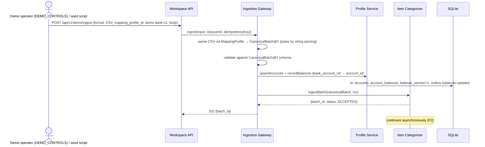
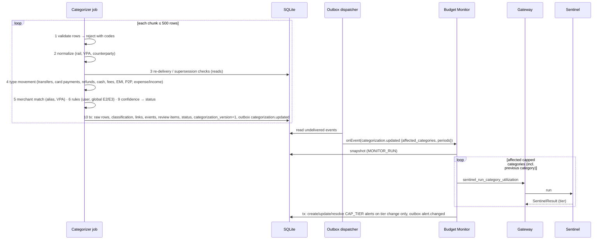
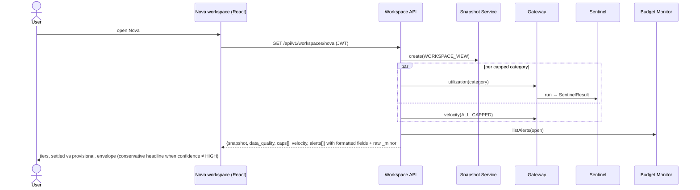
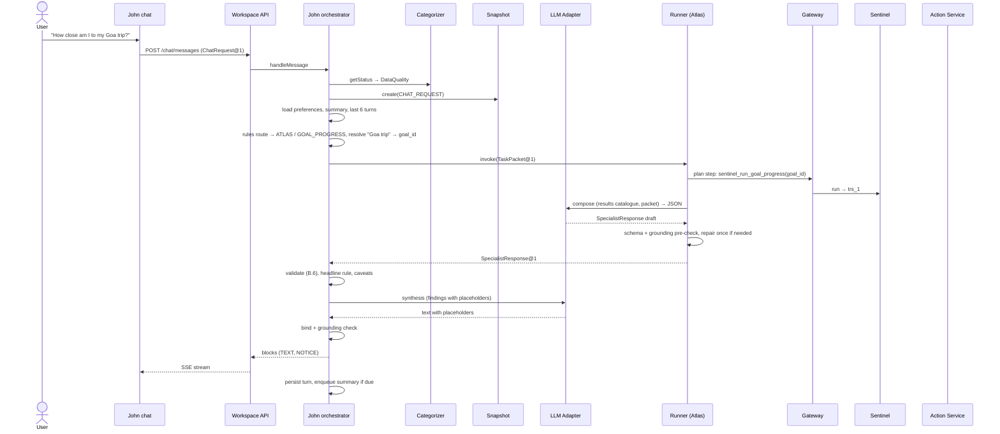
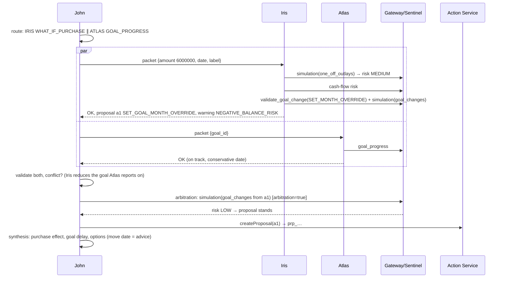
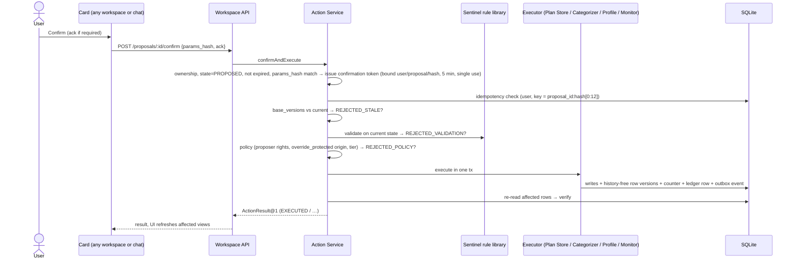
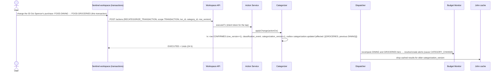

# Document 3 — End-to-End Data Flows (prototype)

Eleven flows cover every path from data entering the system to results on screen and back. Each flow names the responsible component, the data passed, the output, and failure paths. Diagrams use Mermaid.

| # | Flow | Primary components |
| --- | --- | --- |
| F1 | Bank-batch ingestion | Ingestion Gateway, Profile, Categorizer |
| F2 | Normalization, typing, categorization, events | Categorizer, Outbox, Budget Monitor |
| F3 | Workspace view (persistence → retrieval → render) | Workspace API, Snapshot, Gateway, Sentinel |
| F4 | Chat: one specialist | John, Atlas/Nova/Iris, Gateway, Sentinel, LLM |
| F5 | Chat: parallel specialists, dependency edge, arbitration | John, specialists, Sentinel |
| F6 | Confirmation and execution of a proposal | Workspace API, Action Service, rule library, executors, Outbox |
| F7 | Budget change → re-evaluation | Action Service, Plan Store, Budget Monitor, Sentinel |
| F8 | Category correction → propagation | Action Service, Categorizer, Budget Monitor, John cache |
| F9 | Savings goal change via form | Workspace API, Sentinel validators, Action Service |
| F10 | Alert open → lazy narrative | Budget Monitor, John, Nova |
| F11 | Failure handling (missing info, invalid request, timeout, component failure) | All |

---

## F1 — Bank-batch ingestion

| Item | Detail |
| --- | --- |
| Responsible | Ingestion Gateway (format → canonical), Profile (accounts, balances), Categorizer (transactions) |
| Data in | CSV or canonical JSON; idempotency key = SHA-256 of body unless supplied |
| Output | `ingestion_batches` row; accounts and balances; transactions processed in F2 |
| Failure paths | Unreadable file or schema-invalid canonical batch → batch `FAILED`, 422 with `INVALID_INPUT` details, nothing written. Same key + same body → returns the original batch (no new rows). Same key + different body → 409 `IDEMPOTENCY_KEY_REUSED`. Unknown account ref → created (bank master data) for the batch's customer; rows for accounts of another customer → row rejection `UNKNOWN_ACCOUNT` |

---

## F2 — Normalization, typing, categorization, events

| Item | Detail |
| --- | --- |
| Responsible | Categorizer (steps per Categorizer §B.2), Budget Monitor (tiers) |
| Data | Canonical rows → `raw_transactions` + `txn_classification` (+ links, review items) |
| Output | New `categorization_version`; `DataQuality@1` refreshed; alerts for tier changes |
| Failure paths | Row-level rejections recorded; chunk transaction failure → rollback, retry ×3 (2 s/10 s/60 s), then rows left as retryable (`pending_pipeline_count`) for `reprocess_retryable`; Monitor handler failure → delivery retried (1 s/5 s/30 s), then dead letter; Sentinel `DATA_STALE` in Monitor (another chunk committed) → new snapshot, retry once |

---

## F3 — Workspace view (retrieval and render)

| Item | Detail |
| --- | --- |
| Responsible | Workspace API composes; Sentinel computes; Monitor supplies alerts |
| Output | View JSON; every figure traceable to a `tool_result_id` (included in the payload for audit/debug) |
| Failure paths | One function fails → that panel shows "Unavailable" with retry; others render. `DATA_STALE` → one automatic retry with a new snapshot. No caps → empty state with "Set your first cap" (form works) |

Same pattern for Atlas (`goal_progress`, `surplus_baseline`), Iris (`forecast_bill_outlays`, baseline simulation), Sentinel (`ledger_summary`, `spending_timeseries`, `forecast_bill_outlays`, `flag_cashflow_risk`, Categorizer list/review, Profile balances), John strip (`surplus_baseline`, `forecast_bill_outlays`, `flag_cashflow_risk`).

---

## F4 — Chat with one specialist

| Item | Detail |
| --- | --- |
| Data passed | Packet contains task params, preferences, data quality, summary, recent turns — no user ID, no ledger rows (SC §9.2) |
| Output | Grounded reply; any proposal stored via `ACT.createProposal` and rendered as a card |
| Failure paths | See F11 |

---

## F5 — Parallel specialists, dependency edge and arbitration

User: "Can I afford a ₹60,000 phone next week and still keep my Goa trip goal on track?"

**Dependency edge example:** Nova `BREACH_EVENT` returns `GOAL_FUNDING_PRESSURE` (shortfall after rebalance) → John dispatches Atlas `HANDLE_PEER_FINDING` with the hint → Atlas proposes `SET_GOAL_MONTH_OVERRIDE` → John presents both cards.

| Failure paths | Behaviour |
| --- | --- |
| One parallel task fails | Answer from the other; `PARTIAL` notice names the missing part |
| Source of the dependency edge emits no hint | Target not dispatched |
| Arbitration call fails | Rule 5: present both options as a question; no proposal created |

---

## F6 — Confirmation and execution

| Item | Detail |
| --- | --- |
| Output | `action_ledger` row; new versions; event (`plan.changed` or `categorization.updated`) |
| Failure paths | Double click → second call returns `DUPLICATE` with the original result; executor throws → rollback → `FAILED_ROLLED_BACK`; verify mismatch → `EXECUTED_UNVERIFIED` + reconcile job; expired proposal → 409 `EXPIRED`, card asks to refresh |

T1 taps (`POST /actions`) follow the same path from "idempotency check" onward with an intent token issued by the API for the authenticated tap.

---

## F7 — Budget change → re-evaluation (persistence proof)

1. Nova cap form: Dining (`FOOD.DINING`) → ₹15,000 "from now on" → `POST /workspaces/nova/validate-cap` (Sentinel validator) → `POST /proposals` → card → Confirm (F6).
2. Plan Store updates `caps` (version+1), `plan_version`+1, outbox `plan.changed {entities: [cap], periods: [current]}`.
3. Dispatcher → Budget Monitor: utilization for Dining on a new snapshot → tier `HEALTHY` → Warning alert **resolved** (`cause: CAP_CHANGE`), `alert.changed`.
4. John cache drops entries for the old `plan_version`; next chat answer and next Nova view use the new cap.
5. Restart the server: cap and alert state persist (SQLite).

Failure: validator `CAP_BELOW_SPEND` → warning on the card; `PROTECTED_CATEGORY` reduction without the form's acknowledgment → `REJECTED_VALIDATION`.

---

## F8 — Category correction → propagation

Merchant scope ("all Spencer's") → `POST /proposals` → Action Service calls `CAT.dryRun` → card shows "updates N rows, skips M confirmed" → Confirm → same propagation.

Failure: stale `row_version` → `VERSION_CONFLICT` (UI re-reads); category not applicable to type (e.g. transfer) → 422 `CATEGORY_NOT_APPLICABLE_TO_TYPE`; undo after the row changed again → `VERSION_CONFLICT`.

---

## F9 — Savings goal change via form

1. Atlas "Add funds ₹10,000 to Home Deposit" → `POST /workspaces/atlas/validate {operation: ADD_FUNDS}` → `validate_goal_change` + `check_available_balance`.
2. If `INSUFFICIENT_BALANCE`/`BALANCE_UNKNOWN` → form shows the rule; no proposal. Else `POST /proposals {ADD_FUNDS}` → card → Confirm (F6) → executor re-runs both rules on current state → `saved_minor` += amount (→ `COMPLETED` if target reached) → `plan.changed`.
3. Next Atlas view: progress recomputed; John's next answer reflects it; available balance lower (earmarks).

---

## F10 — Alert open → lazy narrative

1. Monitor raised a `CAP_TIER` alert (F2/F7); bell and Nova list show it immediately (no LLM).
2. User taps "Explain" → `POST /chat/messages {trigger: ALERT_OPEN, alert_id}`.
3. John: snapshot `ALERT_OPEN`; route by alert kind (`CAP_TIER` → Nova `BREACH_EVENT`; `ANOMALY` → Nova `EXPLAIN_ANOMALY`; `CASHFLOW_RISK` → Iris `BILL_OUTLOOK`); packet includes the deterministic `Alert@1`.
4. Specialist explains; may propose a rebalance → card.
Failure: LLM down → the alert card still shows tier, utilization, provisional flag and age; chat shows degraded notice.

---

## F11 — Failure handling

| Situation | Detected by | Behaviour | User sees |
| --- | --- | --- | --- |
| Missing information ("add money to my goal") | John rules/router entities | Ask one question (which goal? how much?) with options; pending question stored on thread | Question chips |
| Ambiguous target (two goals match) | John target resolution | Question listing candidates | Chips |
| Invalid request (amount negative, future date beyond limits) | API schema / Sentinel validator | 400 / `REJECTED` with rule code | Inline error / rule text |
| Out of scope ("transfer ₹5,000 to Ravi") | Rules | Refusal + what John can do | `NOTICE OUT_OF_SCOPE` |
| Insufficient history (< 3 months for simulation) | Sentinel `INSUFFICIENT_HISTORY` | Specialist `PARTIAL`, qualitative guidance only | Partial notice |
| Import in progress / low coverage | Categorizer status | Caveat; confidence capped by Sentinel | Notice |
| Specialist timeout (8 s) | Runner AbortSignal | John retries once with a smaller packet, else answers without it | `PARTIAL` |
| Invalid specialist output | Runner schema check / John validator | Repair once; drop invalid proposals or text; security log for bad `tool_result_id` | Partial or reduced answer |
| Ungrounded number in synthesis | Grounding check | Regenerate once, then deterministic fallback text | Plain fallback answer |
| Sentinel failure | `SentinelResult.status` | Specialist `ERROR`; John shows no figures from memory; proposals blocked | `LIVE_FIGURES_UNAVAILABLE` |
| LLM provider failure | Adapter circuit breaker (5 failures / 60 s) | Chat `DEGRADED`; workspaces unaffected | Banner |
| Stale data mid-request | `DATA_STALE` | New snapshot, retry once | Transparent |
| Action conflicts | Action Service | `REJECTED_STALE` → John re-runs the specialist or asks to reconfirm | Message + refreshed card |
| Budget exhausted (6 LLM invocations / 12 tool calls / 20 s) | Counters | Return what is complete | `PARTIAL` |
