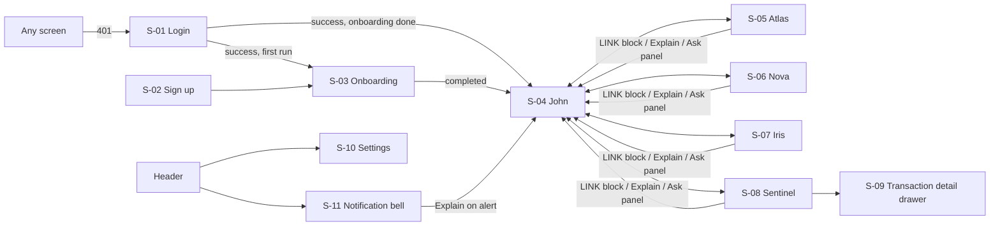
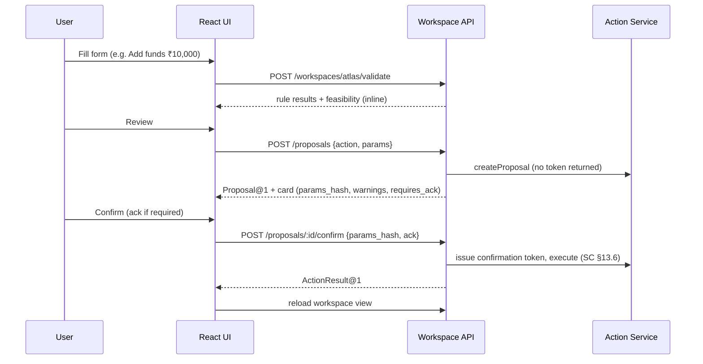

# Document 7 — UI Screens, Navigation and Interaction Design (prototype)

| Attribute | Value |
| --- | --- |
| File | `docs/prototype-design/07-ui-screens-and-interactions.md` |
| Status | **Generated 2026-10-13 — awaiting team approval** (TD-05 in `docs/team-decisions.md`). Not part of the original Doc 0–6 package (which the team approved on 2026-10-13, A-ARCH). Updated 2026-10-15 for team decisions D-PLAN-5, D-PLAN-6 and D-PLAN-9. |
| Why it exists | Docs 0–6 and the specifications define *what* each workspace shows and *which endpoint and action* backs each control, but no document gives a screen-by-screen design (layout regions, fields, states, transitions). WS-UI-P1/P2/P3 would otherwise have to guess. This document consolidates the existing requirements and fills only the layout/interaction gaps, each gap labelled. |
| Authoritative behaviour | `docs/specifications/*.md` (frozen) and Docs 0–6. This document never changes an endpoint, action, tier, field or rule defined there. If it disagrees with them, they win and this document is corrected. |
| Implemented by | `WS-UI-P1` (shell, client, shared components), `WS-UI-P2` (Sentinel workspace, Settings, onboarding, bell), `WS-UI-P3` (John chat, workspace chat panels, alert Explain, desktop verification) |
| Visual assets | None were found in the project materials (no wireframes, screenshots or design files). Layouts below are textual wireframes. Colours, typography and spacing are **not** specified; the team keeps the existing React app's visual style unless it decides otherwise (Q-UI-08). |

## 0. How to read this document

Every statement carries a source label:

| Label | Meaning |
| --- | --- |
| **[C]** | **Confirmed** — stated in a specification or prototype-design document; the source is cited (SC = `system-contracts.md`; Doc N = `docs/prototype-design/0N-*`; "John §C.2" = section C.2 of `john-orchestrator-spec.md`, and so on) |
| **[P]** | Stated in an implementation plan (cited by plan ID). Plans are binding for implementation but rank below specs if they conflict |
| **[I]** | **Inferred design decision** made for this document where the sources are silent. Safe default; may be changed by the WS-UI owner without a contract change unless marked otherwise |
| **[Q]** | **Open question** — listed in §11 and in `docs/team-decisions.md` |

Global rules that apply to every screen **[C]**:
1. The UI calls only `/api/v1/*` (Doc 2 §6; WS-UI-P1 §5). No mock data, no Gemini, no second backend (P-AC-01).
2. The frontend performs **no money arithmetic**. Every amount shown comes from a response field and is only formatted (`formatMinorInr`, `formatBpPct`) (P-AC-05; WS-UI-P1 §3, §5).
3. All user changes go through the Action Service: T1 via `POST /actions`, T2/T3 via `POST /proposals` → card → `POST /proposals/:id/confirm` (SC §13.1–13.4; Doc 2 §6). Action names are the SC §13.2 canonical names (C-5).
4. Typed text never confirms a T2/T3 action (SC §13.1; John §B.9.5).
5. Deferred features are **visible but disabled** with the label "Not in prototype" (Doc 0 §3.2; P-AC-20).
6. Synthetic data is labelled synthetic (Doc 5 §4; WS-UI-P2 §8).
7. Locale `en-IN`, currency INR, time zone Asia/Kolkata (SC §4.3, §21.2 A-2).

---

## 1. Users, roles and platform

| Topic | Design | Source |
| --- | --- | --- |
| User | One individual retail customer per login; no joint or family accounts | [C] SC §1.3, §21.2 A-1 |
| Roles in the UI | A single role: authenticated end user. No admin or operator screens in the prototype (ingestion dashboards are an operator concern and are not built) | [C] SC §1.3; John §B.10 · [I] no admin UI |
| Authentication | Existing email + JWT in the prototype (bank SSO deferred) | [C] SC §20 D-022; Doc 0 §3.2 |
| Delivery surface | Electron desktop shell loading the Vite-built React app; one backend on port 4000 after WS-FND-P5 | [P] `baseline.md` C-2; WS-FND-P5 · see Q-UI-01 (SC §21.2 A-3 says "web app only in v1" for production) |
| Demo controls | Shown only when the backend reports `demo_controls: true` in `/api/v1/health` | [P] WS-UI-P2 §3 · [C] Doc 2 §6 (`DEMO_CONTROLS=true`) |

---

## 2. Application shell

### 2.1 Layout (desktop) [I unless marked]

```
┌──────────────────────────────────────────────────────────────────────────────┐
│ Header: product name · status badge (health) · 🔔 bell (count) · avatar ▾     │
├───────────────┬──────────────────────────────────────────────────────────────┤
│ Sidebar nav   │ Global notice bar (only when present)                         │
│  John         ├──────────────────────────────────────────────────────────────┤
│  Atlas        │                                                              │
│  Nova         │                Active workspace / page                       │
│  Iris         │                                                              │
│  Sentinel     │                                                              │
│               │                                                              │
└───────────────┴──────────────────────────────────────────────────────────────┘
```

| Region | Content | Source |
| --- | --- | --- |
| Sidebar | Exactly five navigation items: John, Atlas, Nova, Iris, Sentinel. No Home, Subscriptions, Spending Analyser, Statement Import or Financial Health items | [C] SC §18, D-025; [P] WS-UI-P1 |
| Nav order | SC §18 lists John, Atlas, Nova, Iris, Sentinel; WS-UI-P1 step 6 lists John, Sentinel, Nova, Atlas, Iris | **[Q] Q-UI-02.** Until decided, use the SC §18 order |
| Header status badge | Live from `GET /api/v1/health` (`status`, `llm.breaker`) — replaces the mock `AgentStatusBadge` | [P] WS-UI-P1 §3 |
| Bell | Count and feed from `GET /api/v1/notifications` (recent `alert.changed`); in-app only | [C] SC §18 (D-007 7c); Doc 2 §6 · [P] WS-UI-P2 |
| Avatar menu | "Settings" (opens the Settings page) and "Log out" | [C] SC §18 (Settings from the avatar menu) · [I] Log out placement |
| Global notice bar | Service unavailable / session expired / degraded LLM notices | [P] WS-UI-P1 §7 · [I] placement |
| Default landing screen after login | John | [I] (first item in SC §18; John is the primary chat surface). Q-UI-03 |

### 2.2 Navigation map



| Transition | Trigger | Source |
| --- | --- | --- |
| Any screen → Login | Any `401` response; the current route is preserved and restored after login | [P] WS-UI-P1 §7 |
| Login → Onboarding | Profile/preferences not yet set for the user | [C] SC §17.6 (D-017) · [I] detection rule: `GET /api/v1/preferences` returns no record or `llm_processing_consent` is unset — **[Q] Q-UI-04** (no "onboarding complete" flag is defined) |
| Workspace → John | An "Ask about this"/"Explain" button (`UI_ACTION`) or an alert's Explain (`ALERT_OPEN`). Whether the answer appears in the workspace's own chat panel or switches to the John screen is [I]: panel for "Ask about this", John screen for alert Explain from the bell | [C] John §B.1 |
| John → Workspace | A `LINK` block `{workspace, view}` rendered as a button | [C] John §C.2 |
| Header → Settings | Avatar menu | [C] SC §18 |

### 2.3 Responsive behaviour [I]
The prototype targets the Electron desktop window. Design for a minimum content width of 1024 px; below 1024 px the sidebar collapses to icons with tooltips; below 768 px it becomes a top drawer and two-column workspace sections stack vertically. No horizontal scrolling of the page; wide tables (transactions, caps) scroll inside their own container. Production white-label web (SC A-3) is out of scope.

### 2.4 Accessibility baseline [I]
- All interactive elements reachable by keyboard in visual order; visible focus ring; `Esc` closes modals and drawers and returns focus to the control that opened them.
- Modals and cards use proper roles (`dialog`, `aria-modal`, labelled by their title). The acknowledgment checkbox on T3 / `requires_ack` cards is a real `<input type="checkbox">` with a label.
- Streaming chat output is announced through an `aria-live="polite"` region; the completion of a turn is announced once.
- Tiers and risk levels are never conveyed by colour alone: always text ("Healthy", "Warning", "Exceeded") plus an icon.
- Money is rendered as text (e.g. "₹1,25,000"), not images; charts have a tabular "View as table" alternative.
- Respect `prefers-reduced-motion` for chart and streaming animations.

---

## 3. Shared UI components (built in WS-UI-P1)

Component file names are those in WS-UI-P1 §4 **[P]**.

### 3.1 `ProposalCard` (T2/T3 confirmation card)
| Element | Rule | Source |
| --- | --- | --- |
| Content | Rendered **by code** from the proposal's `params`, rule-code message templates, `warnings`, `requires_ack`, `tier`; names and amounts from params; resulting values from the cited result; affected-row counts from dry run. No specialist wording on a card | [C] John §B.9.2; SC §13.3 |
| Buttons | **Confirm** (primary) and **Decline**. T3: Confirm is de-emphasised and labelled with the destructive consequence; card lists what will be lost | [C] SC §13.1; John §B.9.2 |
| Acknowledgment | Checkbox shown when `requires_ack` (T3, `NEGATIVE_BALANCE_RISK`, protected-category override). Confirm disabled until checked | [C] SC §13.1, §13.4; John §B.9.1 |
| Confirm request | `POST /api/v1/proposals/:id/confirm {params_hash, ack}` with the `params_hash` the card displayed | [C] Doc 2 §6; SC §13.4 |
| Decline request | `POST /api/v1/proposals/:id/decline` | [C] Doc 2 §6 |
| Double click | Confirm disabled after the first click; server returns `DUPLICATE` anyway | [P] WS-UI-P1 §7 |
| Result states | Rendered inline under the card from `ActionResult@1.status` — see table below | [C] John §B.9.6 · [P] WS-UI-P1 §6 step 2 |
| Expiry | After `expires_at` (30 min) the card shows "Expired — ask again" and its buttons are disabled | [C] SC §13.3 · [P] WS-UI-P3 §7 |

| `ActionResult.status` | Card display [P/C], wording [I] |
| --- | --- |
| `EXECUTED` | "Done." plus the new values from `result`; workspace data refreshes |
| `EXECUTED_UNVERIFIED` | "Applied — confirming…"; refresh again when the next view load reports it |
| `DUPLICATE` | "Already applied." plus the original result |
| `REJECTED_VALIDATION` | The rule message(s) from `constraint-messages` in plain words; no retry loop |
| `REJECTED_STALE` | "Your data changed since this was prepared. Review the updated figures." + reload |
| `REJECTED_POLICY` / `REJECTED_AUTH` | "This change isn't permitted." |
| `FAILED_ROLLED_BACK` | "This change was not applied." |
| `DECLINED` / `EXPIRED` / `SUPERSEDED` | Greyed card with the state label |

### 3.2 `ActionChip` (T1)
A compact button with a ≤ 40-character label **[C]** (John §C.2). Tap → `POST /api/v1/actions {action, params, idempotency_key}` with a new UUID per tap **[P]** (WS-UI-P1 §5). A specialist-proposed T1 action is never executed without this tap **[C]** (SC §13.1). After `EXECUTED`, show `UndoBar` when `undo_available_until` is present.

### 3.3 `UndoBar`
One line "<what changed> · **Undo**", visible until `undo_available_until` (24 h for T1) **[C]** (SC §13.1) **[P]** (WS-UI-P2 §7). Undo → `POST /api/v1/actions/:id/undo`. If the affected rows changed, the server rejects; show the message.

### 3.4 `Notice`
Banner keyed by the `NOTICE` codes of John §C.2 **[C]**: `PARTIAL`, `IMPORT_IN_PROGRESS`, `LOW_COVERAGE`, `STALE_DATA`, `LIVE_FIGURES_UNAVAILABLE`, `DEGRADED_MODE`, `OUT_OF_SCOPE`. Shows the server `text`; the code only selects the icon/severity **[I]**.

### 3.5 `DisabledControl`
Wraps any deferred control: rendered, not clickable, tooltip/label "Not in prototype" **[C]** (Doc 0 §3.2; P-AC-20).

### 3.6 `DataQualityBadge`
Displays `DataQuality@1` (SC §8.1) **[C]**: coverage (`coverage_by_amount_bp` → "Coverage 92%"; `null` → "Coverage —"), "Import in progress" when `import_in_progress`, "N to review" from `needs_review_count`, and an "Incomplete data" marker when `complete = false`. Click → popover listing uncategorized, provisional and unclassified amounts **[I]**.

### 3.7 Formatting helpers (`src/lib/format.js`) [P]
`formatMinorInr(int)` → Indian digit grouping with ₹ (₹1,25,000.50; omit paise when zero **[I]**); `formatBpPct(int)` → "12.5%". Display only.

### 3.8 Standard view states [P/I]
| State | Trigger | Display |
| --- | --- | --- |
| Loading | Request in flight | Skeleton of the section layout (no spinner-only pages) [I] |
| Empty / insufficient data | Empty list, or Sentinel `INSUFFICIENT_DATA` | Explanatory empty state with the data-quality badge; **no fabricated zeros** [P] WS-UI-P1 §7 |
| Error | Non-2xx with `ErrorBody@1` | Inline error with the server message and "Retry" [C] SC §15.1 · [I] layout |
| Backend down | Network failure | Global notice "Service unavailable" + per-section Retry [P] WS-UI-P1 §7 |
| Stale | View `snapshot`/`as_of_date` older than the latest version, or `DATA_STALE` / `REJECTED_STALE` | "Data changed — refresh" [C] SC §7 · [I] wording |
| Permission | `401` → login; `403` → "Not permitted"; `404` on a foreign ID → "Not found" (no existence leak) | [C] Doc 5 S-2, S-3 |

Every workspace view response includes `snapshot_id`, `as_of_date` and `DataQuality@1` **[C]** (Sentinel §B.6.18). Each workspace shows "As of <date>" and the badge in its header **[I]**.

---

## 4. Screen inventory

| ID | Screen | Plan | Essential for demo journey (Doc 6 §5)? |
| --- | --- | --- | --- |
| S-01 | Login | WS-UI-P1 (existing view kept; base URL change in WS-FND-P5) | Yes (entry) |
| S-02 | Sign up | same | No (seeded users) |
| S-03 | Onboarding | WS-UI-P2 | No for the demo (seeded profile); yes for a new user |
| S-04 | John workspace (chat + health strip) | WS-UI-P1 (move), WS-UI-P3 (rebuild) | Yes — steps 4, 6, 8 |
| S-05 | Atlas workspace (+ goal modals, SIP calculator) | WS-UI-P1 | Yes — step 7 |
| S-06 | Nova workspace (+ cap edit, Log expense) | WS-UI-P1, WS-UI-P3 (Explain) | Yes — step 4 |
| S-07 | Iris workspace (planner, what-if) | WS-UI-P1 | Yes — step 9 (Tier 3) |
| S-08 | Sentinel workspace (sections) | WS-UI-P2 | Yes — steps 3, 5 |
| S-09 | Transaction detail drawer | WS-UI-P2 | Yes — step 5 |
| S-10 | Settings page | WS-UI-P2 | No |
| S-11 | Notification bell feed | WS-UI-P2, WS-UI-P3 | Helpful for step 4 |
| S-12 | Embedded workspace chat panel | WS-UI-P3 | Optional |

---

## 5. Screen specifications

### S-01 Login and S-02 Sign up
| Aspect | Design |
| --- | --- |
| Purpose | Authenticate with the existing email + JWT mechanism [C] SC §20 D-022 |
| Endpoints | `POST /api/v1/auth/login`, `POST /api/v1/auth/signup`, `GET /api/v1/auth/me` [C] Doc 2 §6 (existing routes moved under v1 in WS-FND-P5; until then the existing paths are used [P] WS-FND-P5) |
| Fields | Login: email, password. Sign up: name, email, password [I] — **the exact existing request fields are defined by the auth code in the source baseline (imported per D-PLAN-3)**, not by any spec |
| Validation | Email format; password non-empty; server errors shown inline [I] |
| States | Submitting (button disabled), invalid credentials (generic "Email or password is incorrect" — no account enumeration [I]), service unavailable |
| Success | Store the token in memory plus the existing app's persistence mechanism [I]; go to Onboarding (first run) or the preserved route / John |
| Security | No secrets or LLM keys in the frontend [C] Doc 5 S-1 |

### S-03 Onboarding
| Aspect | Design |
| --- | --- |
| Purpose | Collect the optional profile and the mandatory consent decision (D-017) [C] SC §17.6 |
| Endpoint | `POST /api/v1/onboarding {display_name, declared_income_minor?, fixed_lines[], risk_comfort, protected_category_ids[], llm_processing_consent, first_goal?}` → `{profile, preferences}`; executes `UPDATE_PROFILE` / `UPDATE_PREFERENCE` / `CREATE_GOAL` with `origin: UI_FORM` [C] Doc 2 §6. WS-UI-P2 allows "`POST /onboarding` or sequential proposals" [P] — **[Q] Q-UI-05** which one is built (the endpoint is in Doc 2 §6 but no backend plan lists it in its files table) |
| Steps [I] | 1 Name → 2 Income (optional) → 3 Fixed expenses (optional) → 4 Risk comfort → 5 Protected categories (optional) → 6 AI processing consent (required) → 7 First goal (optional) → Summary + Finish |
| Fields | `display_name` (text) · `declared_income_minor` (₹ amount input, ≥ 0; empty = not declared → Sentinel derives observed income) · fixed lines (up to 20; each `label` ≤ 40 chars, leaf `category_id` unique across lines, `amount_minor` ≥ 1; prototype maps the existing rent question to `HOUSING.RENT`) · `risk_comfort` radio CONSERVATIVE / BALANCED (default) / AGGRESSIVE · `protected_category_ids` multi-select of taxonomy parents/leaves (≤ 30; a parent protects all leaves) · `llm_processing_consent` toggle, **Off by default** — the user must opt in (D-PLAN-6; the demo user is seeded with consent on) · first goal: name (1–40), target ₹ (≥ 1), monthly add ₹ (≥ 0), deadline (optional date), priority HIGH/MEDIUM/LOW [C] SC §5.4–5.6, §17.6 |
| Money input | The user types rupees; the client converts the typed decimal string to integer paise **by string parsing, not floating-point arithmetic** (e.g. "1250.5" → 125050) [I] — confirm this does not breach P-AC-05's "no arithmetic on `_minor`" lint (Q-UI-06) |
| Consent copy [I] | "Allow FinMate to send your financial summaries to an AI model to answer chat questions? Workspaces work either way. You can change this in Settings." |
| Consent = No | Chat is disabled everywhere; workspaces still work [C] SC §5.5, §16.6 |
| Validation | Client mirrors the schema limits for fast feedback; the server's rule results are authoritative (e.g. fixed-line category already capped → shows the caps to remove first) [C] SC §13.2 `UPDATE_PROFILE` validator |
| States | Step validation errors inline; submit in progress; server rejection on the summary step with the failing field highlighted [I] |

### S-04 John workspace
**Purpose [C]** (SC §18; Doc 1 §6): chat with grounded answers, confirmation cards, chips, Undo lines; plus a health strip.

**Layout [I]**
```
┌──────────────────────────────────────────────────────────────────────┐
│ Health strip: Surplus · Upcoming bills (next N days) · Cash-flow flag │
├──────────────┬───────────────────────────────────────────────────────┤
│ Thread list  │ Message list (user turns, assistant blocks)           │
│ + New thread │                                                       │
│              ├───────────────────────────────────────────────────────┤
│              │ Composer: textarea · Send · Stop (while streaming)     │
└──────────────┴───────────────────────────────────────────────────────┘
```

| Region | Data / behaviour | Source |
| --- | --- | --- |
| Health strip | `GET /api/v1/workspaces/john` → `{snapshot, surplus, bills, cashflow}`; values formatted from fields; headline rule (conservative figure leads when confidence ≠ HIGH or risk comfort is CONSERVATIVE) | [C] Doc 2 §6; Doc 1 §6; SC §5.5, §11.4 |
| Thread list | `GET /api/v1/chat/threads`; selecting loads `GET /api/v1/chat/threads/:id` (last 50 turns + "Load earlier") | [C] Doc 2 §6 · [P] WS-UI-P3 §7 |
| Send | `POST /api/v1/chat/messages` with `ChatRequest@1` (John §C.1): `{thread_id (null = new), message (≤ 2000 chars), ui_context: {workspace: "JOHN"…}, trigger: {kind: "USER_MESSAGE"}, client_message_id}` — see Q-UI-07 for the differing field names in WS-UI-P3 §5 | [C] John §C.1 |
| Stream | `fetch` + `ReadableStream` SSE parser (EventSource cannot POST); `block` events rendered as they arrive; one `done` event ends the turn | [C] John §C.2 · [P] WS-UI-P3 §3 |
| Stop | Aborts the fetch; partial blocks stay with "Response interrupted" | [P] WS-UI-P3 §3, §7 |
| Retry after cut | Resend with the **same** `client_message_id` (server returns the stored turn) | [P] WS-UI-P3 §7; [C] John §C.1 |

**Block rendering [C]** (John §C.2):

| Block | Rendering |
| --- | --- |
| `TEXT` | Grounded prose via `FormattedText` (no number re-formatting beyond display) [P] WS-UI-P3 §4 |
| `CARD` | `ProposalCard` for `proposal_id` |
| `CHIP` | `ActionChip` with `label` |
| `QUESTION` | Question text + one button per option; selecting sends `answer_to: {question_id, option_id}`; free text (≤ 200) only if the question allows it [C] John §B.8, §C.1 |
| `UNDO` | `UndoBar` for `action_id` until `until` |
| `NOTICE` | `Notice` with `code` and `text` |
| `LINK` | Button "Open <Workspace>" navigating to `workspace` (+ `view` if given) |
| Unknown type | Plain text + console warning (forward compatibility) [P] WS-UI-P3 §5 |

**Turn status [C]** (`ChatResponse@1.status`): `COMPLETE` normal; `PARTIAL` → keep blocks, show the PARTIAL notice the server sends; `DEGRADED` → degraded notice; `REFUSED` → the refusal text.

**States**
| State | Display | Source |
| --- | --- | --- |
| Consent off (`llm_processing_consent = false`) | Composer disabled with "AI chat is off. Turn it on in Settings." + link | [C] SC §16.6 · [P] WS-UI-P3 §7 |
| LLM unavailable | Composer enabled; answers arrive with `DEGRADED_MODE` notice; workspaces unaffected | [C] P-AC-14 |
| Typed "yes" after a card | Server answers with a notice and re-shows the card; nothing executes | [C] John §B.9.5; P-AC-13 |
| Empty thread | Suggested prompts [I] — **must not contain figures** |
| New user, no data | Notice `LOW_COVERAGE` / `IMPORT_IN_PROGRESS` as sent by the server [C] |

### S-05 Atlas workspace (goals)
**Purpose [C]** (Atlas §B.4; SC §18): goal cards, create/edit/fund/release/pause/delete/restore, SIP calculator. Forms do **not** invoke the Atlas agent; only the chat panel does.

**Layout [I]**: header (As of · DataQualityBadge · surplus baseline) → goal card grid → "Recently deleted" collapsible list → SIP calculator panel → "Ask Atlas" chat panel (S-12).

| Element | Endpoint | Action on submit (tier) | Source |
| --- | --- | --- | --- |
| Goal cards | `GET /api/v1/workspaces/atlas` → `{snapshot, goals:[{goal, progress}], surplus}` | — | [C] Atlas §B.4; Doc 2 §6 |
| Create / Edit goal modal | `POST /api/v1/workspaces/atlas/validate {operation, …}` (pre-validation) then `POST /api/v1/proposals` | `CREATE_GOAL` / `UPDATE_GOAL` card (T2) | [C] Atlas §B.4; SC §13.2 |
| Add / Release funds modal | same | `ADD_FUNDS` / `RELEASE_FUNDS` card (T2) | [C] |
| Pause / Resume; "This month only" monthly-add override | same | `SET_GOAL_STATUS` / `SET_GOAL_MONTH_OVERRIDE` card (T2) | [C] |
| Delete | — (uses card progress) | `DELETE_GOAL` card (T3, acknowledgment) | [C] |
| Recently deleted | `GET /api/v1/workspaces/atlas/archived` | `RESTORE_GOAL` card (T2) — enabled (D-PLAN-5) | [C] Atlas §B.4 · [P] WS-UI-P1 step 7 |
| SIP calculator | `POST /api/v1/workspaces/atlas/sip {monthly_amount_minor 10000..100000000, annual_rate_bp 0..3000, months 1..600, annual_step_up_bp 0..5000}` | — (result labelled "Illustrative"; rate is user-supplied) | [C] Sentinel §C.3 `sentinel_project_sip`; D-024 |

**Goal card content [C]** (Goal@1; Sentinel `goal_progress` data): name, priority tier, status chip (Active/Paused/Completed), saved vs target (progress bar from returned values — the bar's width is a display ratio of two returned integers [I]; see Q-UI-06), effective monthly add, projected date and conservative date (headline rule), deadline and on-track flag, required monthly add for deadline when off-track. Card menu: Edit · Add funds · Release funds · Pause/Resume · This month only · Delete.

**Goal form fields [C]** (SC §5.6; Sentinel `validate_goal_change` params): name (1–40, unique among ACTIVE/PAUSED/COMPLETED goals), target ₹ (≥ 1), monthly add ₹ (≥ 0), deadline (optional, date), priority (HIGH/MEDIUM/LOW). Funds modal: amount ₹ (≥ 1). Override modal: period (current month default [I]) and monthly add ₹ (≥ 0).

**Interaction flow (T2) [C]**: fill form → client checks field limits → `validate` call shows rule results and feasibility inline (errors block "Review"; warnings are shown) → "Review" creates the proposal → `ProposalCard` → Confirm → result → goal cards reload. Example (Doc 6 §5 step 7): adding ₹2,00,000 above available balance → `INSUFFICIENT_BALANCE` message; ₹10,000 → card → Confirm → progress updates.

**States**: no goals → empty state "Create your first goal" + Create button [I]; goal limit reached → Create disabled with the `GOAL_LIMIT` message [C] SC §5.6; archived goal past `restore_until` → no Restore button [C].

### S-06 Nova workspace (budgets)
**Purpose [C]** (Nova §B.5; SC §18): caps with tiers and settled/provisional split, daily envelope, alerts, cap edit, rebalance, Log expense.

**Layout [I]**: header (As of · badge) → daily envelope tile → caps table → alerts list → buttons "Log expense", "Add cap" → "Ask Nova" panel.

| Element | Endpoint | Action (tier) | Source |
| --- | --- | --- | --- |
| Caps table | `GET /api/v1/workspaces/nova` → `{snapshot, caps:[{cap, utilization, velocity}], alerts}` | — | [C] Nova §B.5; Doc 2 §6 |
| Daily envelope | same (velocity) | — (headline rule) | [C] |
| Alerts list | `GET /api/v1/alerts?kind=CAP_TIER,ANOMALY,WATCH` | Dismiss chip → `DISMISS_ALERT` (T1); Explain → John `ALERT_OPEN` | [C] Nova §B.5; John §B.1 |
| Edit cap modal | `POST /api/v1/workspaces/nova/validate-cap {category_id, new_cap_minor, scope, override_protected?}` then `POST /api/v1/proposals` | `ADJUST_BUDGET_CAP` (T2) or `REMOVE_CAP` (T2) | [C] Nova §B.5; Doc 2 §6 |
| Cover this overspend | `POST /api/v1/workspaces/nova/rebalance {deficit_category_id}` → `{result, proposal}` | `APPLY_REBALANCE` card (T2, proposer USER) | [C] Nova §B.5; Doc 2 §6 |
| Log expense modal | `POST /api/v1/actions` | `ADD_MANUAL_TRANSACTION` (T1) + Undo | [C] Nova §B.5; Categorizer §C.2 |
| Watch | — | `CREATE_ALERT` (T1) — kept as-is (D-PLAN-5) | [C] SC §13.2 · [P] D-PLAN-5 |

**Caps table columns [C]** (Cap@1; Sentinel utilization): category · effective cap (standing or "this month" override marker) · spent (settled + provisional, provisional shown separately) · remaining · utilization % · tier (Healthy < 80 %, Warning 80–100 %, Exceeded > 100 %, SC §21.1) · protected marker · row actions (Edit, Cover this overspend when Exceeded/Warning [I], Remove).

**Cap edit fields [C]**: category (cappable categories only — expense parents/leaves minus FIXED; violations return `CATEGORY_NOT_CAPPABLE`, SC §5.7), new amount ₹ (≥ 0), scope **"This month only"** (`MONTH`) or **"From now on"** (`STANDING`) — required, no default [C] John §B.8 (cap change lacks scope → ask). For a protected category the form shows an acknowledgment checkbox; only then may `override_protected: true` be sent (D-016) [C] SC §13.4.

**Log expense fields [C]** (ManualEntry@1): date (≤ today, ≥ today − 90 days, Asia/Kolkata), amount ₹ (1 paisa – ₹10,00,000), direction (Debit default [I] / Credit), description (1–80), account (the user's MANUAL_CASH account or one of their bank accounts), category (optional leaf; when chosen the row is CONFIRMED immediately).

**Alert row [C]** (Alert@1): kind, severity, subject (category / merchant / period), tier, provisional flag, created time. Deterministic data is always shown even if Explain fails [C] Nova §B.4.

**Explain flow [C]** (Doc 3 F10; John §B.1): Explain → navigate to John (or open the Nova chat panel [I]) and send `trigger.kind = ALERT_OPEN`, `alert_id`, empty message → Nova explanation + optional `APPLY_REBALANCE` card → Confirm → caps update → alert resolves in the same dispatcher cycle (P-AC-08). Demo step 4.

### S-07 Iris workspace (next-month planner)
**Purpose [C]** (Iris §B.4; SC §18): deterministic planner and purchase what-if; "Ask Iris" panel for advice.

**Layout [I]**: header → target month selector → category adjustment sliders → cap/goal what-if rows → one-off outlays list → result panel → "Apply this plan" → upcoming bills strip → "Ask Iris" panel.

| Element | Endpoint | Source |
| --- | --- | --- |
| Initial load | `GET /api/v1/workspaces/iris` → `{snapshot, bills, baseline_simulation}` | [C] Doc 2 §6 |
| Simulate | `POST /api/v1/workspaces/iris/simulate {target_month, category_adjustments[{category_id, delta_spend_signed_minor}], cap_changes[{category_id, new_cap_minor}], goal_changes[{goal_id, monthly_add_minor}], one_off_outlays[{label ≤ 40, amount_minor ≥ 1, date}]}` | [C] Sentinel §C.3 `sentinel_run_spending_simulation` |
| Result | Opening balance, projected end balance, **conservative** end balance (headline when confidence ≠ HIGH), risk level — all from `data`; no client arithmetic | [C] SC §18; Sentinel §C.3 |
| Apply this plan | Creates `ADJUST_BUDGET_CAP {scope: MONTH}` proposals (proposer USER) → cards | [C] Iris §B.4 |
| Delivery slider | Maps to `category_adjustments` on `FOOD.DELIVERY` | [C] Iris §B.4 |

**Slider design [I]**: each slider represents a delta in whole rupees within a range returned or configured by the team (**[Q] Q-UI-10**: no source defines slider bounds or step). Moving a slider debounces (≈ 400 ms) then calls `simulate`; while pending, the previous result is shown dimmed. Demo step 9: moving the Delivery slider changes the simulated balance and risk level with no LLM call.

**States**: fewer than 3 months of history → result area shows the `INSUFFICIENT_DATA` empty state (SC §21.1 minimum history) [C]; bills strip empty → "No upcoming bills detected".

### S-08 Sentinel workspace
**Purpose [C]** (Sentinel §B.6.18; SC §18; Doc 1 §6): LLM-free financial observer. Sentinel is never a chat persona; its chat panel posts to John.

**Layout [I]**: tabs or anchored sections — **Overview** · **Spending** · **Forecast & risk** · **Bills** · **Transactions** · **Needs review** — plus "Demo: bank feed simulator" (only with demo controls) and the chat panel.

| Section | Endpoint | Content | Source |
| --- | --- | --- | --- |
| Overview | `GET /api/v1/workspaces/sentinel/overview` | Balances per account (stale marker when stale/unknown, SC §5.2), credit-card outstanding shown as a liability, DataQualityBadge | [C] Sentinel §B.6.18 · [P] WS-UI-P2 step 1 |
| Spending | `GET /api/v1/workspaces/sentinel/spending?months=` | Category totals with parent roll-ups, top merchants, uncategorized and unclassified buckets | [C] |
| Trends chart | `GET /api/v1/workspaces/sentinel/timeseries?granularity=&from=&to=` | Line/bar chart + "View as table" | [C] · [I] chart type |
| Forecast & risk radar | `GET /api/v1/workspaces/sentinel/forecast?horizon_days=` | Detected + declared upcoming bills (declared wins on overlap), cash-flow risk flags | [C] |
| Bills panel | `POST /api/v1/actions` | Add declared bill `ADD_DECLARED_BILL` (T1), Delete `DELETE_DECLARED_BILL` (T1); **Edit is disabled** ("Not in prototype" — `UPDATE_DECLARED_BILL` deferred) | [C] Doc 4 §8.1 · [P] WS-UI-P1 step 7, WS-PLT-P1 step 6 |
| Transactions | `GET /api/v1/transactions` (filters, 50 per page, `nextCursor`) | Rows with category chip, inline correction, open drawer (S-09) | [C] · [P] WS-UI-P2 §7 |
| Needs review | `GET /api/v1/review-queue` | Items with reason and exactly the T1 actions relevant to it | [C] Categorizer §B.7 |
| Demo loader | `POST /api/v1/demo/ingest {format, body, mapping_profile_id?}` → `{batch_id, status}` | File picker (JSON / CSV), batch status and row errors; labelled "Demo: bank feed simulator — synthetic data" | [C] Doc 2 §6 · [P] WS-UI-P2 step 5 |

**Tier cut (D-PLAN-9).** If the end-of-D5 checkpoint cuts Tier 3, the forecast/risk-radar section beyond the upcoming-bills list and the demo loader are not built (the `reset-demo` script loads the data); Overview, Spending, Bills, Transactions and Needs review stay. Iris planner verification (S-07, demo step 9) is likewise out of scope after a cut.

**Bill form fields [C]** (DeclaredBill@1): label (≤ 40), category (optional), amount ₹ (≥ 1), next due date, recurrence NONE / MONTHLY / QUARTERLY / YEARLY.

**Transaction row [C/I]**: date · description · merchant · account · amount (direction indicated by sign/label, not colour only) · movement type · category chip with status (CONFIRMED / AUTO / NEEDS_REVIEW / UNCATEGORIZED) · provisional marker for pending rows. Filters [I]: date range, account, category, status, text search.

**Inline correction [C/P]** (WS-UI-P2 §3, §5; SC §13.2):
1. Click the category chip → picker listing taxonomy leaves **filtered by the row's movement type** (from `GET /api/v1/categorizer/taxonomy`).
2. Choose a leaf → `POST /api/v1/actions {action: "RECATEGORIZE_TRANSACTION", params: {txn_id, category_id, scope: "TRANSACTION"}}` with the row version (`If-Match`/`row_version`, CAT-AC-15) → `UndoBar`.
3. Checkbox "Apply to all from this merchant" → `POST /api/v1/proposals` with `scope: "MERCHANT"` → card showing dry-run counts (rows affected, confirmed rows skipped) → Confirm (T2).
4. Version conflict → "This transaction changed; refresh".
Demo step 5: Spencer's row Dining → Groceries; Undo appears; Nova reflects both categories.

**Needs-review actions [C]** (Categorizer §B.7; Doc 4 §8.1): `CONFIRM_CATEGORY` (T1) and `DISMISS_REVIEW_ITEM` (T1) are built. Reason-specific actions for `POSSIBLE_DUPLICATE` (`RESOLVE_DUPLICATE`), `UNMATCHED_REFUND`/`CARD_COUNTERPART_MISSING` (`CONFIRM_LINK`/`BREAK_LINK`) and type fixes (`SET_TRANSACTION_TYPE`) are deferred → `DisabledControl`; `SET_TRANSACTION_TYPE` stays enabled because it already works in the source baseline (D-PLAN-5).

### S-09 Transaction detail drawer
| Aspect | Design |
| --- | --- |
| Endpoint | `GET /api/v1/transactions/:id` (ClassificationResult@1) [C] Categorizer §C.3 |
| Content | Raw description, amounts, dates, account, movement type, category and status, `method` and evidence ("Why is this here?"), link to a refund's original / card counterpart when present, event history [C] Categorizer §C.3; John §B.10 · [P] WS-UI-P2 step 2 |
| Actions | Recategorize (as S-08); Delete manual entry (`DELETE_MANUAL_TRANSACTION`) and "Mark counterparty as my own account" (`MARK_OWN_ACCOUNT_COUNTERPARTY`) shown as `DisabledControl` (deferred, Doc 0 §3.2) |
| States | Loading, not found (foreign or deleted ID → "Not found") |

### S-10 Settings page
| Section | Endpoint(s) | Action (tier) | Source |
| --- | --- | --- | --- |
| Profile: declared income, fixed-expense lines | `GET /api/v1/profile` | `UPDATE_PROFILE` card (T2) | [C] Doc 2 §6; SC §13.2 |
| Preferences: risk comfort, protected categories | `GET /api/v1/preferences` | `UPDATE_PREFERENCE` (T1, Undo) | [C] |
| AI processing consent toggle | same | `UPDATE_PREFERENCE` (T1); when off, show "John chat is disabled; workspaces still work" | [C] SC §16.6 · [P] WS-UI-P2 §7 |
| Category rules | Read-only list (existing rules route) | Create/Delete disabled ("Not in prototype") | [P] WS-UI-P2 §3, §12 |
| Memory facts | List + delete (John store routes: `GET /api/v1/memory`, `DELETE /api/v1/memory/{fact_id}`; the source-baseline routes are `/settings/memory-facts` and `/memory/facts/:fact_id`) | Delete (not an action; SC §13.2 has no `DELETE_MEMORY_FACT`) | [C] John §B.1 · [P] WS-UI-P2 §3, WS-PLT-P1 §4 · see Q-UI-11 (Doc 0 §3.2 defers John's memory facts) |
| Account | Display name, email (read-only) [I] | — | |

### S-11 Notification bell
`GET /api/v1/notifications` → recent `alert.changed` entries; badge count of unread [I: "unread" kept client-side per session — no read-state API exists]. Each entry: alert summary + "Explain" (→ `ALERT_OPEN`) + "Open in Nova". In-app only [C] SC §18 (D-007). Alerts should appear < 5 s after detection [C] SC §21.1 → the bell polls `/notifications` every 5 s while the window is focused [I] (no push channel is specified).

### S-12 Embedded workspace chat panel
Collapsible right-hand panel in Atlas, Nova, Iris and Sentinel. Posts to the same `POST /api/v1/chat/messages` with `ui_context.workspace` = `ATLAS`/`NOVA`/`IRIS`/`SENTINEL`; John routes with that workspace's specialist as default; Sentinel's panel goes to John (never a Sentinel persona) [C] SC §18; John §B.3. Renders the same blocks as S-04. "Explain"/"Ask about this" buttons send a canned prompt with `trigger.kind = UI_ACTION` and `prompt_id`; the canned text is shown in the thread [C] John §B.1. Disabled when consent is off.

When the user has a goal, category or alert selected in the workspace, the panel also sends `ui_context.selected_goal_id` / `selected_category_id` / `selected_alert_id` [C] SC §9.2 (TaskPacket `ui_context`) · [I] "selected" means the card or row last opened.

---

## 6. Core interaction flows

### 6.1 Form → card → confirm (T2/T3)

[C] SC §13.3–13.6; Doc 3 F6, F9. A token is never returned at proposal creation (gap G-2, WS-PLT-P1).

### 6.2 Tap → execute → undo (T1)
`ActionChip`/inline control → `POST /actions {action, params, idempotency_key}` (server issues the intent token internally) → `ActionResult@1` → `UndoBar` → optional `POST /actions/:id/undo` [C] Doc 2 §6; SC §13.4.

### 6.3 Chat turn
`POST /chat/messages` (SSE) → `block` events (TEXT, NOTICE, QUESTION, CARD, CHIP, UNDO, LINK) → `done`. Card confirmation and chip taps leave the chat path and go through 6.1/6.2; John reports the `ActionResult` on the next render [C] John §B.1, §B.9.

### 6.4 Alert lifecycle as seen by the user
Spend/category change → Budget Monitor creates or updates a `CAP_TIER` alert (no LLM) → bell count and Nova alerts list update (< 5 s) → Explain → `ALERT_OPEN` chat turn → explanation + rebalance card → Confirm → alert `RESOLVED` [C] Nova §B.4; Doc 3 F7, F10.

### 6.5 Correction propagation
Inline recategorization (S-08) → `categorization.updated` → Monitor recomputes both categories → Nova tiers change → next John answer uses new numbers [C] Doc 3 F8; P-AC-09.

---

## 7. Demo journey → screens (Doc 6 §5)

| Step | Screen(s) | Controls used |
| --- | --- | --- |
| 1 reset + seed | — (`npm run reset-demo`) | — |
| 2 health | Header status badge | `/health` |
| 3 | S-08 Overview, Spending, Forecast, Needs review | badge, charts, review list (3 seeded items) |
| 4 | S-06 alerts → Explain → S-04 (or panel) → card | `ALERT_OPEN`, `ProposalCard` |
| 5 | S-08 Transactions → inline correction → Undo; S-06 | `RECATEGORIZE_TRANSACTION` T1 |
| 6 | S-04 phone what-if question | streaming, cards (Decline) |
| 7 | S-05 Add funds (rejected, then accepted) | `ADD_FUNDS` card |
| 8 | S-04 "How healthy are my finances?" | TEXT blocks |
| 9 | S-07 Delivery slider | `simulate` |
| 10 | restart → S-06 | persistence |

---

## 8. Deferred and conditional controls (rendered with `DisabledControl`)

| Control | Screen | Status | Source |
| --- | --- | --- | --- |
| Edit declared bill (`UPDATE_DECLARED_BILL`) | S-08 Bills | Disabled | [C] Doc 0 §3.2 · [P] WS-UI-P1 step 7 |
| Create / delete category rule | S-10 | Disabled | [P] WS-UI-P1 step 7, WS-UI-P2 §12 |
| Resolve duplicate, confirm/break link | S-08 Needs review | Disabled | [C] Doc 0 §3.2 |
| Mark own-account counterparty | S-09 | Disabled | [C] Doc 0 §3.2 |
| Delete manual transaction | S-09 | Disabled (Undo of the add remains) | [C] Doc 0 §3.2; Doc 4 §8.1 |
| Restore deleted goal (`RESTORE_GOAL`) | S-05 | **Enabled** — already works in the source baseline; kept as-is (D-PLAN-5, audit A-18) | [P] WS-UI-P1 step 7 |
| Watch (`CREATE_ALERT`) | S-06, S-08 | **Enabled** — kept as-is (D-PLAN-5) | [P] WS-PLT-P1 step 6 |
| Change movement type (`SET_TRANSACTION_TYPE`) | S-08, S-09 | **Enabled** — kept as-is (D-PLAN-5; WS-CAT-P3 scope note) | [P] WS-CAT-P3 |
| Category-rule creation (`CREATE_CATEGORY_RULE`) | S-10 | Kept in the backend as-is (D-PLAN-5); the Settings rules list stays read-only in WS-UI-P2 | [P] WS-UI-P2 §12 |
| `REMOVE_CAP` | S-06 | Enabled once WS-PLT-P1 registers it | [P] WS-UI-P1 step 7 |
| Statement upload by the end user | — | Not shown at all (no end-user upload in v1, D-009/D-023); only the demo loader exists | [C] SC §20 D-023 |

---

## 9. UI ↔ backend traceability

| Screen | Endpoints consumed | Producing plans (backend) | Consuming plan (UI) |
| --- | --- | --- | --- |
| S-01/S-02 | `/auth/*` | source baseline; moved in WS-FND-P5 | WS-UI-P1, WS-FND-P5 (coordinated edit of `authService.js`) |
| S-03 | `/onboarding` or `/proposals` + `/actions` | WS-PLT-P1/P2 (Q-UI-05) | WS-UI-P2 |
| S-04 | `/workspaces/john`, `/chat/messages`, `/chat/threads*` | WS-JON-P1/P2, WS-SEN-P2 (view schema) | WS-UI-P3 |
| S-05 | `/workspaces/atlas*`, `/proposals*` | WS-SEN-P2, WS-PLT-P1 | WS-UI-P1 |
| S-06 | `/workspaces/nova*`, `/alerts`, `/actions`, `/proposals*` | WS-SEN-P2, WS-PLT-P1/P2, WS-CAT-P3 (manual entry executor) | WS-UI-P1, WS-UI-P3 |
| S-07 | `/workspaces/iris*` | WS-SEN-P2 | WS-UI-P1 |
| S-08/S-09 | `/workspaces/sentinel/*`, `/transactions*`, `/review-queue`, `/categorizer/taxonomy`, `/demo/ingest`, `/actions`, `/proposals*` | WS-SEN-P2, WS-CAT-P2/P3, WS-PLT-P2 | WS-UI-P2 |
| S-10 | `/profile`, `/preferences`, rules list, memory routes | WS-PLT-P2, WS-JON (memory store) | WS-UI-P2 |
| S-11 | `/notifications`, `/alerts` | WS-PLT-P2 | WS-UI-P2, WS-UI-P3 |
| S-12 | `/chat/messages` | WS-JON-P1 | WS-UI-P3 |

Response shapes for every `/workspaces/*` view are fixed by the HTTP JSON Schemas published by **WS-SEN-P2** (its schema commit, D4–D5; WS-UI-P1 builds against current responses and Doc 2 §6 until then) (`backend/src/shared/contracts/schemas/http/workspaces-*.json`); the UI validates responses against them in development mode (console warning) [P] WS-UI-P2 §5. Chat block shapes are fixed by the **WS-JON-P1 contract commit** (Draft PR, D1).

---

## 10. Implementation notes for WS-UI

1. Build shared components (§3) first; every screen composes them.
2. Never compute money; a progress bar's width is the only permitted ratio and must be computed from two returned integers without being displayed as a number (Q-UI-06).
3. Prefer server-provided wording (rule messages, notice text) over client copy.
4. Keep `[I]` decisions easy to change (labels in one place, layout in CSS).
5. Record a screenshot per screen and state in the PR (WS-UI-P1/P2/P3 handoff).

---

## 11. Open questions (also in `docs/team-decisions.md`)

| ID | Question | Recommended default | Blocks |
| --- | --- | --- | --- |
| Q-UI-01 | Prototype surface: Electron desktop only (baseline C-2), or also a browser build (Doc 0 §3.1 "browser or Electron"; Doc 6 §5 step 2 mentions `npm run web`)? | Electron only, as recorded in C-2 | WS-FND-P5 scripts; WS-UI-P3 verification |
| Q-UI-02 | Sidebar order: SC §18 (John, Atlas, Nova, Iris, Sentinel) or WS-UI-P1 step 6 (John, Sentinel, Nova, Atlas, Iris)? | SC §18 order | Nothing (cosmetic) |
| Q-UI-03 | Landing screen after login | John | Nothing |
| Q-UI-04 | How the UI knows onboarding is complete (no flag defined) | Preferences record exists with `llm_processing_consent` set | WS-UI-P2 onboarding step |
| Q-UI-05 | Build `POST /onboarding` (Doc 2 §6) or sequential proposals (WS-UI-P2)? No backend plan currently owns `/onboarding` | Sequential proposals/actions (no new route); or assign `/onboarding` to WS-PLT-P2 | WS-UI-P2 onboarding |
| Q-UI-06 | Does converting typed rupees to paise (string parsing) and drawing progress-bar widths violate the "no arithmetic on `_minor`" rule (P-AC-05)? | Allowed in `src/lib/format.js` and `src/lib/money-input.js` only, with lint exemptions for those two files | WS-UI-P1 lint rule |
| Q-UI-07 | `ChatRequest@1` field names: John §C.1 (`message`, `trigger.kind = USER_MESSAGE`) vs WS-UI-P3 §5 (`text`, `kind = MESSAGE`) | John §C.1 (frozen spec); confirm in the WS-JON-P1 contract commit (D1) | WS-UI-P3 |
| Q-UI-08 | Visual style (colours, typography, theme) | Keep the existing app's styles if the source baseline is imported; otherwise a minimal neutral theme | Nothing |
| Q-UI-09 | ~~Conditional controls~~ — **resolved 2026-10-13 by D-PLAN-5**: controls that already work in the source baseline stay enabled; no new deferred actions are built | — | — |
| Q-UI-10 | Iris slider ranges and step | Range ±50 % of the category's trailing monthly average as returned in `baseline_simulation`, step ₹100 — requires the server to return that average | WS-UI-P1 Iris view |
| Q-UI-11 | Memory facts in Settings: Doc 0 §3.2 defers John's memory facts, but WS-UI-P2 lists list/delete and the source baseline has the routes | Show list/delete only if the routes exist; otherwise hide the section | WS-UI-P2 Settings |
